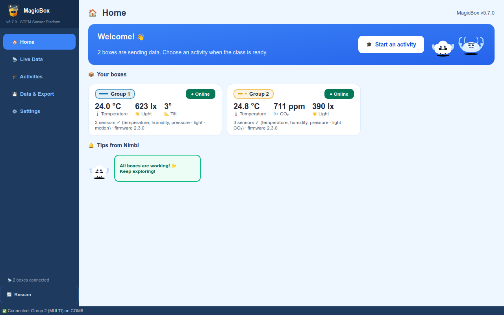
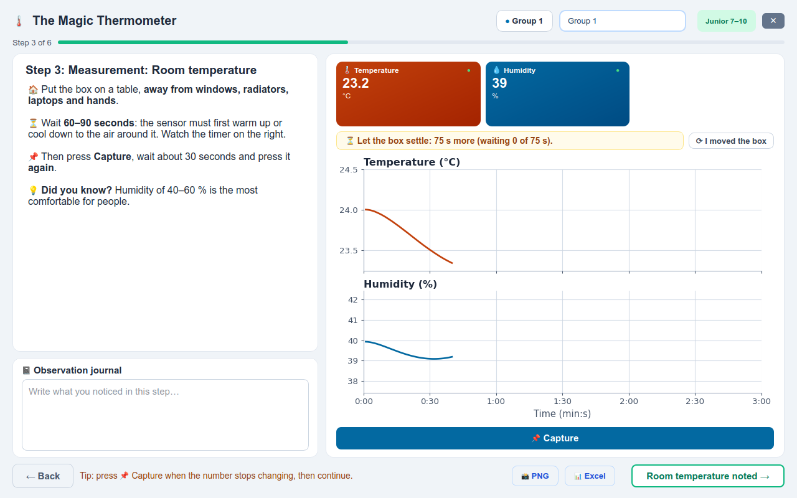

# MagicBox

**English** · [Română](README_RO.md) · [Français](README_FR.md) · [Deutsch](README_DE.md)

**Version 5.7.0** · Windows 10 / 11 · the app and the documents in English, Romanian, French and German

## For teachers

MagicBox is a sensor box for science lessons. Pupils use it to measure
temperature, humidity, air pressure, light, carbon dioxide and motion. The
application on the computer charts the measurements live and leads the class
through guided experiments, explore tools and games, for pupils aged 7 to 19.

**Every activity has a teacher guide and a pupil sheet, in English,
Romanian, French and German.** The guide covers preparing the lesson, running it, the questions to
ask and where pupils usually go wrong. In the app, the **Open guide** button
on each activity opens the right one.

*Left: the Home page, with the connected boxes. Right: a guided experiment.
Every screen and every button is explained, with pictures, in the
[User manual](MagicBox/docs/en/user_manual.pdf) [⬇](https://github.com/GeoEduLab/MagicBox/raw/main/MagicBox/docs/en/user_manual.pdf).*

### ⬇️ [Download MagicBox 5.7.0 (a single ZIP file)](https://github.com/GeoEduLab/MagicBox/releases/download/v5.7.0/MagicBox_v5.7.0.zip)

The archive holds everything: the app, the guides, the sheets, the box
firmware and its flashing guide, all from the same version.

The documents alone (guides, sheets, First steps, the technical manual, the
flashing guide, in all four languages, in the same folders as in the app):
**[MagicBox_docs_v5.7.0.zip](https://github.com/GeoEduLab/MagicBox/releases/download/v5.7.0/MagicBox_docs_v5.7.0.zip)**. Every PDF below also opens here
on GitHub; the ⬇ arrow next to it downloads it.

---

## 1. Installing the app

1. Unzip it (right-click → **Extract All…**) into **Documents** or onto a
   USB stick. Not into *Program Files*, and do not run the app from inside the
   ZIP. Keep the whole `MagicBox` folder together.
2. Run **`MagicBox.exe`**. Nothing else needs installing.
3. If *"Windows protected your PC"* appears, click **More info → Run anyway**.
   The app has no commercial signature; that is all the message means.
4. When Windows asks about the network, tick **Private networks** and click
   **Allow access**. Without it the boxes cannot connect over WiFi.

The app starts in English; for Romanian, French or German choose it in
**Settings → Language and display → Language:**, then restart it; **Open
guide** then opens the guides in that language. The steps from the
download to the first box on screen, with a "what you see → what to do" table,
are in [First steps](MagicBox/docs/en/first_steps.pdf) [⬇](https://github.com/GeoEduLab/MagicBox/raw/main/MagicBox/docs/en/first_steps.pdf) (two pages).

**Over USB:** use a USB Type-C *data* cable. If the box does not appear within
10 seconds, install the board driver once:
[CP210x](https://www.silabs.com/developers/usb-to-uart-bridge-vcp-drivers)
or [CH340](https://www.wch-ic.com/downloads/CH341SER_EXE.html).

**Over WiFi:** once per box, from a phone.

1. Switch the box on. The first time, it opens a network called
   **MagicBox-XXXX** (XXXX = the last four characters of the box ID;
   **CutiaMagica-XXXX** on firmware older than 2.2.6). Tap it in the phone's
   WiFi settings.
2. The phone says the network has no internet (on Samsung: *Internet may not
   be available*): choose **Connect only this time**.
3. The phone stays on **MagicBox-XXXX**, "without internet": that is normal.
4. The setup page opens by itself; if it does not, open
   **http://192.168.4.1** in the browser (d). Pick the class network from the
   list (a), type its password (b) and tap **Save and connect** (c). The box
   restarts and joins the network; the app finds it on its own.

The box sees **2.4 GHz networks only**: on a dual-band router keep the 2.4 GHz
band switched on. The computer and the boxes must be on the same network. If
the school network does not work (a sign-in with a user name *and* a password,
or devices that cannot see each other), use a phone hotspot. To change
network: hold the box's BOOT button while switching it on, and it forgets the
saved one.

**Sensors:** the box has three sockets for four sensors, so one is always
left out, and it shows as `FAIL` at power-on: that is normal. With the box
switched off, plug in the sensor the activity needs (the games need the
motion sensor).

## 2. The box firmware

Boxes that work need no reflashing. Load the firmware onto a new box, or when
the app warns that a box runs old firmware. The steps, with pictures, are in
the [flashing guide](MagicBox/firmware/FLASHING_GUIDE.pdf) [⬇](https://github.com/GeoEduLab/MagicBox/raw/main/MagicBox/firmware/FLASHING_GUIDE.pdf): about 30 minutes the
first time, then 2–3 minutes per box. Use the `serial_wifi_…` variant (USB and
WiFi) from the [firmware](MagicBox/firmware) folder.

If a box lying flat shows acceleration Z of about −1 g instead of +1 g, tick
**Motion sensor upside down** for that box in **Settings → Box names**. No
other firmware is needed.

## 3. The documents

All of them in one archive: **[MagicBox_docs_v5.7.0.zip](https://github.com/GeoEduLab/MagicBox/releases/download/v5.7.0/MagicBox_docs_v5.7.0.zip)**. A
single PDF: click its name to read it on GitHub, or ⬇ to download it.

| | English | Română | Français | Deutsch |
|---|---|---|---|---|
| First steps: installing, connecting, common problems | [first_steps.pdf](MagicBox/docs/en/first_steps.pdf) [⬇](https://github.com/GeoEduLab/MagicBox/raw/main/MagicBox/docs/en/first_steps.pdf) | [primii_pasi.pdf](MagicBox/docs/ro/primii_pasi.pdf) [⬇](https://github.com/GeoEduLab/MagicBox/raw/main/MagicBox/docs/ro/primii_pasi.pdf) | [premiers_pas.pdf](MagicBox/docs/fr/premiers_pas.pdf) [⬇](https://github.com/GeoEduLab/MagicBox/raw/main/MagicBox/docs/fr/premiers_pas.pdf) | [erste_schritte.pdf](MagicBox/docs/de/erste_schritte.pdf) [⬇](https://github.com/GeoEduLab/MagicBox/raw/main/MagicBox/docs/de/erste_schritte.pdf) |
| User manual: every screen and every button, with pictures | [user_manual.pdf](MagicBox/docs/en/user_manual.pdf) [⬇](https://github.com/GeoEduLab/MagicBox/raw/main/MagicBox/docs/en/user_manual.pdf) | [manual_de_utilizare.pdf](MagicBox/docs/ro/manual_de_utilizare.pdf) [⬇](https://github.com/GeoEduLab/MagicBox/raw/main/MagicBox/docs/ro/manual_de_utilizare.pdf) | [manuel_utilisateur.pdf](MagicBox/docs/fr/manuel_utilisateur.pdf) [⬇](https://github.com/GeoEduLab/MagicBox/raw/main/MagicBox/docs/fr/manuel_utilisateur.pdf) | [benutzerhandbuch.pdf](MagicBox/docs/de/benutzerhandbuch.pdf) [⬇](https://github.com/GeoEduLab/MagicBox/raw/main/MagicBox/docs/de/benutzerhandbuch.pdf) |
| Activities by grade and subject (one page) | [activities_by_grade_and_subject.pdf](MagicBox/docs/en/activities_by_grade_and_subject.pdf) [⬇](https://github.com/GeoEduLab/MagicBox/raw/main/MagicBox/docs/en/activities_by_grade_and_subject.pdf) | [activitatile_pe_clase_si_discipline.pdf](MagicBox/docs/ro/activitatile_pe_clase_si_discipline.pdf) [⬇](https://github.com/GeoEduLab/MagicBox/raw/main/MagicBox/docs/ro/activitatile_pe_clase_si_discipline.pdf) | [activites_par_classe_et_matiere.pdf](MagicBox/docs/fr/activites_par_classe_et_matiere.pdf) [⬇](https://github.com/GeoEduLab/MagicBox/raw/main/MagicBox/docs/fr/activites_par_classe_et_matiere.pdf) | [aktivitaeten_nach_klasse_und_fach.pdf](MagicBox/docs/de/aktivitaeten_nach_klasse_und_fach.pdf) [⬇](https://github.com/GeoEduLab/MagicBox/raw/main/MagicBox/docs/de/aktivitaeten_nach_klasse_und_fach.pdf) |
| Curriculum plan (which activity for which grade) | [curriculum_plan.pdf](MagicBox/docs/en/curriculum_plan.pdf) [⬇](https://github.com/GeoEduLab/MagicBox/raw/main/MagicBox/docs/en/curriculum_plan.pdf) | [plan_curricular.pdf](MagicBox/docs/ro/plan_curricular.pdf) [⬇](https://github.com/GeoEduLab/MagicBox/raw/main/MagicBox/docs/ro/plan_curricular.pdf) | [plan_curriculaire.pdf](MagicBox/docs/fr/plan_curriculaire.pdf) [⬇](https://github.com/GeoEduLab/MagicBox/raw/main/MagicBox/docs/fr/plan_curriculaire.pdf) | [lehrplan.pdf](MagicBox/docs/de/lehrplan.pdf) [⬇](https://github.com/GeoEduLab/MagicBox/raw/main/MagicBox/docs/de/lehrplan.pdf) |
| Technical manual and troubleshooting | [technical_manual.pdf](MagicBox/docs/en/technical_manual.pdf) [⬇](https://github.com/GeoEduLab/MagicBox/raw/main/MagicBox/docs/en/technical_manual.pdf) | [manual_tehnic.pdf](MagicBox/docs/ro/manual_tehnic.pdf) [⬇](https://github.com/GeoEduLab/MagicBox/raw/main/MagicBox/docs/ro/manual_tehnic.pdf) | [manuel_technique.pdf](MagicBox/docs/fr/manuel_technique.pdf) [⬇](https://github.com/GeoEduLab/MagicBox/raw/main/MagicBox/docs/fr/manuel_technique.pdf) | [technisches_handbuch.pdf](MagicBox/docs/de/technisches_handbuch.pdf) [⬇](https://github.com/GeoEduLab/MagicBox/raw/main/MagicBox/docs/de/technisches_handbuch.pdf) |
| Flashing the firmware | [FLASHING_GUIDE.pdf](MagicBox/firmware/FLASHING_GUIDE.pdf) [⬇](https://github.com/GeoEduLab/MagicBox/raw/main/MagicBox/firmware/FLASHING_GUIDE.pdf) | [FLASHING_GUIDE_RO.pdf](MagicBox/firmware/FLASHING_GUIDE_RO.pdf) [⬇](https://github.com/GeoEduLab/MagicBox/raw/main/MagicBox/firmware/FLASHING_GUIDE_RO.pdf) | [FLASHING_GUIDE_FR.pdf](MagicBox/firmware/FLASHING_GUIDE_FR.pdf) [⬇](https://github.com/GeoEduLab/MagicBox/raw/main/MagicBox/firmware/FLASHING_GUIDE_FR.pdf) | [FLASHING_GUIDE_DE.pdf](MagicBox/firmware/FLASHING_GUIDE_DE.pdf) [⬇](https://github.com/GeoEduLab/MagicBox/raw/main/MagicBox/firmware/FLASHING_GUIDE_DE.pdf) |

What changed between versions: [CHANGELOG.txt](MagicBox/CHANGELOG.txt) (the app)
and [firmware/CHANGELOG.txt](MagicBox/firmware/CHANGELOG.txt).

---

## The activities

Every PDF opens right here on GitHub; ⬇ next to it downloads the file.
Grades follow the Romanian school system (II = age 8, XII = age 18).

### Guided experiments

| Activity | Grades | Teacher guide | Pupil sheet |
|---|---|---|---|
| 🌞 Light is Everywhere | II–IV | [EN](MagicBox/docs/en/teacher_guides/light_is_everywhere.pdf) [⬇](https://github.com/GeoEduLab/MagicBox/raw/main/MagicBox/docs/en/teacher_guides/light_is_everywhere.pdf) · [RO](MagicBox/docs/ro/ghiduri_profesor/lumina_de_pretutindeni.pdf) [⬇](https://github.com/GeoEduLab/MagicBox/raw/main/MagicBox/docs/ro/ghiduri_profesor/lumina_de_pretutindeni.pdf) · [FR](MagicBox/docs/fr/guides_enseignant/lumiere_est_partout.pdf) [⬇](https://github.com/GeoEduLab/MagicBox/raw/main/MagicBox/docs/fr/guides_enseignant/lumiere_est_partout.pdf) · [DE](MagicBox/docs/de/lehrerhandbuecher/licht_ist_ueberall.pdf) [⬇](https://github.com/GeoEduLab/MagicBox/raw/main/MagicBox/docs/de/lehrerhandbuecher/licht_ist_ueberall.pdf) | [EN](MagicBox/docs/en/student_sheets/light_is_everywhere.pdf) [⬇](https://github.com/GeoEduLab/MagicBox/raw/main/MagicBox/docs/en/student_sheets/light_is_everywhere.pdf) · [RO](MagicBox/docs/ro/fise_elev/lumina_de_pretutindeni.pdf) [⬇](https://github.com/GeoEduLab/MagicBox/raw/main/MagicBox/docs/ro/fise_elev/lumina_de_pretutindeni.pdf) · [FR](MagicBox/docs/fr/fiches_eleve/lumiere_est_partout.pdf) [⬇](https://github.com/GeoEduLab/MagicBox/raw/main/MagicBox/docs/fr/fiches_eleve/lumiere_est_partout.pdf) · [DE](MagicBox/docs/de/arbeitsblaetter/licht_ist_ueberall.pdf) [⬇](https://github.com/GeoEduLab/MagicBox/raw/main/MagicBox/docs/de/arbeitsblaetter/licht_ist_ueberall.pdf) |
| 🌡️ The Magic Thermometer | II–IV | [EN](MagicBox/docs/en/teacher_guides/magic_thermometer.pdf) [⬇](https://github.com/GeoEduLab/MagicBox/raw/main/MagicBox/docs/en/teacher_guides/magic_thermometer.pdf) · [RO](MagicBox/docs/ro/ghiduri_profesor/termometrul_magic.pdf) [⬇](https://github.com/GeoEduLab/MagicBox/raw/main/MagicBox/docs/ro/ghiduri_profesor/termometrul_magic.pdf) · [FR](MagicBox/docs/fr/guides_enseignant/thermometre_magique.pdf) [⬇](https://github.com/GeoEduLab/MagicBox/raw/main/MagicBox/docs/fr/guides_enseignant/thermometre_magique.pdf) · [DE](MagicBox/docs/de/lehrerhandbuecher/magische_thermometer.pdf) [⬇](https://github.com/GeoEduLab/MagicBox/raw/main/MagicBox/docs/de/lehrerhandbuecher/magische_thermometer.pdf) | [EN](MagicBox/docs/en/student_sheets/magic_thermometer.pdf) [⬇](https://github.com/GeoEduLab/MagicBox/raw/main/MagicBox/docs/en/student_sheets/magic_thermometer.pdf) · [RO](MagicBox/docs/ro/fise_elev/termometrul_magic.pdf) [⬇](https://github.com/GeoEduLab/MagicBox/raw/main/MagicBox/docs/ro/fise_elev/termometrul_magic.pdf) · [FR](MagicBox/docs/fr/fiches_eleve/thermometre_magique.pdf) [⬇](https://github.com/GeoEduLab/MagicBox/raw/main/MagicBox/docs/fr/fiches_eleve/thermometre_magique.pdf) · [DE](MagicBox/docs/de/arbeitsblaetter/magische_thermometer.pdf) [⬇](https://github.com/GeoEduLab/MagicBox/raw/main/MagicBox/docs/de/arbeitsblaetter/magische_thermometer.pdf) |
| 🫁 The Air We Breathe | II–IV | [EN](MagicBox/docs/en/teacher_guides/air_we_breathe.pdf) [⬇](https://github.com/GeoEduLab/MagicBox/raw/main/MagicBox/docs/en/teacher_guides/air_we_breathe.pdf) · [RO](MagicBox/docs/ro/ghiduri_profesor/aerul_pe_care_il_respiram.pdf) [⬇](https://github.com/GeoEduLab/MagicBox/raw/main/MagicBox/docs/ro/ghiduri_profesor/aerul_pe_care_il_respiram.pdf) · [FR](MagicBox/docs/fr/guides_enseignant/air_que_nous_respirons.pdf) [⬇](https://github.com/GeoEduLab/MagicBox/raw/main/MagicBox/docs/fr/guides_enseignant/air_que_nous_respirons.pdf) · [DE](MagicBox/docs/de/lehrerhandbuecher/luft_die_wir_atmen.pdf) [⬇](https://github.com/GeoEduLab/MagicBox/raw/main/MagicBox/docs/de/lehrerhandbuecher/luft_die_wir_atmen.pdf) | [EN](MagicBox/docs/en/student_sheets/air_we_breathe.pdf) [⬇](https://github.com/GeoEduLab/MagicBox/raw/main/MagicBox/docs/en/student_sheets/air_we_breathe.pdf) · [RO](MagicBox/docs/ro/fise_elev/aerul_pe_care_il_respiram.pdf) [⬇](https://github.com/GeoEduLab/MagicBox/raw/main/MagicBox/docs/ro/fise_elev/aerul_pe_care_il_respiram.pdf) · [FR](MagicBox/docs/fr/fiches_eleve/air_que_nous_respirons.pdf) [⬇](https://github.com/GeoEduLab/MagicBox/raw/main/MagicBox/docs/fr/fiches_eleve/air_que_nous_respirons.pdf) · [DE](MagicBox/docs/de/arbeitsblaetter/luft_die_wir_atmen.pdf) [⬇](https://github.com/GeoEduLab/MagicBox/raw/main/MagicBox/docs/de/arbeitsblaetter/luft_die_wir_atmen.pdf) |
| 🏠 Indoor Pollution | V–VIII | [EN](MagicBox/docs/en/teacher_guides/indoor_pollution.pdf) [⬇](https://github.com/GeoEduLab/MagicBox/raw/main/MagicBox/docs/en/teacher_guides/indoor_pollution.pdf) · [RO](MagicBox/docs/ro/ghiduri_profesor/poluarea_de_interior.pdf) [⬇](https://github.com/GeoEduLab/MagicBox/raw/main/MagicBox/docs/ro/ghiduri_profesor/poluarea_de_interior.pdf) · [FR](MagicBox/docs/fr/guides_enseignant/pollution_interieure.pdf) [⬇](https://github.com/GeoEduLab/MagicBox/raw/main/MagicBox/docs/fr/guides_enseignant/pollution_interieure.pdf) · [DE](MagicBox/docs/de/lehrerhandbuecher/luftverschmutzung_in_innenraeumen.pdf) [⬇](https://github.com/GeoEduLab/MagicBox/raw/main/MagicBox/docs/de/lehrerhandbuecher/luftverschmutzung_in_innenraeumen.pdf) | [EN](MagicBox/docs/en/student_sheets/indoor_pollution.pdf) [⬇](https://github.com/GeoEduLab/MagicBox/raw/main/MagicBox/docs/en/student_sheets/indoor_pollution.pdf) · [RO](MagicBox/docs/ro/fise_elev/poluarea_de_interior.pdf) [⬇](https://github.com/GeoEduLab/MagicBox/raw/main/MagicBox/docs/ro/fise_elev/poluarea_de_interior.pdf) · [FR](MagicBox/docs/fr/fiches_eleve/pollution_interieure.pdf) [⬇](https://github.com/GeoEduLab/MagicBox/raw/main/MagicBox/docs/fr/fiches_eleve/pollution_interieure.pdf) · [DE](MagicBox/docs/de/arbeitsblaetter/luftverschmutzung_in_innenraeumen.pdf) [⬇](https://github.com/GeoEduLab/MagicBox/raw/main/MagicBox/docs/de/arbeitsblaetter/luftverschmutzung_in_innenraeumen.pdf) |
| 🌿 CO₂ and Photosynthesis | X–XII | [EN](MagicBox/docs/en/teacher_guides/co2_and_photosynthesis.pdf) [⬇](https://github.com/GeoEduLab/MagicBox/raw/main/MagicBox/docs/en/teacher_guides/co2_and_photosynthesis.pdf) · [RO](MagicBox/docs/ro/ghiduri_profesor/co2_si_fotosinteza.pdf) [⬇](https://github.com/GeoEduLab/MagicBox/raw/main/MagicBox/docs/ro/ghiduri_profesor/co2_si_fotosinteza.pdf) · [FR](MagicBox/docs/fr/guides_enseignant/co2_et_photosynthese.pdf) [⬇](https://github.com/GeoEduLab/MagicBox/raw/main/MagicBox/docs/fr/guides_enseignant/co2_et_photosynthese.pdf) · [DE](MagicBox/docs/de/lehrerhandbuecher/co2_und_fotosynthese.pdf) [⬇](https://github.com/GeoEduLab/MagicBox/raw/main/MagicBox/docs/de/lehrerhandbuecher/co2_und_fotosynthese.pdf) | [EN](MagicBox/docs/en/student_sheets/co2_and_photosynthesis.pdf) [⬇](https://github.com/GeoEduLab/MagicBox/raw/main/MagicBox/docs/en/student_sheets/co2_and_photosynthesis.pdf) · [RO](MagicBox/docs/ro/fise_elev/co2_si_fotosinteza.pdf) [⬇](https://github.com/GeoEduLab/MagicBox/raw/main/MagicBox/docs/ro/fise_elev/co2_si_fotosinteza.pdf) · [FR](MagicBox/docs/fr/fiches_eleve/co2_et_photosynthese.pdf) [⬇](https://github.com/GeoEduLab/MagicBox/raw/main/MagicBox/docs/fr/fiches_eleve/co2_et_photosynthese.pdf) · [DE](MagicBox/docs/de/arbeitsblaetter/co2_und_fotosynthese.pdf) [⬇](https://github.com/GeoEduLab/MagicBox/raw/main/MagicBox/docs/de/arbeitsblaetter/co2_und_fotosynthese.pdf) |
| 📊 The Seismometer | V–XII | [EN](MagicBox/docs/en/teacher_guides/seismometer.pdf) [⬇](https://github.com/GeoEduLab/MagicBox/raw/main/MagicBox/docs/en/teacher_guides/seismometer.pdf) · [RO](MagicBox/docs/ro/ghiduri_profesor/seismograful.pdf) [⬇](https://github.com/GeoEduLab/MagicBox/raw/main/MagicBox/docs/ro/ghiduri_profesor/seismograful.pdf) · [FR](MagicBox/docs/fr/guides_enseignant/sismometre.pdf) [⬇](https://github.com/GeoEduLab/MagicBox/raw/main/MagicBox/docs/fr/guides_enseignant/sismometre.pdf) · [DE](MagicBox/docs/de/lehrerhandbuecher/seismometer.pdf) [⬇](https://github.com/GeoEduLab/MagicBox/raw/main/MagicBox/docs/de/lehrerhandbuecher/seismometer.pdf) | [EN](MagicBox/docs/en/student_sheets/seismometer.pdf) [⬇](https://github.com/GeoEduLab/MagicBox/raw/main/MagicBox/docs/en/student_sheets/seismometer.pdf) · [RO](MagicBox/docs/ro/fise_elev/seismograful.pdf) [⬇](https://github.com/GeoEduLab/MagicBox/raw/main/MagicBox/docs/ro/fise_elev/seismograful.pdf) · [FR](MagicBox/docs/fr/fiches_eleve/sismometre.pdf) [⬇](https://github.com/GeoEduLab/MagicBox/raw/main/MagicBox/docs/fr/fiches_eleve/sismometre.pdf) · [DE](MagicBox/docs/de/arbeitsblaetter/seismometer.pdf) [⬇](https://github.com/GeoEduLab/MagicBox/raw/main/MagicBox/docs/de/arbeitsblaetter/seismometer.pdf) |
| ✈️ Flying Straight | II–IV | [EN](MagicBox/docs/en/teacher_guides/flying_straight.pdf) [⬇](https://github.com/GeoEduLab/MagicBox/raw/main/MagicBox/docs/en/teacher_guides/flying_straight.pdf) · [RO](MagicBox/docs/ro/ghiduri_profesor/zbor_drept.pdf) [⬇](https://github.com/GeoEduLab/MagicBox/raw/main/MagicBox/docs/ro/ghiduri_profesor/zbor_drept.pdf) · [FR](MagicBox/docs/fr/guides_enseignant/voler_droit.pdf) [⬇](https://github.com/GeoEduLab/MagicBox/raw/main/MagicBox/docs/fr/guides_enseignant/voler_droit.pdf) · [DE](MagicBox/docs/de/lehrerhandbuecher/geradeaus_fliegen.pdf) [⬇](https://github.com/GeoEduLab/MagicBox/raw/main/MagicBox/docs/de/lehrerhandbuecher/geradeaus_fliegen.pdf) | [EN](MagicBox/docs/en/student_sheets/flying_straight.pdf) [⬇](https://github.com/GeoEduLab/MagicBox/raw/main/MagicBox/docs/en/student_sheets/flying_straight.pdf) · [RO](MagicBox/docs/ro/fise_elev/zbor_drept.pdf) [⬇](https://github.com/GeoEduLab/MagicBox/raw/main/MagicBox/docs/ro/fise_elev/zbor_drept.pdf) · [FR](MagicBox/docs/fr/fiches_eleve/voler_droit.pdf) [⬇](https://github.com/GeoEduLab/MagicBox/raw/main/MagicBox/docs/fr/fiches_eleve/voler_droit.pdf) · [DE](MagicBox/docs/de/arbeitsblaetter/geradeaus_fliegen.pdf) [⬇](https://github.com/GeoEduLab/MagicBox/raw/main/MagicBox/docs/de/arbeitsblaetter/geradeaus_fliegen.pdf) |
| ⚖️ The Box in Balance | II–IV | [EN](MagicBox/docs/en/teacher_guides/box_in_balance.pdf) [⬇](https://github.com/GeoEduLab/MagicBox/raw/main/MagicBox/docs/en/teacher_guides/box_in_balance.pdf) · [RO](MagicBox/docs/ro/ghiduri_profesor/cutia_in_echilibru.pdf) [⬇](https://github.com/GeoEduLab/MagicBox/raw/main/MagicBox/docs/ro/ghiduri_profesor/cutia_in_echilibru.pdf) · [FR](MagicBox/docs/fr/guides_enseignant/boitier_en_equilibre.pdf) [⬇](https://github.com/GeoEduLab/MagicBox/raw/main/MagicBox/docs/fr/guides_enseignant/boitier_en_equilibre.pdf) · [DE](MagicBox/docs/de/lehrerhandbuecher/box_im_gleichgewicht.pdf) [⬇](https://github.com/GeoEduLab/MagicBox/raw/main/MagicBox/docs/de/lehrerhandbuecher/box_im_gleichgewicht.pdf) | [EN](MagicBox/docs/en/student_sheets/box_in_balance.pdf) [⬇](https://github.com/GeoEduLab/MagicBox/raw/main/MagicBox/docs/en/student_sheets/box_in_balance.pdf) · [RO](MagicBox/docs/ro/fise_elev/cutia_in_echilibru.pdf) [⬇](https://github.com/GeoEduLab/MagicBox/raw/main/MagicBox/docs/ro/fise_elev/cutia_in_echilibru.pdf) · [FR](MagicBox/docs/fr/fiches_eleve/boitier_en_equilibre.pdf) [⬇](https://github.com/GeoEduLab/MagicBox/raw/main/MagicBox/docs/fr/fiches_eleve/boitier_en_equilibre.pdf) · [DE](MagicBox/docs/de/arbeitsblaetter/box_im_gleichgewicht.pdf) [⬇](https://github.com/GeoEduLab/MagicBox/raw/main/MagicBox/docs/de/arbeitsblaetter/box_im_gleichgewicht.pdf) |
| ⛰️ Pressure and Altitude | V–VIII | [EN](MagicBox/docs/en/teacher_guides/pressure_and_altitude.pdf) [⬇](https://github.com/GeoEduLab/MagicBox/raw/main/MagicBox/docs/en/teacher_guides/pressure_and_altitude.pdf) · [RO](MagicBox/docs/ro/ghiduri_profesor/presiune_si_altitudine.pdf) [⬇](https://github.com/GeoEduLab/MagicBox/raw/main/MagicBox/docs/ro/ghiduri_profesor/presiune_si_altitudine.pdf) · [FR](MagicBox/docs/fr/guides_enseignant/pression_et_altitude.pdf) [⬇](https://github.com/GeoEduLab/MagicBox/raw/main/MagicBox/docs/fr/guides_enseignant/pression_et_altitude.pdf) · [DE](MagicBox/docs/de/lehrerhandbuecher/luftdruck_und_hoehe.pdf) [⬇](https://github.com/GeoEduLab/MagicBox/raw/main/MagicBox/docs/de/lehrerhandbuecher/luftdruck_und_hoehe.pdf) | [EN](MagicBox/docs/en/student_sheets/pressure_and_altitude.pdf) [⬇](https://github.com/GeoEduLab/MagicBox/raw/main/MagicBox/docs/en/student_sheets/pressure_and_altitude.pdf) · [RO](MagicBox/docs/ro/fise_elev/presiune_si_altitudine.pdf) [⬇](https://github.com/GeoEduLab/MagicBox/raw/main/MagicBox/docs/ro/fise_elev/presiune_si_altitudine.pdf) · [FR](MagicBox/docs/fr/fiches_eleve/pression_et_altitude.pdf) [⬇](https://github.com/GeoEduLab/MagicBox/raw/main/MagicBox/docs/fr/fiches_eleve/pression_et_altitude.pdf) · [DE](MagicBox/docs/de/arbeitsblaetter/luftdruck_und_hoehe.pdf) [⬇](https://github.com/GeoEduLab/MagicBox/raw/main/MagicBox/docs/de/arbeitsblaetter/luftdruck_und_hoehe.pdf) |
| 🌆 Urban Heat Islands | V–VIII | [EN](MagicBox/docs/en/teacher_guides/urban_heat_islands.pdf) [⬇](https://github.com/GeoEduLab/MagicBox/raw/main/MagicBox/docs/en/teacher_guides/urban_heat_islands.pdf) · [RO](MagicBox/docs/ro/ghiduri_profesor/insule_termice.pdf) [⬇](https://github.com/GeoEduLab/MagicBox/raw/main/MagicBox/docs/ro/ghiduri_profesor/insule_termice.pdf) · [FR](MagicBox/docs/fr/guides_enseignant/ilots_de_chaleur_urbains.pdf) [⬇](https://github.com/GeoEduLab/MagicBox/raw/main/MagicBox/docs/fr/guides_enseignant/ilots_de_chaleur_urbains.pdf) · [DE](MagicBox/docs/de/lehrerhandbuecher/staedtische_waermeinseln.pdf) [⬇](https://github.com/GeoEduLab/MagicBox/raw/main/MagicBox/docs/de/lehrerhandbuecher/staedtische_waermeinseln.pdf) | [EN](MagicBox/docs/en/student_sheets/urban_heat_islands.pdf) [⬇](https://github.com/GeoEduLab/MagicBox/raw/main/MagicBox/docs/en/student_sheets/urban_heat_islands.pdf) · [RO](MagicBox/docs/ro/fise_elev/insule_termice.pdf) [⬇](https://github.com/GeoEduLab/MagicBox/raw/main/MagicBox/docs/ro/fise_elev/insule_termice.pdf) · [FR](MagicBox/docs/fr/fiches_eleve/ilots_de_chaleur_urbains.pdf) [⬇](https://github.com/GeoEduLab/MagicBox/raw/main/MagicBox/docs/fr/fiches_eleve/ilots_de_chaleur_urbains.pdf) · [DE](MagicBox/docs/de/arbeitsblaetter/staedtische_waermeinseln.pdf) [⬇](https://github.com/GeoEduLab/MagicBox/raw/main/MagicBox/docs/de/arbeitsblaetter/staedtische_waermeinseln.pdf) |
| ⚡ Solar Panels | IX–XII | [EN](MagicBox/docs/en/teacher_guides/solar_panels.pdf) [⬇](https://github.com/GeoEduLab/MagicBox/raw/main/MagicBox/docs/en/teacher_guides/solar_panels.pdf) · [RO](MagicBox/docs/ro/ghiduri_profesor/panouri_solare.pdf) [⬇](https://github.com/GeoEduLab/MagicBox/raw/main/MagicBox/docs/ro/ghiduri_profesor/panouri_solare.pdf) · [FR](MagicBox/docs/fr/guides_enseignant/panneaux_solaires.pdf) [⬇](https://github.com/GeoEduLab/MagicBox/raw/main/MagicBox/docs/fr/guides_enseignant/panneaux_solaires.pdf) · [DE](MagicBox/docs/de/lehrerhandbuecher/solarmodule.pdf) [⬇](https://github.com/GeoEduLab/MagicBox/raw/main/MagicBox/docs/de/lehrerhandbuecher/solarmodule.pdf) | [EN](MagicBox/docs/en/student_sheets/solar_panels.pdf) [⬇](https://github.com/GeoEduLab/MagicBox/raw/main/MagicBox/docs/en/student_sheets/solar_panels.pdf) · [RO](MagicBox/docs/ro/fise_elev/panouri_solare.pdf) [⬇](https://github.com/GeoEduLab/MagicBox/raw/main/MagicBox/docs/ro/fise_elev/panouri_solare.pdf) · [FR](MagicBox/docs/fr/fiches_eleve/panneaux_solaires.pdf) [⬇](https://github.com/GeoEduLab/MagicBox/raw/main/MagicBox/docs/fr/fiches_eleve/panneaux_solaires.pdf) · [DE](MagicBox/docs/de/arbeitsblaetter/solarmodule.pdf) [⬇](https://github.com/GeoEduLab/MagicBox/raw/main/MagicBox/docs/de/arbeitsblaetter/solarmodule.pdf) |
| 🔥 Air Convection | V–VIII | [EN](MagicBox/docs/en/teacher_guides/air_convection.pdf) [⬇](https://github.com/GeoEduLab/MagicBox/raw/main/MagicBox/docs/en/teacher_guides/air_convection.pdf) · [RO](MagicBox/docs/ro/ghiduri_profesor/convectia_aerului.pdf) [⬇](https://github.com/GeoEduLab/MagicBox/raw/main/MagicBox/docs/ro/ghiduri_profesor/convectia_aerului.pdf) · [FR](MagicBox/docs/fr/guides_enseignant/convection_de_l_air.pdf) [⬇](https://github.com/GeoEduLab/MagicBox/raw/main/MagicBox/docs/fr/guides_enseignant/convection_de_l_air.pdf) · [DE](MagicBox/docs/de/lehrerhandbuecher/konvektion_der_luft.pdf) [⬇](https://github.com/GeoEduLab/MagicBox/raw/main/MagicBox/docs/de/lehrerhandbuecher/konvektion_der_luft.pdf) | [EN](MagicBox/docs/en/student_sheets/air_convection.pdf) [⬇](https://github.com/GeoEduLab/MagicBox/raw/main/MagicBox/docs/en/student_sheets/air_convection.pdf) · [RO](MagicBox/docs/ro/fise_elev/convectia_aerului.pdf) [⬇](https://github.com/GeoEduLab/MagicBox/raw/main/MagicBox/docs/ro/fise_elev/convectia_aerului.pdf) · [FR](MagicBox/docs/fr/fiches_eleve/convection_de_l_air.pdf) [⬇](https://github.com/GeoEduLab/MagicBox/raw/main/MagicBox/docs/fr/fiches_eleve/convection_de_l_air.pdf) · [DE](MagicBox/docs/de/arbeitsblaetter/konvektion_der_luft.pdf) [⬇](https://github.com/GeoEduLab/MagicBox/raw/main/MagicBox/docs/de/arbeitsblaetter/konvektion_der_luft.pdf) |
| 💧 The Water Cycle | V–VIII | [EN](MagicBox/docs/en/teacher_guides/water_cycle.pdf) [⬇](https://github.com/GeoEduLab/MagicBox/raw/main/MagicBox/docs/en/teacher_guides/water_cycle.pdf) · [RO](MagicBox/docs/ro/ghiduri_profesor/ciclul_apei.pdf) [⬇](https://github.com/GeoEduLab/MagicBox/raw/main/MagicBox/docs/ro/ghiduri_profesor/ciclul_apei.pdf) · [FR](MagicBox/docs/fr/guides_enseignant/cycle_de_l_eau.pdf) [⬇](https://github.com/GeoEduLab/MagicBox/raw/main/MagicBox/docs/fr/guides_enseignant/cycle_de_l_eau.pdf) · [DE](MagicBox/docs/de/lehrerhandbuecher/wasserkreislauf.pdf) [⬇](https://github.com/GeoEduLab/MagicBox/raw/main/MagicBox/docs/de/lehrerhandbuecher/wasserkreislauf.pdf) | [EN](MagicBox/docs/en/student_sheets/water_cycle.pdf) [⬇](https://github.com/GeoEduLab/MagicBox/raw/main/MagicBox/docs/en/student_sheets/water_cycle.pdf) · [RO](MagicBox/docs/ro/fise_elev/ciclul_apei.pdf) [⬇](https://github.com/GeoEduLab/MagicBox/raw/main/MagicBox/docs/ro/fise_elev/ciclul_apei.pdf) · [FR](MagicBox/docs/fr/fiches_eleve/cycle_de_l_eau.pdf) [⬇](https://github.com/GeoEduLab/MagicBox/raw/main/MagicBox/docs/fr/fiches_eleve/cycle_de_l_eau.pdf) · [DE](MagicBox/docs/de/arbeitsblaetter/wasserkreislauf.pdf) [⬇](https://github.com/GeoEduLab/MagicBox/raw/main/MagicBox/docs/de/arbeitsblaetter/wasserkreislauf.pdf) |
| 🌐 Physics of the Atmosphere | IX–XII | [EN](MagicBox/docs/en/teacher_guides/physics_of_the_atmosphere.pdf) [⬇](https://github.com/GeoEduLab/MagicBox/raw/main/MagicBox/docs/en/teacher_guides/physics_of_the_atmosphere.pdf) · [RO](MagicBox/docs/ro/ghiduri_profesor/fizica_atmosferei.pdf) [⬇](https://github.com/GeoEduLab/MagicBox/raw/main/MagicBox/docs/ro/ghiduri_profesor/fizica_atmosferei.pdf) · [FR](MagicBox/docs/fr/guides_enseignant/physique_de_l_atmosphere.pdf) [⬇](https://github.com/GeoEduLab/MagicBox/raw/main/MagicBox/docs/fr/guides_enseignant/physique_de_l_atmosphere.pdf) · [DE](MagicBox/docs/de/lehrerhandbuecher/physik_der_atmosphaere.pdf) [⬇](https://github.com/GeoEduLab/MagicBox/raw/main/MagicBox/docs/de/lehrerhandbuecher/physik_der_atmosphaere.pdf) | [EN](MagicBox/docs/en/student_sheets/physics_of_the_atmosphere.pdf) [⬇](https://github.com/GeoEduLab/MagicBox/raw/main/MagicBox/docs/en/student_sheets/physics_of_the_atmosphere.pdf) · [RO](MagicBox/docs/ro/fise_elev/fizica_atmosferei.pdf) [⬇](https://github.com/GeoEduLab/MagicBox/raw/main/MagicBox/docs/ro/fise_elev/fizica_atmosferei.pdf) · [FR](MagicBox/docs/fr/fiches_eleve/physique_de_l_atmosphere.pdf) [⬇](https://github.com/GeoEduLab/MagicBox/raw/main/MagicBox/docs/fr/fiches_eleve/physique_de_l_atmosphere.pdf) · [DE](MagicBox/docs/de/arbeitsblaetter/physik_der_atmosphaere.pdf) [⬇](https://github.com/GeoEduLab/MagicBox/raw/main/MagicBox/docs/de/arbeitsblaetter/physik_der_atmosphaere.pdf) |
| ⚗️ The Beer–Lambert Law | X–XII | [EN](MagicBox/docs/en/teacher_guides/beer_lambert_law.pdf) [⬇](https://github.com/GeoEduLab/MagicBox/raw/main/MagicBox/docs/en/teacher_guides/beer_lambert_law.pdf) · [RO](MagicBox/docs/ro/ghiduri_profesor/legea_beer_lambert.pdf) [⬇](https://github.com/GeoEduLab/MagicBox/raw/main/MagicBox/docs/ro/ghiduri_profesor/legea_beer_lambert.pdf) · [FR](MagicBox/docs/fr/guides_enseignant/loi_de_beer_lambert.pdf) [⬇](https://github.com/GeoEduLab/MagicBox/raw/main/MagicBox/docs/fr/guides_enseignant/loi_de_beer_lambert.pdf) · [DE](MagicBox/docs/de/lehrerhandbuecher/lambert_beer_gesetz.pdf) [⬇](https://github.com/GeoEduLab/MagicBox/raw/main/MagicBox/docs/de/lehrerhandbuecher/lambert_beer_gesetz.pdf) | [EN](MagicBox/docs/en/student_sheets/beer_lambert_law.pdf) [⬇](https://github.com/GeoEduLab/MagicBox/raw/main/MagicBox/docs/en/student_sheets/beer_lambert_law.pdf) · [RO](MagicBox/docs/ro/fise_elev/legea_beer_lambert.pdf) [⬇](https://github.com/GeoEduLab/MagicBox/raw/main/MagicBox/docs/ro/fise_elev/legea_beer_lambert.pdf) · [FR](MagicBox/docs/fr/fiches_eleve/loi_de_beer_lambert.pdf) [⬇](https://github.com/GeoEduLab/MagicBox/raw/main/MagicBox/docs/fr/fiches_eleve/loi_de_beer_lambert.pdf) · [DE](MagicBox/docs/de/arbeitsblaetter/lambert_beer_gesetz.pdf) [⬇](https://github.com/GeoEduLab/MagicBox/raw/main/MagicBox/docs/de/arbeitsblaetter/lambert_beer_gesetz.pdf) |

### Explore tools

| Activity | Grades | Teacher guide | Pupil sheet |
|---|---|---|---|
| 📌 Measurement Notebook | IV–XII | [EN](MagicBox/docs/en/teacher_guides/measurement_notebook.pdf) [⬇](https://github.com/GeoEduLab/MagicBox/raw/main/MagicBox/docs/en/teacher_guides/measurement_notebook.pdf) · [RO](MagicBox/docs/ro/ghiduri_profesor/carnetul_de_masuratori.pdf) [⬇](https://github.com/GeoEduLab/MagicBox/raw/main/MagicBox/docs/ro/ghiduri_profesor/carnetul_de_masuratori.pdf) · [FR](MagicBox/docs/fr/guides_enseignant/carnet_de_mesures.pdf) [⬇](https://github.com/GeoEduLab/MagicBox/raw/main/MagicBox/docs/fr/guides_enseignant/carnet_de_mesures.pdf) · [DE](MagicBox/docs/de/lehrerhandbuecher/messheft.pdf) [⬇](https://github.com/GeoEduLab/MagicBox/raw/main/MagicBox/docs/de/lehrerhandbuecher/messheft.pdf) | [EN](MagicBox/docs/en/student_sheets/measurement_notebook.pdf) [⬇](https://github.com/GeoEduLab/MagicBox/raw/main/MagicBox/docs/en/student_sheets/measurement_notebook.pdf) · [RO](MagicBox/docs/ro/fise_elev/carnetul_de_masuratori.pdf) [⬇](https://github.com/GeoEduLab/MagicBox/raw/main/MagicBox/docs/ro/fise_elev/carnetul_de_masuratori.pdf) · [FR](MagicBox/docs/fr/fiches_eleve/carnet_de_mesures.pdf) [⬇](https://github.com/GeoEduLab/MagicBox/raw/main/MagicBox/docs/fr/fiches_eleve/carnet_de_mesures.pdf) · [DE](MagicBox/docs/de/arbeitsblaetter/messheft.pdf) [⬇](https://github.com/GeoEduLab/MagicBox/raw/main/MagicBox/docs/de/arbeitsblaetter/messheft.pdf) |
| 🌦️ Weather Station | V–XII | [EN](MagicBox/docs/en/teacher_guides/weather_station.pdf) [⬇](https://github.com/GeoEduLab/MagicBox/raw/main/MagicBox/docs/en/teacher_guides/weather_station.pdf) · [RO](MagicBox/docs/ro/ghiduri_profesor/statia_meteo.pdf) [⬇](https://github.com/GeoEduLab/MagicBox/raw/main/MagicBox/docs/ro/ghiduri_profesor/statia_meteo.pdf) · [FR](MagicBox/docs/fr/guides_enseignant/station_meteo.pdf) [⬇](https://github.com/GeoEduLab/MagicBox/raw/main/MagicBox/docs/fr/guides_enseignant/station_meteo.pdf) · [DE](MagicBox/docs/de/lehrerhandbuecher/wetterstation.pdf) [⬇](https://github.com/GeoEduLab/MagicBox/raw/main/MagicBox/docs/de/lehrerhandbuecher/wetterstation.pdf) | [EN](MagicBox/docs/en/student_sheets/weather_station.pdf) [⬇](https://github.com/GeoEduLab/MagicBox/raw/main/MagicBox/docs/en/student_sheets/weather_station.pdf) · [RO](MagicBox/docs/ro/fise_elev/statia_meteo.pdf) [⬇](https://github.com/GeoEduLab/MagicBox/raw/main/MagicBox/docs/ro/fise_elev/statia_meteo.pdf) · [FR](MagicBox/docs/fr/fiches_eleve/station_meteo.pdf) [⬇](https://github.com/GeoEduLab/MagicBox/raw/main/MagicBox/docs/fr/fiches_eleve/station_meteo.pdf) · [DE](MagicBox/docs/de/arbeitsblaetter/wetterstation.pdf) [⬇](https://github.com/GeoEduLab/MagicBox/raw/main/MagicBox/docs/de/arbeitsblaetter/wetterstation.pdf) |
| 🌬️ Air Quality | V–XII | [EN](MagicBox/docs/en/teacher_guides/air_quality.pdf) [⬇](https://github.com/GeoEduLab/MagicBox/raw/main/MagicBox/docs/en/teacher_guides/air_quality.pdf) · [RO](MagicBox/docs/ro/ghiduri_profesor/calitatea_aerului.pdf) [⬇](https://github.com/GeoEduLab/MagicBox/raw/main/MagicBox/docs/ro/ghiduri_profesor/calitatea_aerului.pdf) · [FR](MagicBox/docs/fr/guides_enseignant/qualite_de_l_air.pdf) [⬇](https://github.com/GeoEduLab/MagicBox/raw/main/MagicBox/docs/fr/guides_enseignant/qualite_de_l_air.pdf) · [DE](MagicBox/docs/de/lehrerhandbuecher/luftqualitaet.pdf) [⬇](https://github.com/GeoEduLab/MagicBox/raw/main/MagicBox/docs/de/lehrerhandbuecher/luftqualitaet.pdf) | [EN](MagicBox/docs/en/student_sheets/air_quality.pdf) [⬇](https://github.com/GeoEduLab/MagicBox/raw/main/MagicBox/docs/en/student_sheets/air_quality.pdf) · [RO](MagicBox/docs/ro/fise_elev/calitatea_aerului.pdf) [⬇](https://github.com/GeoEduLab/MagicBox/raw/main/MagicBox/docs/ro/fise_elev/calitatea_aerului.pdf) · [FR](MagicBox/docs/fr/fiches_eleve/qualite_de_l_air.pdf) [⬇](https://github.com/GeoEduLab/MagicBox/raw/main/MagicBox/docs/fr/fiches_eleve/qualite_de_l_air.pdf) · [DE](MagicBox/docs/de/arbeitsblaetter/luftqualitaet.pdf) [⬇](https://github.com/GeoEduLab/MagicBox/raw/main/MagicBox/docs/de/arbeitsblaetter/luftqualitaet.pdf) |
| ☀️ Solar Energy | VI–XII | [EN](MagicBox/docs/en/teacher_guides/solar_energy.pdf) [⬇](https://github.com/GeoEduLab/MagicBox/raw/main/MagicBox/docs/en/teacher_guides/solar_energy.pdf) · [RO](MagicBox/docs/ro/ghiduri_profesor/energia_solara.pdf) [⬇](https://github.com/GeoEduLab/MagicBox/raw/main/MagicBox/docs/ro/ghiduri_profesor/energia_solara.pdf) · [FR](MagicBox/docs/fr/guides_enseignant/energie_solaire.pdf) [⬇](https://github.com/GeoEduLab/MagicBox/raw/main/MagicBox/docs/fr/guides_enseignant/energie_solaire.pdf) · [DE](MagicBox/docs/de/lehrerhandbuecher/sonnenenergie.pdf) [⬇](https://github.com/GeoEduLab/MagicBox/raw/main/MagicBox/docs/de/lehrerhandbuecher/sonnenenergie.pdf) | [EN](MagicBox/docs/en/student_sheets/solar_energy.pdf) [⬇](https://github.com/GeoEduLab/MagicBox/raw/main/MagicBox/docs/en/student_sheets/solar_energy.pdf) · [RO](MagicBox/docs/ro/fise_elev/energia_solara.pdf) [⬇](https://github.com/GeoEduLab/MagicBox/raw/main/MagicBox/docs/ro/fise_elev/energia_solara.pdf) · [FR](MagicBox/docs/fr/fiches_eleve/energie_solaire.pdf) [⬇](https://github.com/GeoEduLab/MagicBox/raw/main/MagicBox/docs/fr/fiches_eleve/energie_solaire.pdf) · [DE](MagicBox/docs/de/arbeitsblaetter/sonnenenergie.pdf) [⬇](https://github.com/GeoEduLab/MagicBox/raw/main/MagicBox/docs/de/arbeitsblaetter/sonnenenergie.pdf) |
| 📐 Seismology | V–XII | [EN](MagicBox/docs/en/teacher_guides/seismology.pdf) [⬇](https://github.com/GeoEduLab/MagicBox/raw/main/MagicBox/docs/en/teacher_guides/seismology.pdf) · [RO](MagicBox/docs/ro/ghiduri_profesor/seismologie.pdf) [⬇](https://github.com/GeoEduLab/MagicBox/raw/main/MagicBox/docs/ro/ghiduri_profesor/seismologie.pdf) · [FR](MagicBox/docs/fr/guides_enseignant/sismologie.pdf) [⬇](https://github.com/GeoEduLab/MagicBox/raw/main/MagicBox/docs/fr/guides_enseignant/sismologie.pdf) · [DE](MagicBox/docs/de/lehrerhandbuecher/seismologie.pdf) [⬇](https://github.com/GeoEduLab/MagicBox/raw/main/MagicBox/docs/de/lehrerhandbuecher/seismologie.pdf) | [EN](MagicBox/docs/en/student_sheets/seismology.pdf) [⬇](https://github.com/GeoEduLab/MagicBox/raw/main/MagicBox/docs/en/student_sheets/seismology.pdf) · [RO](MagicBox/docs/ro/fise_elev/seismologie.pdf) [⬇](https://github.com/GeoEduLab/MagicBox/raw/main/MagicBox/docs/ro/fise_elev/seismologie.pdf) · [FR](MagicBox/docs/fr/fiches_eleve/sismologie.pdf) [⬇](https://github.com/GeoEduLab/MagicBox/raw/main/MagicBox/docs/fr/fiches_eleve/sismologie.pdf) · [DE](MagicBox/docs/de/arbeitsblaetter/seismologie.pdf) [⬇](https://github.com/GeoEduLab/MagicBox/raw/main/MagicBox/docs/de/arbeitsblaetter/seismologie.pdf) |
| 🌆 Heat Islands with Several Boxes | V–XII | [EN](MagicBox/docs/en/teacher_guides/heat_islands_with_several_boxes.pdf) [⬇](https://github.com/GeoEduLab/MagicBox/raw/main/MagicBox/docs/en/teacher_guides/heat_islands_with_several_boxes.pdf) · [RO](MagicBox/docs/ro/ghiduri_profesor/insule_termice_cu_mai_multe_cutii.pdf) [⬇](https://github.com/GeoEduLab/MagicBox/raw/main/MagicBox/docs/ro/ghiduri_profesor/insule_termice_cu_mai_multe_cutii.pdf) · [FR](MagicBox/docs/fr/guides_enseignant/ilots_de_chaleur_avec_plusieurs_boitiers.pdf) [⬇](https://github.com/GeoEduLab/MagicBox/raw/main/MagicBox/docs/fr/guides_enseignant/ilots_de_chaleur_avec_plusieurs_boitiers.pdf) · [DE](MagicBox/docs/de/lehrerhandbuecher/waermeinseln_mit_mehreren_boxen.pdf) [⬇](https://github.com/GeoEduLab/MagicBox/raw/main/MagicBox/docs/de/lehrerhandbuecher/waermeinseln_mit_mehreren_boxen.pdf) | [EN](MagicBox/docs/en/student_sheets/heat_islands_with_several_boxes.pdf) [⬇](https://github.com/GeoEduLab/MagicBox/raw/main/MagicBox/docs/en/student_sheets/heat_islands_with_several_boxes.pdf) · [RO](MagicBox/docs/ro/fise_elev/insule_termice_cu_mai_multe_cutii.pdf) [⬇](https://github.com/GeoEduLab/MagicBox/raw/main/MagicBox/docs/ro/fise_elev/insule_termice_cu_mai_multe_cutii.pdf) · [FR](MagicBox/docs/fr/fiches_eleve/ilots_de_chaleur_avec_plusieurs_boitiers.pdf) [⬇](https://github.com/GeoEduLab/MagicBox/raw/main/MagicBox/docs/fr/fiches_eleve/ilots_de_chaleur_avec_plusieurs_boitiers.pdf) · [DE](MagicBox/docs/de/arbeitsblaetter/waermeinseln_mit_mehreren_boxen.pdf) [⬇](https://github.com/GeoEduLab/MagicBox/raw/main/MagicBox/docs/de/arbeitsblaetter/waermeinseln_mit_mehreren_boxen.pdf) |
| 🌿 The Greenhouse Effect | V–XII | [EN](MagicBox/docs/en/teacher_guides/greenhouse_effect.pdf) [⬇](https://github.com/GeoEduLab/MagicBox/raw/main/MagicBox/docs/en/teacher_guides/greenhouse_effect.pdf) · [RO](MagicBox/docs/ro/ghiduri_profesor/efectul_de_sera.pdf) [⬇](https://github.com/GeoEduLab/MagicBox/raw/main/MagicBox/docs/ro/ghiduri_profesor/efectul_de_sera.pdf) · [FR](MagicBox/docs/fr/guides_enseignant/effet_de_serre.pdf) [⬇](https://github.com/GeoEduLab/MagicBox/raw/main/MagicBox/docs/fr/guides_enseignant/effet_de_serre.pdf) · [DE](MagicBox/docs/de/lehrerhandbuecher/treibhauseffekt.pdf) [⬇](https://github.com/GeoEduLab/MagicBox/raw/main/MagicBox/docs/de/lehrerhandbuecher/treibhauseffekt.pdf) | [EN](MagicBox/docs/en/student_sheets/greenhouse_effect.pdf) [⬇](https://github.com/GeoEduLab/MagicBox/raw/main/MagicBox/docs/en/student_sheets/greenhouse_effect.pdf) · [RO](MagicBox/docs/ro/fise_elev/efectul_de_sera.pdf) [⬇](https://github.com/GeoEduLab/MagicBox/raw/main/MagicBox/docs/ro/fise_elev/efectul_de_sera.pdf) · [FR](MagicBox/docs/fr/fiches_eleve/effet_de_serre.pdf) [⬇](https://github.com/GeoEduLab/MagicBox/raw/main/MagicBox/docs/fr/fiches_eleve/effet_de_serre.pdf) · [DE](MagicBox/docs/de/arbeitsblaetter/treibhauseffekt.pdf) [⬇](https://github.com/GeoEduLab/MagicBox/raw/main/MagicBox/docs/de/arbeitsblaetter/treibhauseffekt.pdf) |
| 🔬 Spectroscopy | IX–XII | [EN](MagicBox/docs/en/teacher_guides/spectroscopy.pdf) [⬇](https://github.com/GeoEduLab/MagicBox/raw/main/MagicBox/docs/en/teacher_guides/spectroscopy.pdf) · [RO](MagicBox/docs/ro/ghiduri_profesor/spectroscopie.pdf) [⬇](https://github.com/GeoEduLab/MagicBox/raw/main/MagicBox/docs/ro/ghiduri_profesor/spectroscopie.pdf) · [FR](MagicBox/docs/fr/guides_enseignant/spectroscopie.pdf) [⬇](https://github.com/GeoEduLab/MagicBox/raw/main/MagicBox/docs/fr/guides_enseignant/spectroscopie.pdf) · [DE](MagicBox/docs/de/lehrerhandbuecher/spektroskopie.pdf) [⬇](https://github.com/GeoEduLab/MagicBox/raw/main/MagicBox/docs/de/lehrerhandbuecher/spektroskopie.pdf) | [EN](MagicBox/docs/en/student_sheets/spectroscopy.pdf) [⬇](https://github.com/GeoEduLab/MagicBox/raw/main/MagicBox/docs/en/student_sheets/spectroscopy.pdf) · [RO](MagicBox/docs/ro/fise_elev/spectroscopie.pdf) [⬇](https://github.com/GeoEduLab/MagicBox/raw/main/MagicBox/docs/ro/fise_elev/spectroscopie.pdf) · [FR](MagicBox/docs/fr/fiches_eleve/spectroscopie.pdf) [⬇](https://github.com/GeoEduLab/MagicBox/raw/main/MagicBox/docs/fr/fiches_eleve/spectroscopie.pdf) · [DE](MagicBox/docs/de/arbeitsblaetter/spektroskopie.pdf) [⬇](https://github.com/GeoEduLab/MagicBox/raw/main/MagicBox/docs/de/arbeitsblaetter/spektroskopie.pdf) |

### Games

| Activity | Grades | Teacher guide | Pupil sheet |
|---|---|---|---|
| 🎮 Among the Clouds | II–VIII | [EN](MagicBox/docs/en/teacher_guides/among_the_clouds.pdf) [⬇](https://github.com/GeoEduLab/MagicBox/raw/main/MagicBox/docs/en/teacher_guides/among_the_clouds.pdf) · [RO](MagicBox/docs/ro/ghiduri_profesor/printre_nori.pdf) [⬇](https://github.com/GeoEduLab/MagicBox/raw/main/MagicBox/docs/ro/ghiduri_profesor/printre_nori.pdf) · [FR](MagicBox/docs/fr/guides_enseignant/parmi_les_nuages.pdf) [⬇](https://github.com/GeoEduLab/MagicBox/raw/main/MagicBox/docs/fr/guides_enseignant/parmi_les_nuages.pdf) · [DE](MagicBox/docs/de/lehrerhandbuecher/zwischen_den_wolken.pdf) [⬇](https://github.com/GeoEduLab/MagicBox/raw/main/MagicBox/docs/de/lehrerhandbuecher/zwischen_den_wolken.pdf) | [EN](MagicBox/docs/en/student_sheets/among_the_clouds.pdf) [⬇](https://github.com/GeoEduLab/MagicBox/raw/main/MagicBox/docs/en/student_sheets/among_the_clouds.pdf) · [RO](MagicBox/docs/ro/fise_elev/printre_nori.pdf) [⬇](https://github.com/GeoEduLab/MagicBox/raw/main/MagicBox/docs/ro/fise_elev/printre_nori.pdf) · [FR](MagicBox/docs/fr/fiches_eleve/parmi_les_nuages.pdf) [⬇](https://github.com/GeoEduLab/MagicBox/raw/main/MagicBox/docs/fr/fiches_eleve/parmi_les_nuages.pdf) · [DE](MagicBox/docs/de/arbeitsblaetter/zwischen_den_wolken.pdf) [⬇](https://github.com/GeoEduLab/MagicBox/raw/main/MagicBox/docs/de/arbeitsblaetter/zwischen_den_wolken.pdf) |
| 🎮 Earthquake! | IV–XII | [EN](MagicBox/docs/en/teacher_guides/earthquake.pdf) [⬇](https://github.com/GeoEduLab/MagicBox/raw/main/MagicBox/docs/en/teacher_guides/earthquake.pdf) · [RO](MagicBox/docs/ro/ghiduri_profesor/cutremur.pdf) [⬇](https://github.com/GeoEduLab/MagicBox/raw/main/MagicBox/docs/ro/ghiduri_profesor/cutremur.pdf) · [FR](MagicBox/docs/fr/guides_enseignant/seisme.pdf) [⬇](https://github.com/GeoEduLab/MagicBox/raw/main/MagicBox/docs/fr/guides_enseignant/seisme.pdf) · [DE](MagicBox/docs/de/lehrerhandbuecher/erdbeben.pdf) [⬇](https://github.com/GeoEduLab/MagicBox/raw/main/MagicBox/docs/de/lehrerhandbuecher/erdbeben.pdf) | [EN](MagicBox/docs/en/student_sheets/earthquake.pdf) [⬇](https://github.com/GeoEduLab/MagicBox/raw/main/MagicBox/docs/en/student_sheets/earthquake.pdf) · [RO](MagicBox/docs/ro/fise_elev/cutremur.pdf) [⬇](https://github.com/GeoEduLab/MagicBox/raw/main/MagicBox/docs/ro/fise_elev/cutremur.pdf) · [FR](MagicBox/docs/fr/fiches_eleve/seisme.pdf) [⬇](https://github.com/GeoEduLab/MagicBox/raw/main/MagicBox/docs/fr/fiches_eleve/seisme.pdf) · [DE](MagicBox/docs/de/arbeitsblaetter/erdbeben.pdf) [⬇](https://github.com/GeoEduLab/MagicBox/raw/main/MagicBox/docs/de/arbeitsblaetter/erdbeben.pdf) |
| 🎮 Resonance | XI | [EN](MagicBox/docs/en/teacher_guides/resonance.pdf) [⬇](https://github.com/GeoEduLab/MagicBox/raw/main/MagicBox/docs/en/teacher_guides/resonance.pdf) · [RO](MagicBox/docs/ro/ghiduri_profesor/rezonanta.pdf) [⬇](https://github.com/GeoEduLab/MagicBox/raw/main/MagicBox/docs/ro/ghiduri_profesor/rezonanta.pdf) · [FR](MagicBox/docs/fr/guides_enseignant/resonance.pdf) [⬇](https://github.com/GeoEduLab/MagicBox/raw/main/MagicBox/docs/fr/guides_enseignant/resonance.pdf) · [DE](MagicBox/docs/de/lehrerhandbuecher/resonanz.pdf) [⬇](https://github.com/GeoEduLab/MagicBox/raw/main/MagicBox/docs/de/lehrerhandbuecher/resonanz.pdf) | [EN](MagicBox/docs/en/student_sheets/resonance.pdf) [⬇](https://github.com/GeoEduLab/MagicBox/raw/main/MagicBox/docs/en/student_sheets/resonance.pdf) · [RO](MagicBox/docs/ro/fise_elev/rezonanta.pdf) [⬇](https://github.com/GeoEduLab/MagicBox/raw/main/MagicBox/docs/ro/fise_elev/rezonanta.pdf) · [FR](MagicBox/docs/fr/fiches_eleve/resonance.pdf) [⬇](https://github.com/GeoEduLab/MagicBox/raw/main/MagicBox/docs/fr/fiches_eleve/resonance.pdf) · [DE](MagicBox/docs/de/arbeitsblaetter/resonanz.pdf) [⬇](https://github.com/GeoEduLab/MagicBox/raw/main/MagicBox/docs/de/arbeitsblaetter/resonanz.pdf) |
| 🎯 Gyro Target | V–XII | [EN](MagicBox/docs/en/teacher_guides/gyro_target.pdf) [⬇](https://github.com/GeoEduLab/MagicBox/raw/main/MagicBox/docs/en/teacher_guides/gyro_target.pdf) · [RO](MagicBox/docs/ro/ghiduri_profesor/tinta_giroscopica.pdf) [⬇](https://github.com/GeoEduLab/MagicBox/raw/main/MagicBox/docs/ro/ghiduri_profesor/tinta_giroscopica.pdf) · [FR](MagicBox/docs/fr/guides_enseignant/cible_gyroscopique.pdf) [⬇](https://github.com/GeoEduLab/MagicBox/raw/main/MagicBox/docs/fr/guides_enseignant/cible_gyroscopique.pdf) · [DE](MagicBox/docs/de/lehrerhandbuecher/gyro_zielscheibe.pdf) [⬇](https://github.com/GeoEduLab/MagicBox/raw/main/MagicBox/docs/de/lehrerhandbuecher/gyro_zielscheibe.pdf) | [EN](MagicBox/docs/en/student_sheets/gyro_target.pdf) [⬇](https://github.com/GeoEduLab/MagicBox/raw/main/MagicBox/docs/en/student_sheets/gyro_target.pdf) · [RO](MagicBox/docs/ro/fise_elev/tinta_giroscopica.pdf) [⬇](https://github.com/GeoEduLab/MagicBox/raw/main/MagicBox/docs/ro/fise_elev/tinta_giroscopica.pdf) · [FR](MagicBox/docs/fr/fiches_eleve/cible_gyroscopique.pdf) [⬇](https://github.com/GeoEduLab/MagicBox/raw/main/MagicBox/docs/fr/fiches_eleve/cible_gyroscopique.pdf) · [DE](MagicBox/docs/de/arbeitsblaetter/gyro_zielscheibe.pdf) [⬇](https://github.com/GeoEduLab/MagicBox/raw/main/MagicBox/docs/de/arbeitsblaetter/gyro_zielscheibe.pdf) |
