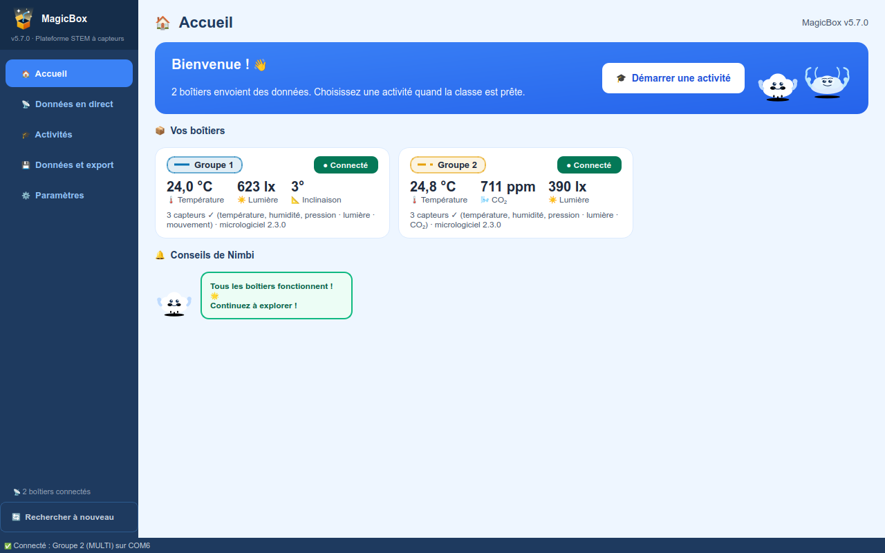
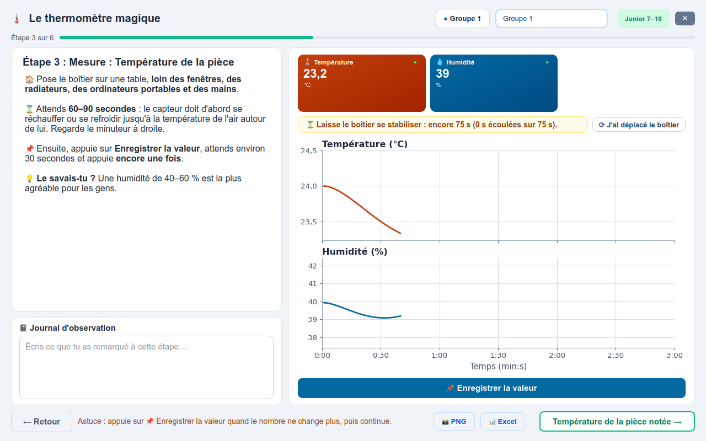

# MagicBox

[English](README.md) · [Română](README_RO.md) · **Français** · [Deutsch](README_DE.md)

**Version 5.7.0** · Windows 10 / 11 · l'application et les documents en anglais, roumain, français et allemand

## Pour les enseignants

MagicBox est un boîtier à capteurs pour les cours de sciences. Les élèves
mesurent la température, l'humidité, la pression de l'air, la lumière, le
dioxyde de carbone et le mouvement. L'application sur l'ordinateur trace les
mesures en direct et guide la classe à travers des expériences guidées, des
outils d'exploration et des jeux, pour des élèves de 7 à 19 ans.

**Chaque activité a un guide de l'enseignant et une fiche élève, en français,
anglais, roumain et allemand.** Le guide explique comment préparer la séance,
la conduire, quelles questions poser et où les élèves se trompent souvent.
Dans l'application, le bouton **Ouvrir le guide** de chaque activité ouvre le
bon guide.

*À gauche : la page Accueil, avec les boîtiers connectés. À droite : une
expérience guidée. Chaque écran et chaque bouton sont expliqués, en images,
dans le [Manuel d'utilisation](MagicBox/docs/fr/manuel_utilisateur.pdf) [⬇](https://github.com/GeoEduLab/MagicBox/raw/main/MagicBox/docs/fr/manuel_utilisateur.pdf).*

### ⬇️ [Télécharger MagicBox 5.7.0 (un seul fichier ZIP)](https://github.com/GeoEduLab/MagicBox/releases/download/v5.7.0/MagicBox_v5.7.0.zip)

L'archive contient tout : l'application, les guides, les fiches, le firmware
du boîtier et son guide d'installation, tous de la même version.

Les documents seuls (guides, fiches, Premiers pas, manuel technique, guide du
firmware, dans les quatre langues, dans les mêmes dossiers que dans
l'application) : **[MagicBox_docs_v5.7.0.zip](https://github.com/GeoEduLab/MagicBox/releases/download/v5.7.0/MagicBox_docs_v5.7.0.zip)**. Chaque PDF
ci-dessous s'ouvre aussi ici, sur GitHub ; la flèche ⬇ à côté le télécharge.

---

## 1. Installer l'application

1. Décompressez le ZIP (clic droit → **Extraire tout…**) dans **Documents** ou
   sur une clé USB. Pas dans *Program Files*, et ne lancez pas l'application
   depuis l'intérieur du ZIP. Gardez tout le dossier `MagicBox` ensemble.
2. Lancez **`MagicBox.exe`**. Rien d'autre à installer.
3. Si *« Windows a protégé votre ordinateur »* apparaît, cliquez sur
   **Informations complémentaires → Exécuter quand même**. L'application n'a
   pas de signature commerciale ; le message ne veut rien dire de plus.
4. Quand Windows pose la question du réseau, cochez **Réseaux privés** et
   cliquez sur **Autoriser l'accès**. Sinon les boîtiers ne peuvent pas se
   connecter en WiFi.

L'application démarre en anglais. Pour le français : **Settings → Language
and display → Language: Français**, puis redémarrez-la ; **Ouvrir le guide**
ouvre alors les guides en français. Les étapes du téléchargement au premier
boîtier à l'écran, avec un tableau « ce que vous voyez → ce que vous faites »,
sont dans [Premiers pas](MagicBox/docs/fr/premiers_pas.pdf) [⬇](https://github.com/GeoEduLab/MagicBox/raw/main/MagicBox/docs/fr/premiers_pas.pdf) (deux pages).

**Par USB :** utilisez un câble USB Type-C *de données*. Si le boîtier
n'apparaît pas dans les 10 secondes, installez une fois le pilote de la carte :
[CP210x](https://www.silabs.com/developers/usb-to-uart-bridge-vcp-drivers)
ou [CH340](https://www.wch-ic.com/downloads/CH341SER_EXE.html).

**Par WiFi :** une seule fois par boîtier, depuis un téléphone.

1. Allumez le boîtier. La première fois, il ouvre un réseau appelé
   **MagicBox-XXXX** (XXXX = les quatre derniers caractères de l'identifiant du
   boîtier ; **CutiaMagica-XXXX** avec un firmware antérieur à 2.2.6).
   Touchez-le dans les réglages WiFi du téléphone.
2. Le téléphone indique que le réseau n'a pas d'internet (sur Samsung :
   *Internet may not be available*) : choisissez **Connect only this time**
   (Se connecter cette fois seulement).
3. Le téléphone reste sur **MagicBox-XXXX**, « sans internet » : c'est normal.
4. La page de configuration s'ouvre d'elle-même ; sinon, ouvrez
   **http://192.168.4.1** dans le navigateur (d). Choisissez le réseau de la
   classe dans la liste (a), tapez son mot de passe (b) et touchez **Save and
   connect** (c). Le boîtier redémarre et rejoint le réseau ; l'application le
   trouve toute seule.

Le boîtier ne voit que les réseaux **2,4 GHz** : sur un routeur bi-bande,
laissez la bande 2,4 GHz activée. L'ordinateur et les boîtiers doivent être
sur le même réseau. Si le réseau de l'école ne fonctionne pas (connexion avec
un nom d'utilisateur *et* un mot de passe, ou appareils qui ne peuvent pas se
voir), utilisez le partage de connexion d'un téléphone. Pour changer de
réseau : maintenez le bouton BOOT du boîtier pendant que vous l'allumez, et il
oublie le réseau enregistré.

**Capteurs :** le boîtier a trois connecteurs pour quatre capteurs, donc il en
manque toujours un, qui s'affiche `FAIL` au démarrage : c'est normal. Boîtier
éteint, branchez le capteur dont l'activité a besoin (les jeux demandent le
capteur de mouvement).

## 2. Le firmware du boîtier

Les boîtiers qui fonctionnent n'ont pas besoin d'être reprogrammés. Chargez le
firmware sur un boîtier neuf, ou quand l'application signale qu'un boîtier a un
firmware ancien. Les étapes, en images, sont dans le
[guide d'installation du firmware](MagicBox/firmware/FLASHING_GUIDE_FR.pdf) [⬇](https://github.com/GeoEduLab/MagicBox/raw/main/MagicBox/firmware/FLASHING_GUIDE_FR.pdf) :
environ 30 minutes la première fois, puis 2 à 3 minutes par boîtier. Utilisez
la variante `serial_wifi_…` (USB et WiFi) du dossier [firmware](MagicBox/firmware).

Si un boîtier posé à plat indique une accélération Z d'environ −1 g au lieu de
+1 g, cochez **Capteur de mouvement à l'envers** pour ce boîtier dans
**Paramètres → Noms des boîtiers**. Aucun autre firmware n'est nécessaire.

## 3. Les documents

Tous dans une seule archive : **[MagicBox_docs_v5.7.0.zip](https://github.com/GeoEduLab/MagicBox/releases/download/v5.7.0/MagicBox_docs_v5.7.0.zip)**. Un
seul PDF : cliquez sur son nom pour le lire sur GitHub, ou sur ⬇ pour le
télécharger.

| | Français | English | Română | Deutsch |
|---|---|---|---|---|
| Premiers pas : installation, connexion, problèmes fréquents | [premiers_pas.pdf](MagicBox/docs/fr/premiers_pas.pdf) [⬇](https://github.com/GeoEduLab/MagicBox/raw/main/MagicBox/docs/fr/premiers_pas.pdf) | [first_steps.pdf](MagicBox/docs/en/first_steps.pdf) [⬇](https://github.com/GeoEduLab/MagicBox/raw/main/MagicBox/docs/en/first_steps.pdf) | [primii_pasi.pdf](MagicBox/docs/ro/primii_pasi.pdf) [⬇](https://github.com/GeoEduLab/MagicBox/raw/main/MagicBox/docs/ro/primii_pasi.pdf) | [erste_schritte.pdf](MagicBox/docs/de/erste_schritte.pdf) [⬇](https://github.com/GeoEduLab/MagicBox/raw/main/MagicBox/docs/de/erste_schritte.pdf) |
| Manuel d'utilisation : chaque écran et chaque bouton, en images | [manuel_utilisateur.pdf](MagicBox/docs/fr/manuel_utilisateur.pdf) [⬇](https://github.com/GeoEduLab/MagicBox/raw/main/MagicBox/docs/fr/manuel_utilisateur.pdf) | [user_manual.pdf](MagicBox/docs/en/user_manual.pdf) [⬇](https://github.com/GeoEduLab/MagicBox/raw/main/MagicBox/docs/en/user_manual.pdf) | [manual_de_utilizare.pdf](MagicBox/docs/ro/manual_de_utilizare.pdf) [⬇](https://github.com/GeoEduLab/MagicBox/raw/main/MagicBox/docs/ro/manual_de_utilizare.pdf) | [benutzerhandbuch.pdf](MagicBox/docs/de/benutzerhandbuch.pdf) [⬇](https://github.com/GeoEduLab/MagicBox/raw/main/MagicBox/docs/de/benutzerhandbuch.pdf) |
| Les activités par classe et par matière (une page) | [activites_par_classe_et_matiere.pdf](MagicBox/docs/fr/activites_par_classe_et_matiere.pdf) [⬇](https://github.com/GeoEduLab/MagicBox/raw/main/MagicBox/docs/fr/activites_par_classe_et_matiere.pdf) | [activities_by_grade_and_subject.pdf](MagicBox/docs/en/activities_by_grade_and_subject.pdf) [⬇](https://github.com/GeoEduLab/MagicBox/raw/main/MagicBox/docs/en/activities_by_grade_and_subject.pdf) | [activitatile_pe_clase_si_discipline.pdf](MagicBox/docs/ro/activitatile_pe_clase_si_discipline.pdf) [⬇](https://github.com/GeoEduLab/MagicBox/raw/main/MagicBox/docs/ro/activitatile_pe_clase_si_discipline.pdf) | [aktivitaeten_nach_klasse_und_fach.pdf](MagicBox/docs/de/aktivitaeten_nach_klasse_und_fach.pdf) [⬇](https://github.com/GeoEduLab/MagicBox/raw/main/MagicBox/docs/de/aktivitaeten_nach_klasse_und_fach.pdf) |
| Plan curriculaire (quelle activité pour quelle classe) | [plan_curriculaire.pdf](MagicBox/docs/fr/plan_curriculaire.pdf) [⬇](https://github.com/GeoEduLab/MagicBox/raw/main/MagicBox/docs/fr/plan_curriculaire.pdf) | [curriculum_plan.pdf](MagicBox/docs/en/curriculum_plan.pdf) [⬇](https://github.com/GeoEduLab/MagicBox/raw/main/MagicBox/docs/en/curriculum_plan.pdf) | [plan_curricular.pdf](MagicBox/docs/ro/plan_curricular.pdf) [⬇](https://github.com/GeoEduLab/MagicBox/raw/main/MagicBox/docs/ro/plan_curricular.pdf) | [lehrplan.pdf](MagicBox/docs/de/lehrplan.pdf) [⬇](https://github.com/GeoEduLab/MagicBox/raw/main/MagicBox/docs/de/lehrplan.pdf) |
| Manuel technique et dépannage | [manuel_technique.pdf](MagicBox/docs/fr/manuel_technique.pdf) [⬇](https://github.com/GeoEduLab/MagicBox/raw/main/MagicBox/docs/fr/manuel_technique.pdf) | [technical_manual.pdf](MagicBox/docs/en/technical_manual.pdf) [⬇](https://github.com/GeoEduLab/MagicBox/raw/main/MagicBox/docs/en/technical_manual.pdf) | [manual_tehnic.pdf](MagicBox/docs/ro/manual_tehnic.pdf) [⬇](https://github.com/GeoEduLab/MagicBox/raw/main/MagicBox/docs/ro/manual_tehnic.pdf) | [technisches_handbuch.pdf](MagicBox/docs/de/technisches_handbuch.pdf) [⬇](https://github.com/GeoEduLab/MagicBox/raw/main/MagicBox/docs/de/technisches_handbuch.pdf) |
| Installer le firmware | [FLASHING_GUIDE_FR.pdf](MagicBox/firmware/FLASHING_GUIDE_FR.pdf) [⬇](https://github.com/GeoEduLab/MagicBox/raw/main/MagicBox/firmware/FLASHING_GUIDE_FR.pdf) | [FLASHING_GUIDE.pdf](MagicBox/firmware/FLASHING_GUIDE.pdf) [⬇](https://github.com/GeoEduLab/MagicBox/raw/main/MagicBox/firmware/FLASHING_GUIDE.pdf) | [FLASHING_GUIDE_RO.pdf](MagicBox/firmware/FLASHING_GUIDE_RO.pdf) [⬇](https://github.com/GeoEduLab/MagicBox/raw/main/MagicBox/firmware/FLASHING_GUIDE_RO.pdf) | [FLASHING_GUIDE_DE.pdf](MagicBox/firmware/FLASHING_GUIDE_DE.pdf) [⬇](https://github.com/GeoEduLab/MagicBox/raw/main/MagicBox/firmware/FLASHING_GUIDE_DE.pdf) |

Ce qui a changé d'une version à l'autre : [CHANGELOG.txt](MagicBox/CHANGELOG.txt)
(l'application) et [firmware/CHANGELOG.txt](MagicBox/firmware/CHANGELOG.txt)
(en anglais).

---

## Les activités

Chaque PDF s'ouvre directement ici, sur GitHub ; ⬇ à côté télécharge le
fichier. Les classes suivent le système scolaire roumain (II = 8 ans,
XII = 18 ans).

### Expériences guidées

| Activité | Classes | Guide de l'enseignant | Fiche élève |
|---|---|---|---|
| 🌞 La lumière est partout | II–IV | [FR](MagicBox/docs/fr/guides_enseignant/lumiere_est_partout.pdf) [⬇](https://github.com/GeoEduLab/MagicBox/raw/main/MagicBox/docs/fr/guides_enseignant/lumiere_est_partout.pdf) · [EN](MagicBox/docs/en/teacher_guides/light_is_everywhere.pdf) [⬇](https://github.com/GeoEduLab/MagicBox/raw/main/MagicBox/docs/en/teacher_guides/light_is_everywhere.pdf) · [RO](MagicBox/docs/ro/ghiduri_profesor/lumina_de_pretutindeni.pdf) [⬇](https://github.com/GeoEduLab/MagicBox/raw/main/MagicBox/docs/ro/ghiduri_profesor/lumina_de_pretutindeni.pdf) · [DE](MagicBox/docs/de/lehrerhandbuecher/licht_ist_ueberall.pdf) [⬇](https://github.com/GeoEduLab/MagicBox/raw/main/MagicBox/docs/de/lehrerhandbuecher/licht_ist_ueberall.pdf) | [FR](MagicBox/docs/fr/fiches_eleve/lumiere_est_partout.pdf) [⬇](https://github.com/GeoEduLab/MagicBox/raw/main/MagicBox/docs/fr/fiches_eleve/lumiere_est_partout.pdf) · [EN](MagicBox/docs/en/student_sheets/light_is_everywhere.pdf) [⬇](https://github.com/GeoEduLab/MagicBox/raw/main/MagicBox/docs/en/student_sheets/light_is_everywhere.pdf) · [RO](MagicBox/docs/ro/fise_elev/lumina_de_pretutindeni.pdf) [⬇](https://github.com/GeoEduLab/MagicBox/raw/main/MagicBox/docs/ro/fise_elev/lumina_de_pretutindeni.pdf) · [DE](MagicBox/docs/de/arbeitsblaetter/licht_ist_ueberall.pdf) [⬇](https://github.com/GeoEduLab/MagicBox/raw/main/MagicBox/docs/de/arbeitsblaetter/licht_ist_ueberall.pdf) |
| 🌡️ Le thermomètre magique | II–IV | [FR](MagicBox/docs/fr/guides_enseignant/thermometre_magique.pdf) [⬇](https://github.com/GeoEduLab/MagicBox/raw/main/MagicBox/docs/fr/guides_enseignant/thermometre_magique.pdf) · [EN](MagicBox/docs/en/teacher_guides/magic_thermometer.pdf) [⬇](https://github.com/GeoEduLab/MagicBox/raw/main/MagicBox/docs/en/teacher_guides/magic_thermometer.pdf) · [RO](MagicBox/docs/ro/ghiduri_profesor/termometrul_magic.pdf) [⬇](https://github.com/GeoEduLab/MagicBox/raw/main/MagicBox/docs/ro/ghiduri_profesor/termometrul_magic.pdf) · [DE](MagicBox/docs/de/lehrerhandbuecher/magische_thermometer.pdf) [⬇](https://github.com/GeoEduLab/MagicBox/raw/main/MagicBox/docs/de/lehrerhandbuecher/magische_thermometer.pdf) | [FR](MagicBox/docs/fr/fiches_eleve/thermometre_magique.pdf) [⬇](https://github.com/GeoEduLab/MagicBox/raw/main/MagicBox/docs/fr/fiches_eleve/thermometre_magique.pdf) · [EN](MagicBox/docs/en/student_sheets/magic_thermometer.pdf) [⬇](https://github.com/GeoEduLab/MagicBox/raw/main/MagicBox/docs/en/student_sheets/magic_thermometer.pdf) · [RO](MagicBox/docs/ro/fise_elev/termometrul_magic.pdf) [⬇](https://github.com/GeoEduLab/MagicBox/raw/main/MagicBox/docs/ro/fise_elev/termometrul_magic.pdf) · [DE](MagicBox/docs/de/arbeitsblaetter/magische_thermometer.pdf) [⬇](https://github.com/GeoEduLab/MagicBox/raw/main/MagicBox/docs/de/arbeitsblaetter/magische_thermometer.pdf) |
| 🫁 L'air que nous respirons | II–IV | [FR](MagicBox/docs/fr/guides_enseignant/air_que_nous_respirons.pdf) [⬇](https://github.com/GeoEduLab/MagicBox/raw/main/MagicBox/docs/fr/guides_enseignant/air_que_nous_respirons.pdf) · [EN](MagicBox/docs/en/teacher_guides/air_we_breathe.pdf) [⬇](https://github.com/GeoEduLab/MagicBox/raw/main/MagicBox/docs/en/teacher_guides/air_we_breathe.pdf) · [RO](MagicBox/docs/ro/ghiduri_profesor/aerul_pe_care_il_respiram.pdf) [⬇](https://github.com/GeoEduLab/MagicBox/raw/main/MagicBox/docs/ro/ghiduri_profesor/aerul_pe_care_il_respiram.pdf) · [DE](MagicBox/docs/de/lehrerhandbuecher/luft_die_wir_atmen.pdf) [⬇](https://github.com/GeoEduLab/MagicBox/raw/main/MagicBox/docs/de/lehrerhandbuecher/luft_die_wir_atmen.pdf) | [FR](MagicBox/docs/fr/fiches_eleve/air_que_nous_respirons.pdf) [⬇](https://github.com/GeoEduLab/MagicBox/raw/main/MagicBox/docs/fr/fiches_eleve/air_que_nous_respirons.pdf) · [EN](MagicBox/docs/en/student_sheets/air_we_breathe.pdf) [⬇](https://github.com/GeoEduLab/MagicBox/raw/main/MagicBox/docs/en/student_sheets/air_we_breathe.pdf) · [RO](MagicBox/docs/ro/fise_elev/aerul_pe_care_il_respiram.pdf) [⬇](https://github.com/GeoEduLab/MagicBox/raw/main/MagicBox/docs/ro/fise_elev/aerul_pe_care_il_respiram.pdf) · [DE](MagicBox/docs/de/arbeitsblaetter/luft_die_wir_atmen.pdf) [⬇](https://github.com/GeoEduLab/MagicBox/raw/main/MagicBox/docs/de/arbeitsblaetter/luft_die_wir_atmen.pdf) |
| 🏠 La pollution intérieure | V–VIII | [FR](MagicBox/docs/fr/guides_enseignant/pollution_interieure.pdf) [⬇](https://github.com/GeoEduLab/MagicBox/raw/main/MagicBox/docs/fr/guides_enseignant/pollution_interieure.pdf) · [EN](MagicBox/docs/en/teacher_guides/indoor_pollution.pdf) [⬇](https://github.com/GeoEduLab/MagicBox/raw/main/MagicBox/docs/en/teacher_guides/indoor_pollution.pdf) · [RO](MagicBox/docs/ro/ghiduri_profesor/poluarea_de_interior.pdf) [⬇](https://github.com/GeoEduLab/MagicBox/raw/main/MagicBox/docs/ro/ghiduri_profesor/poluarea_de_interior.pdf) · [DE](MagicBox/docs/de/lehrerhandbuecher/luftverschmutzung_in_innenraeumen.pdf) [⬇](https://github.com/GeoEduLab/MagicBox/raw/main/MagicBox/docs/de/lehrerhandbuecher/luftverschmutzung_in_innenraeumen.pdf) | [FR](MagicBox/docs/fr/fiches_eleve/pollution_interieure.pdf) [⬇](https://github.com/GeoEduLab/MagicBox/raw/main/MagicBox/docs/fr/fiches_eleve/pollution_interieure.pdf) · [EN](MagicBox/docs/en/student_sheets/indoor_pollution.pdf) [⬇](https://github.com/GeoEduLab/MagicBox/raw/main/MagicBox/docs/en/student_sheets/indoor_pollution.pdf) · [RO](MagicBox/docs/ro/fise_elev/poluarea_de_interior.pdf) [⬇](https://github.com/GeoEduLab/MagicBox/raw/main/MagicBox/docs/ro/fise_elev/poluarea_de_interior.pdf) · [DE](MagicBox/docs/de/arbeitsblaetter/luftverschmutzung_in_innenraeumen.pdf) [⬇](https://github.com/GeoEduLab/MagicBox/raw/main/MagicBox/docs/de/arbeitsblaetter/luftverschmutzung_in_innenraeumen.pdf) |
| 🌿 CO₂ et photosynthèse | X–XII | [FR](MagicBox/docs/fr/guides_enseignant/co2_et_photosynthese.pdf) [⬇](https://github.com/GeoEduLab/MagicBox/raw/main/MagicBox/docs/fr/guides_enseignant/co2_et_photosynthese.pdf) · [EN](MagicBox/docs/en/teacher_guides/co2_and_photosynthesis.pdf) [⬇](https://github.com/GeoEduLab/MagicBox/raw/main/MagicBox/docs/en/teacher_guides/co2_and_photosynthesis.pdf) · [RO](MagicBox/docs/ro/ghiduri_profesor/co2_si_fotosinteza.pdf) [⬇](https://github.com/GeoEduLab/MagicBox/raw/main/MagicBox/docs/ro/ghiduri_profesor/co2_si_fotosinteza.pdf) · [DE](MagicBox/docs/de/lehrerhandbuecher/co2_und_fotosynthese.pdf) [⬇](https://github.com/GeoEduLab/MagicBox/raw/main/MagicBox/docs/de/lehrerhandbuecher/co2_und_fotosynthese.pdf) | [FR](MagicBox/docs/fr/fiches_eleve/co2_et_photosynthese.pdf) [⬇](https://github.com/GeoEduLab/MagicBox/raw/main/MagicBox/docs/fr/fiches_eleve/co2_et_photosynthese.pdf) · [EN](MagicBox/docs/en/student_sheets/co2_and_photosynthesis.pdf) [⬇](https://github.com/GeoEduLab/MagicBox/raw/main/MagicBox/docs/en/student_sheets/co2_and_photosynthesis.pdf) · [RO](MagicBox/docs/ro/fise_elev/co2_si_fotosinteza.pdf) [⬇](https://github.com/GeoEduLab/MagicBox/raw/main/MagicBox/docs/ro/fise_elev/co2_si_fotosinteza.pdf) · [DE](MagicBox/docs/de/arbeitsblaetter/co2_und_fotosynthese.pdf) [⬇](https://github.com/GeoEduLab/MagicBox/raw/main/MagicBox/docs/de/arbeitsblaetter/co2_und_fotosynthese.pdf) |
| 📊 Le sismomètre | V–XII | [FR](MagicBox/docs/fr/guides_enseignant/sismometre.pdf) [⬇](https://github.com/GeoEduLab/MagicBox/raw/main/MagicBox/docs/fr/guides_enseignant/sismometre.pdf) · [EN](MagicBox/docs/en/teacher_guides/seismometer.pdf) [⬇](https://github.com/GeoEduLab/MagicBox/raw/main/MagicBox/docs/en/teacher_guides/seismometer.pdf) · [RO](MagicBox/docs/ro/ghiduri_profesor/seismograful.pdf) [⬇](https://github.com/GeoEduLab/MagicBox/raw/main/MagicBox/docs/ro/ghiduri_profesor/seismograful.pdf) · [DE](MagicBox/docs/de/lehrerhandbuecher/seismometer.pdf) [⬇](https://github.com/GeoEduLab/MagicBox/raw/main/MagicBox/docs/de/lehrerhandbuecher/seismometer.pdf) | [FR](MagicBox/docs/fr/fiches_eleve/sismometre.pdf) [⬇](https://github.com/GeoEduLab/MagicBox/raw/main/MagicBox/docs/fr/fiches_eleve/sismometre.pdf) · [EN](MagicBox/docs/en/student_sheets/seismometer.pdf) [⬇](https://github.com/GeoEduLab/MagicBox/raw/main/MagicBox/docs/en/student_sheets/seismometer.pdf) · [RO](MagicBox/docs/ro/fise_elev/seismograful.pdf) [⬇](https://github.com/GeoEduLab/MagicBox/raw/main/MagicBox/docs/ro/fise_elev/seismograful.pdf) · [DE](MagicBox/docs/de/arbeitsblaetter/seismometer.pdf) [⬇](https://github.com/GeoEduLab/MagicBox/raw/main/MagicBox/docs/de/arbeitsblaetter/seismometer.pdf) |
| ✈️ Voler droit | II–IV | [FR](MagicBox/docs/fr/guides_enseignant/voler_droit.pdf) [⬇](https://github.com/GeoEduLab/MagicBox/raw/main/MagicBox/docs/fr/guides_enseignant/voler_droit.pdf) · [EN](MagicBox/docs/en/teacher_guides/flying_straight.pdf) [⬇](https://github.com/GeoEduLab/MagicBox/raw/main/MagicBox/docs/en/teacher_guides/flying_straight.pdf) · [RO](MagicBox/docs/ro/ghiduri_profesor/zbor_drept.pdf) [⬇](https://github.com/GeoEduLab/MagicBox/raw/main/MagicBox/docs/ro/ghiduri_profesor/zbor_drept.pdf) · [DE](MagicBox/docs/de/lehrerhandbuecher/geradeaus_fliegen.pdf) [⬇](https://github.com/GeoEduLab/MagicBox/raw/main/MagicBox/docs/de/lehrerhandbuecher/geradeaus_fliegen.pdf) | [FR](MagicBox/docs/fr/fiches_eleve/voler_droit.pdf) [⬇](https://github.com/GeoEduLab/MagicBox/raw/main/MagicBox/docs/fr/fiches_eleve/voler_droit.pdf) · [EN](MagicBox/docs/en/student_sheets/flying_straight.pdf) [⬇](https://github.com/GeoEduLab/MagicBox/raw/main/MagicBox/docs/en/student_sheets/flying_straight.pdf) · [RO](MagicBox/docs/ro/fise_elev/zbor_drept.pdf) [⬇](https://github.com/GeoEduLab/MagicBox/raw/main/MagicBox/docs/ro/fise_elev/zbor_drept.pdf) · [DE](MagicBox/docs/de/arbeitsblaetter/geradeaus_fliegen.pdf) [⬇](https://github.com/GeoEduLab/MagicBox/raw/main/MagicBox/docs/de/arbeitsblaetter/geradeaus_fliegen.pdf) |
| ⚖️ Le boîtier en équilibre | II–IV | [FR](MagicBox/docs/fr/guides_enseignant/boitier_en_equilibre.pdf) [⬇](https://github.com/GeoEduLab/MagicBox/raw/main/MagicBox/docs/fr/guides_enseignant/boitier_en_equilibre.pdf) · [EN](MagicBox/docs/en/teacher_guides/box_in_balance.pdf) [⬇](https://github.com/GeoEduLab/MagicBox/raw/main/MagicBox/docs/en/teacher_guides/box_in_balance.pdf) · [RO](MagicBox/docs/ro/ghiduri_profesor/cutia_in_echilibru.pdf) [⬇](https://github.com/GeoEduLab/MagicBox/raw/main/MagicBox/docs/ro/ghiduri_profesor/cutia_in_echilibru.pdf) · [DE](MagicBox/docs/de/lehrerhandbuecher/box_im_gleichgewicht.pdf) [⬇](https://github.com/GeoEduLab/MagicBox/raw/main/MagicBox/docs/de/lehrerhandbuecher/box_im_gleichgewicht.pdf) | [FR](MagicBox/docs/fr/fiches_eleve/boitier_en_equilibre.pdf) [⬇](https://github.com/GeoEduLab/MagicBox/raw/main/MagicBox/docs/fr/fiches_eleve/boitier_en_equilibre.pdf) · [EN](MagicBox/docs/en/student_sheets/box_in_balance.pdf) [⬇](https://github.com/GeoEduLab/MagicBox/raw/main/MagicBox/docs/en/student_sheets/box_in_balance.pdf) · [RO](MagicBox/docs/ro/fise_elev/cutia_in_echilibru.pdf) [⬇](https://github.com/GeoEduLab/MagicBox/raw/main/MagicBox/docs/ro/fise_elev/cutia_in_echilibru.pdf) · [DE](MagicBox/docs/de/arbeitsblaetter/box_im_gleichgewicht.pdf) [⬇](https://github.com/GeoEduLab/MagicBox/raw/main/MagicBox/docs/de/arbeitsblaetter/box_im_gleichgewicht.pdf) |
| ⛰️ Pression et altitude | V–VIII | [FR](MagicBox/docs/fr/guides_enseignant/pression_et_altitude.pdf) [⬇](https://github.com/GeoEduLab/MagicBox/raw/main/MagicBox/docs/fr/guides_enseignant/pression_et_altitude.pdf) · [EN](MagicBox/docs/en/teacher_guides/pressure_and_altitude.pdf) [⬇](https://github.com/GeoEduLab/MagicBox/raw/main/MagicBox/docs/en/teacher_guides/pressure_and_altitude.pdf) · [RO](MagicBox/docs/ro/ghiduri_profesor/presiune_si_altitudine.pdf) [⬇](https://github.com/GeoEduLab/MagicBox/raw/main/MagicBox/docs/ro/ghiduri_profesor/presiune_si_altitudine.pdf) · [DE](MagicBox/docs/de/lehrerhandbuecher/luftdruck_und_hoehe.pdf) [⬇](https://github.com/GeoEduLab/MagicBox/raw/main/MagicBox/docs/de/lehrerhandbuecher/luftdruck_und_hoehe.pdf) | [FR](MagicBox/docs/fr/fiches_eleve/pression_et_altitude.pdf) [⬇](https://github.com/GeoEduLab/MagicBox/raw/main/MagicBox/docs/fr/fiches_eleve/pression_et_altitude.pdf) · [EN](MagicBox/docs/en/student_sheets/pressure_and_altitude.pdf) [⬇](https://github.com/GeoEduLab/MagicBox/raw/main/MagicBox/docs/en/student_sheets/pressure_and_altitude.pdf) · [RO](MagicBox/docs/ro/fise_elev/presiune_si_altitudine.pdf) [⬇](https://github.com/GeoEduLab/MagicBox/raw/main/MagicBox/docs/ro/fise_elev/presiune_si_altitudine.pdf) · [DE](MagicBox/docs/de/arbeitsblaetter/luftdruck_und_hoehe.pdf) [⬇](https://github.com/GeoEduLab/MagicBox/raw/main/MagicBox/docs/de/arbeitsblaetter/luftdruck_und_hoehe.pdf) |
| 🌆 Îlots de chaleur urbains | V–VIII | [FR](MagicBox/docs/fr/guides_enseignant/ilots_de_chaleur_urbains.pdf) [⬇](https://github.com/GeoEduLab/MagicBox/raw/main/MagicBox/docs/fr/guides_enseignant/ilots_de_chaleur_urbains.pdf) · [EN](MagicBox/docs/en/teacher_guides/urban_heat_islands.pdf) [⬇](https://github.com/GeoEduLab/MagicBox/raw/main/MagicBox/docs/en/teacher_guides/urban_heat_islands.pdf) · [RO](MagicBox/docs/ro/ghiduri_profesor/insule_termice.pdf) [⬇](https://github.com/GeoEduLab/MagicBox/raw/main/MagicBox/docs/ro/ghiduri_profesor/insule_termice.pdf) · [DE](MagicBox/docs/de/lehrerhandbuecher/staedtische_waermeinseln.pdf) [⬇](https://github.com/GeoEduLab/MagicBox/raw/main/MagicBox/docs/de/lehrerhandbuecher/staedtische_waermeinseln.pdf) | [FR](MagicBox/docs/fr/fiches_eleve/ilots_de_chaleur_urbains.pdf) [⬇](https://github.com/GeoEduLab/MagicBox/raw/main/MagicBox/docs/fr/fiches_eleve/ilots_de_chaleur_urbains.pdf) · [EN](MagicBox/docs/en/student_sheets/urban_heat_islands.pdf) [⬇](https://github.com/GeoEduLab/MagicBox/raw/main/MagicBox/docs/en/student_sheets/urban_heat_islands.pdf) · [RO](MagicBox/docs/ro/fise_elev/insule_termice.pdf) [⬇](https://github.com/GeoEduLab/MagicBox/raw/main/MagicBox/docs/ro/fise_elev/insule_termice.pdf) · [DE](MagicBox/docs/de/arbeitsblaetter/staedtische_waermeinseln.pdf) [⬇](https://github.com/GeoEduLab/MagicBox/raw/main/MagicBox/docs/de/arbeitsblaetter/staedtische_waermeinseln.pdf) |
| ⚡ Panneaux solaires | IX–XII | [FR](MagicBox/docs/fr/guides_enseignant/panneaux_solaires.pdf) [⬇](https://github.com/GeoEduLab/MagicBox/raw/main/MagicBox/docs/fr/guides_enseignant/panneaux_solaires.pdf) · [EN](MagicBox/docs/en/teacher_guides/solar_panels.pdf) [⬇](https://github.com/GeoEduLab/MagicBox/raw/main/MagicBox/docs/en/teacher_guides/solar_panels.pdf) · [RO](MagicBox/docs/ro/ghiduri_profesor/panouri_solare.pdf) [⬇](https://github.com/GeoEduLab/MagicBox/raw/main/MagicBox/docs/ro/ghiduri_profesor/panouri_solare.pdf) · [DE](MagicBox/docs/de/lehrerhandbuecher/solarmodule.pdf) [⬇](https://github.com/GeoEduLab/MagicBox/raw/main/MagicBox/docs/de/lehrerhandbuecher/solarmodule.pdf) | [FR](MagicBox/docs/fr/fiches_eleve/panneaux_solaires.pdf) [⬇](https://github.com/GeoEduLab/MagicBox/raw/main/MagicBox/docs/fr/fiches_eleve/panneaux_solaires.pdf) · [EN](MagicBox/docs/en/student_sheets/solar_panels.pdf) [⬇](https://github.com/GeoEduLab/MagicBox/raw/main/MagicBox/docs/en/student_sheets/solar_panels.pdf) · [RO](MagicBox/docs/ro/fise_elev/panouri_solare.pdf) [⬇](https://github.com/GeoEduLab/MagicBox/raw/main/MagicBox/docs/ro/fise_elev/panouri_solare.pdf) · [DE](MagicBox/docs/de/arbeitsblaetter/solarmodule.pdf) [⬇](https://github.com/GeoEduLab/MagicBox/raw/main/MagicBox/docs/de/arbeitsblaetter/solarmodule.pdf) |
| 🔥 La convection de l'air | V–VIII | [FR](MagicBox/docs/fr/guides_enseignant/convection_de_l_air.pdf) [⬇](https://github.com/GeoEduLab/MagicBox/raw/main/MagicBox/docs/fr/guides_enseignant/convection_de_l_air.pdf) · [EN](MagicBox/docs/en/teacher_guides/air_convection.pdf) [⬇](https://github.com/GeoEduLab/MagicBox/raw/main/MagicBox/docs/en/teacher_guides/air_convection.pdf) · [RO](MagicBox/docs/ro/ghiduri_profesor/convectia_aerului.pdf) [⬇](https://github.com/GeoEduLab/MagicBox/raw/main/MagicBox/docs/ro/ghiduri_profesor/convectia_aerului.pdf) · [DE](MagicBox/docs/de/lehrerhandbuecher/konvektion_der_luft.pdf) [⬇](https://github.com/GeoEduLab/MagicBox/raw/main/MagicBox/docs/de/lehrerhandbuecher/konvektion_der_luft.pdf) | [FR](MagicBox/docs/fr/fiches_eleve/convection_de_l_air.pdf) [⬇](https://github.com/GeoEduLab/MagicBox/raw/main/MagicBox/docs/fr/fiches_eleve/convection_de_l_air.pdf) · [EN](MagicBox/docs/en/student_sheets/air_convection.pdf) [⬇](https://github.com/GeoEduLab/MagicBox/raw/main/MagicBox/docs/en/student_sheets/air_convection.pdf) · [RO](MagicBox/docs/ro/fise_elev/convectia_aerului.pdf) [⬇](https://github.com/GeoEduLab/MagicBox/raw/main/MagicBox/docs/ro/fise_elev/convectia_aerului.pdf) · [DE](MagicBox/docs/de/arbeitsblaetter/konvektion_der_luft.pdf) [⬇](https://github.com/GeoEduLab/MagicBox/raw/main/MagicBox/docs/de/arbeitsblaetter/konvektion_der_luft.pdf) |
| 💧 Le cycle de l'eau | V–VIII | [FR](MagicBox/docs/fr/guides_enseignant/cycle_de_l_eau.pdf) [⬇](https://github.com/GeoEduLab/MagicBox/raw/main/MagicBox/docs/fr/guides_enseignant/cycle_de_l_eau.pdf) · [EN](MagicBox/docs/en/teacher_guides/water_cycle.pdf) [⬇](https://github.com/GeoEduLab/MagicBox/raw/main/MagicBox/docs/en/teacher_guides/water_cycle.pdf) · [RO](MagicBox/docs/ro/ghiduri_profesor/ciclul_apei.pdf) [⬇](https://github.com/GeoEduLab/MagicBox/raw/main/MagicBox/docs/ro/ghiduri_profesor/ciclul_apei.pdf) · [DE](MagicBox/docs/de/lehrerhandbuecher/wasserkreislauf.pdf) [⬇](https://github.com/GeoEduLab/MagicBox/raw/main/MagicBox/docs/de/lehrerhandbuecher/wasserkreislauf.pdf) | [FR](MagicBox/docs/fr/fiches_eleve/cycle_de_l_eau.pdf) [⬇](https://github.com/GeoEduLab/MagicBox/raw/main/MagicBox/docs/fr/fiches_eleve/cycle_de_l_eau.pdf) · [EN](MagicBox/docs/en/student_sheets/water_cycle.pdf) [⬇](https://github.com/GeoEduLab/MagicBox/raw/main/MagicBox/docs/en/student_sheets/water_cycle.pdf) · [RO](MagicBox/docs/ro/fise_elev/ciclul_apei.pdf) [⬇](https://github.com/GeoEduLab/MagicBox/raw/main/MagicBox/docs/ro/fise_elev/ciclul_apei.pdf) · [DE](MagicBox/docs/de/arbeitsblaetter/wasserkreislauf.pdf) [⬇](https://github.com/GeoEduLab/MagicBox/raw/main/MagicBox/docs/de/arbeitsblaetter/wasserkreislauf.pdf) |
| 🌐 Physique de l'atmosphère | IX–XII | [FR](MagicBox/docs/fr/guides_enseignant/physique_de_l_atmosphere.pdf) [⬇](https://github.com/GeoEduLab/MagicBox/raw/main/MagicBox/docs/fr/guides_enseignant/physique_de_l_atmosphere.pdf) · [EN](MagicBox/docs/en/teacher_guides/physics_of_the_atmosphere.pdf) [⬇](https://github.com/GeoEduLab/MagicBox/raw/main/MagicBox/docs/en/teacher_guides/physics_of_the_atmosphere.pdf) · [RO](MagicBox/docs/ro/ghiduri_profesor/fizica_atmosferei.pdf) [⬇](https://github.com/GeoEduLab/MagicBox/raw/main/MagicBox/docs/ro/ghiduri_profesor/fizica_atmosferei.pdf) · [DE](MagicBox/docs/de/lehrerhandbuecher/physik_der_atmosphaere.pdf) [⬇](https://github.com/GeoEduLab/MagicBox/raw/main/MagicBox/docs/de/lehrerhandbuecher/physik_der_atmosphaere.pdf) | [FR](MagicBox/docs/fr/fiches_eleve/physique_de_l_atmosphere.pdf) [⬇](https://github.com/GeoEduLab/MagicBox/raw/main/MagicBox/docs/fr/fiches_eleve/physique_de_l_atmosphere.pdf) · [EN](MagicBox/docs/en/student_sheets/physics_of_the_atmosphere.pdf) [⬇](https://github.com/GeoEduLab/MagicBox/raw/main/MagicBox/docs/en/student_sheets/physics_of_the_atmosphere.pdf) · [RO](MagicBox/docs/ro/fise_elev/fizica_atmosferei.pdf) [⬇](https://github.com/GeoEduLab/MagicBox/raw/main/MagicBox/docs/ro/fise_elev/fizica_atmosferei.pdf) · [DE](MagicBox/docs/de/arbeitsblaetter/physik_der_atmosphaere.pdf) [⬇](https://github.com/GeoEduLab/MagicBox/raw/main/MagicBox/docs/de/arbeitsblaetter/physik_der_atmosphaere.pdf) |
| ⚗️ La loi de Beer–Lambert | X–XII | [FR](MagicBox/docs/fr/guides_enseignant/loi_de_beer_lambert.pdf) [⬇](https://github.com/GeoEduLab/MagicBox/raw/main/MagicBox/docs/fr/guides_enseignant/loi_de_beer_lambert.pdf) · [EN](MagicBox/docs/en/teacher_guides/beer_lambert_law.pdf) [⬇](https://github.com/GeoEduLab/MagicBox/raw/main/MagicBox/docs/en/teacher_guides/beer_lambert_law.pdf) · [RO](MagicBox/docs/ro/ghiduri_profesor/legea_beer_lambert.pdf) [⬇](https://github.com/GeoEduLab/MagicBox/raw/main/MagicBox/docs/ro/ghiduri_profesor/legea_beer_lambert.pdf) · [DE](MagicBox/docs/de/lehrerhandbuecher/lambert_beer_gesetz.pdf) [⬇](https://github.com/GeoEduLab/MagicBox/raw/main/MagicBox/docs/de/lehrerhandbuecher/lambert_beer_gesetz.pdf) | [FR](MagicBox/docs/fr/fiches_eleve/loi_de_beer_lambert.pdf) [⬇](https://github.com/GeoEduLab/MagicBox/raw/main/MagicBox/docs/fr/fiches_eleve/loi_de_beer_lambert.pdf) · [EN](MagicBox/docs/en/student_sheets/beer_lambert_law.pdf) [⬇](https://github.com/GeoEduLab/MagicBox/raw/main/MagicBox/docs/en/student_sheets/beer_lambert_law.pdf) · [RO](MagicBox/docs/ro/fise_elev/legea_beer_lambert.pdf) [⬇](https://github.com/GeoEduLab/MagicBox/raw/main/MagicBox/docs/ro/fise_elev/legea_beer_lambert.pdf) · [DE](MagicBox/docs/de/arbeitsblaetter/lambert_beer_gesetz.pdf) [⬇](https://github.com/GeoEduLab/MagicBox/raw/main/MagicBox/docs/de/arbeitsblaetter/lambert_beer_gesetz.pdf) |

### Outils d'exploration

| Activité | Classes | Guide de l'enseignant | Fiche élève |
|---|---|---|---|
| 📌 Carnet de mesures | IV–XII | [FR](MagicBox/docs/fr/guides_enseignant/carnet_de_mesures.pdf) [⬇](https://github.com/GeoEduLab/MagicBox/raw/main/MagicBox/docs/fr/guides_enseignant/carnet_de_mesures.pdf) · [EN](MagicBox/docs/en/teacher_guides/measurement_notebook.pdf) [⬇](https://github.com/GeoEduLab/MagicBox/raw/main/MagicBox/docs/en/teacher_guides/measurement_notebook.pdf) · [RO](MagicBox/docs/ro/ghiduri_profesor/carnetul_de_masuratori.pdf) [⬇](https://github.com/GeoEduLab/MagicBox/raw/main/MagicBox/docs/ro/ghiduri_profesor/carnetul_de_masuratori.pdf) · [DE](MagicBox/docs/de/lehrerhandbuecher/messheft.pdf) [⬇](https://github.com/GeoEduLab/MagicBox/raw/main/MagicBox/docs/de/lehrerhandbuecher/messheft.pdf) | [FR](MagicBox/docs/fr/fiches_eleve/carnet_de_mesures.pdf) [⬇](https://github.com/GeoEduLab/MagicBox/raw/main/MagicBox/docs/fr/fiches_eleve/carnet_de_mesures.pdf) · [EN](MagicBox/docs/en/student_sheets/measurement_notebook.pdf) [⬇](https://github.com/GeoEduLab/MagicBox/raw/main/MagicBox/docs/en/student_sheets/measurement_notebook.pdf) · [RO](MagicBox/docs/ro/fise_elev/carnetul_de_masuratori.pdf) [⬇](https://github.com/GeoEduLab/MagicBox/raw/main/MagicBox/docs/ro/fise_elev/carnetul_de_masuratori.pdf) · [DE](MagicBox/docs/de/arbeitsblaetter/messheft.pdf) [⬇](https://github.com/GeoEduLab/MagicBox/raw/main/MagicBox/docs/de/arbeitsblaetter/messheft.pdf) |
| 🌦️ Station météo | V–XII | [FR](MagicBox/docs/fr/guides_enseignant/station_meteo.pdf) [⬇](https://github.com/GeoEduLab/MagicBox/raw/main/MagicBox/docs/fr/guides_enseignant/station_meteo.pdf) · [EN](MagicBox/docs/en/teacher_guides/weather_station.pdf) [⬇](https://github.com/GeoEduLab/MagicBox/raw/main/MagicBox/docs/en/teacher_guides/weather_station.pdf) · [RO](MagicBox/docs/ro/ghiduri_profesor/statia_meteo.pdf) [⬇](https://github.com/GeoEduLab/MagicBox/raw/main/MagicBox/docs/ro/ghiduri_profesor/statia_meteo.pdf) · [DE](MagicBox/docs/de/lehrerhandbuecher/wetterstation.pdf) [⬇](https://github.com/GeoEduLab/MagicBox/raw/main/MagicBox/docs/de/lehrerhandbuecher/wetterstation.pdf) | [FR](MagicBox/docs/fr/fiches_eleve/station_meteo.pdf) [⬇](https://github.com/GeoEduLab/MagicBox/raw/main/MagicBox/docs/fr/fiches_eleve/station_meteo.pdf) · [EN](MagicBox/docs/en/student_sheets/weather_station.pdf) [⬇](https://github.com/GeoEduLab/MagicBox/raw/main/MagicBox/docs/en/student_sheets/weather_station.pdf) · [RO](MagicBox/docs/ro/fise_elev/statia_meteo.pdf) [⬇](https://github.com/GeoEduLab/MagicBox/raw/main/MagicBox/docs/ro/fise_elev/statia_meteo.pdf) · [DE](MagicBox/docs/de/arbeitsblaetter/wetterstation.pdf) [⬇](https://github.com/GeoEduLab/MagicBox/raw/main/MagicBox/docs/de/arbeitsblaetter/wetterstation.pdf) |
| 🌬️ Qualité de l'air | V–XII | [FR](MagicBox/docs/fr/guides_enseignant/qualite_de_l_air.pdf) [⬇](https://github.com/GeoEduLab/MagicBox/raw/main/MagicBox/docs/fr/guides_enseignant/qualite_de_l_air.pdf) · [EN](MagicBox/docs/en/teacher_guides/air_quality.pdf) [⬇](https://github.com/GeoEduLab/MagicBox/raw/main/MagicBox/docs/en/teacher_guides/air_quality.pdf) · [RO](MagicBox/docs/ro/ghiduri_profesor/calitatea_aerului.pdf) [⬇](https://github.com/GeoEduLab/MagicBox/raw/main/MagicBox/docs/ro/ghiduri_profesor/calitatea_aerului.pdf) · [DE](MagicBox/docs/de/lehrerhandbuecher/luftqualitaet.pdf) [⬇](https://github.com/GeoEduLab/MagicBox/raw/main/MagicBox/docs/de/lehrerhandbuecher/luftqualitaet.pdf) | [FR](MagicBox/docs/fr/fiches_eleve/qualite_de_l_air.pdf) [⬇](https://github.com/GeoEduLab/MagicBox/raw/main/MagicBox/docs/fr/fiches_eleve/qualite_de_l_air.pdf) · [EN](MagicBox/docs/en/student_sheets/air_quality.pdf) [⬇](https://github.com/GeoEduLab/MagicBox/raw/main/MagicBox/docs/en/student_sheets/air_quality.pdf) · [RO](MagicBox/docs/ro/fise_elev/calitatea_aerului.pdf) [⬇](https://github.com/GeoEduLab/MagicBox/raw/main/MagicBox/docs/ro/fise_elev/calitatea_aerului.pdf) · [DE](MagicBox/docs/de/arbeitsblaetter/luftqualitaet.pdf) [⬇](https://github.com/GeoEduLab/MagicBox/raw/main/MagicBox/docs/de/arbeitsblaetter/luftqualitaet.pdf) |
| ☀️ Énergie solaire | VI–XII | [FR](MagicBox/docs/fr/guides_enseignant/energie_solaire.pdf) [⬇](https://github.com/GeoEduLab/MagicBox/raw/main/MagicBox/docs/fr/guides_enseignant/energie_solaire.pdf) · [EN](MagicBox/docs/en/teacher_guides/solar_energy.pdf) [⬇](https://github.com/GeoEduLab/MagicBox/raw/main/MagicBox/docs/en/teacher_guides/solar_energy.pdf) · [RO](MagicBox/docs/ro/ghiduri_profesor/energia_solara.pdf) [⬇](https://github.com/GeoEduLab/MagicBox/raw/main/MagicBox/docs/ro/ghiduri_profesor/energia_solara.pdf) · [DE](MagicBox/docs/de/lehrerhandbuecher/sonnenenergie.pdf) [⬇](https://github.com/GeoEduLab/MagicBox/raw/main/MagicBox/docs/de/lehrerhandbuecher/sonnenenergie.pdf) | [FR](MagicBox/docs/fr/fiches_eleve/energie_solaire.pdf) [⬇](https://github.com/GeoEduLab/MagicBox/raw/main/MagicBox/docs/fr/fiches_eleve/energie_solaire.pdf) · [EN](MagicBox/docs/en/student_sheets/solar_energy.pdf) [⬇](https://github.com/GeoEduLab/MagicBox/raw/main/MagicBox/docs/en/student_sheets/solar_energy.pdf) · [RO](MagicBox/docs/ro/fise_elev/energia_solara.pdf) [⬇](https://github.com/GeoEduLab/MagicBox/raw/main/MagicBox/docs/ro/fise_elev/energia_solara.pdf) · [DE](MagicBox/docs/de/arbeitsblaetter/sonnenenergie.pdf) [⬇](https://github.com/GeoEduLab/MagicBox/raw/main/MagicBox/docs/de/arbeitsblaetter/sonnenenergie.pdf) |
| 📐 Sismologie | V–XII | [FR](MagicBox/docs/fr/guides_enseignant/sismologie.pdf) [⬇](https://github.com/GeoEduLab/MagicBox/raw/main/MagicBox/docs/fr/guides_enseignant/sismologie.pdf) · [EN](MagicBox/docs/en/teacher_guides/seismology.pdf) [⬇](https://github.com/GeoEduLab/MagicBox/raw/main/MagicBox/docs/en/teacher_guides/seismology.pdf) · [RO](MagicBox/docs/ro/ghiduri_profesor/seismologie.pdf) [⬇](https://github.com/GeoEduLab/MagicBox/raw/main/MagicBox/docs/ro/ghiduri_profesor/seismologie.pdf) · [DE](MagicBox/docs/de/lehrerhandbuecher/seismologie.pdf) [⬇](https://github.com/GeoEduLab/MagicBox/raw/main/MagicBox/docs/de/lehrerhandbuecher/seismologie.pdf) | [FR](MagicBox/docs/fr/fiches_eleve/sismologie.pdf) [⬇](https://github.com/GeoEduLab/MagicBox/raw/main/MagicBox/docs/fr/fiches_eleve/sismologie.pdf) · [EN](MagicBox/docs/en/student_sheets/seismology.pdf) [⬇](https://github.com/GeoEduLab/MagicBox/raw/main/MagicBox/docs/en/student_sheets/seismology.pdf) · [RO](MagicBox/docs/ro/fise_elev/seismologie.pdf) [⬇](https://github.com/GeoEduLab/MagicBox/raw/main/MagicBox/docs/ro/fise_elev/seismologie.pdf) · [DE](MagicBox/docs/de/arbeitsblaetter/seismologie.pdf) [⬇](https://github.com/GeoEduLab/MagicBox/raw/main/MagicBox/docs/de/arbeitsblaetter/seismologie.pdf) |
| 🌆 Îlots de chaleur avec plusieurs boîtiers | V–XII | [FR](MagicBox/docs/fr/guides_enseignant/ilots_de_chaleur_avec_plusieurs_boitiers.pdf) [⬇](https://github.com/GeoEduLab/MagicBox/raw/main/MagicBox/docs/fr/guides_enseignant/ilots_de_chaleur_avec_plusieurs_boitiers.pdf) · [EN](MagicBox/docs/en/teacher_guides/heat_islands_with_several_boxes.pdf) [⬇](https://github.com/GeoEduLab/MagicBox/raw/main/MagicBox/docs/en/teacher_guides/heat_islands_with_several_boxes.pdf) · [RO](MagicBox/docs/ro/ghiduri_profesor/insule_termice_cu_mai_multe_cutii.pdf) [⬇](https://github.com/GeoEduLab/MagicBox/raw/main/MagicBox/docs/ro/ghiduri_profesor/insule_termice_cu_mai_multe_cutii.pdf) · [DE](MagicBox/docs/de/lehrerhandbuecher/waermeinseln_mit_mehreren_boxen.pdf) [⬇](https://github.com/GeoEduLab/MagicBox/raw/main/MagicBox/docs/de/lehrerhandbuecher/waermeinseln_mit_mehreren_boxen.pdf) | [FR](MagicBox/docs/fr/fiches_eleve/ilots_de_chaleur_avec_plusieurs_boitiers.pdf) [⬇](https://github.com/GeoEduLab/MagicBox/raw/main/MagicBox/docs/fr/fiches_eleve/ilots_de_chaleur_avec_plusieurs_boitiers.pdf) · [EN](MagicBox/docs/en/student_sheets/heat_islands_with_several_boxes.pdf) [⬇](https://github.com/GeoEduLab/MagicBox/raw/main/MagicBox/docs/en/student_sheets/heat_islands_with_several_boxes.pdf) · [RO](MagicBox/docs/ro/fise_elev/insule_termice_cu_mai_multe_cutii.pdf) [⬇](https://github.com/GeoEduLab/MagicBox/raw/main/MagicBox/docs/ro/fise_elev/insule_termice_cu_mai_multe_cutii.pdf) · [DE](MagicBox/docs/de/arbeitsblaetter/waermeinseln_mit_mehreren_boxen.pdf) [⬇](https://github.com/GeoEduLab/MagicBox/raw/main/MagicBox/docs/de/arbeitsblaetter/waermeinseln_mit_mehreren_boxen.pdf) |
| 🌿 L'effet de serre | V–XII | [FR](MagicBox/docs/fr/guides_enseignant/effet_de_serre.pdf) [⬇](https://github.com/GeoEduLab/MagicBox/raw/main/MagicBox/docs/fr/guides_enseignant/effet_de_serre.pdf) · [EN](MagicBox/docs/en/teacher_guides/greenhouse_effect.pdf) [⬇](https://github.com/GeoEduLab/MagicBox/raw/main/MagicBox/docs/en/teacher_guides/greenhouse_effect.pdf) · [RO](MagicBox/docs/ro/ghiduri_profesor/efectul_de_sera.pdf) [⬇](https://github.com/GeoEduLab/MagicBox/raw/main/MagicBox/docs/ro/ghiduri_profesor/efectul_de_sera.pdf) · [DE](MagicBox/docs/de/lehrerhandbuecher/treibhauseffekt.pdf) [⬇](https://github.com/GeoEduLab/MagicBox/raw/main/MagicBox/docs/de/lehrerhandbuecher/treibhauseffekt.pdf) | [FR](MagicBox/docs/fr/fiches_eleve/effet_de_serre.pdf) [⬇](https://github.com/GeoEduLab/MagicBox/raw/main/MagicBox/docs/fr/fiches_eleve/effet_de_serre.pdf) · [EN](MagicBox/docs/en/student_sheets/greenhouse_effect.pdf) [⬇](https://github.com/GeoEduLab/MagicBox/raw/main/MagicBox/docs/en/student_sheets/greenhouse_effect.pdf) · [RO](MagicBox/docs/ro/fise_elev/efectul_de_sera.pdf) [⬇](https://github.com/GeoEduLab/MagicBox/raw/main/MagicBox/docs/ro/fise_elev/efectul_de_sera.pdf) · [DE](MagicBox/docs/de/arbeitsblaetter/treibhauseffekt.pdf) [⬇](https://github.com/GeoEduLab/MagicBox/raw/main/MagicBox/docs/de/arbeitsblaetter/treibhauseffekt.pdf) |
| 🔬 Spectroscopie | IX–XII | [FR](MagicBox/docs/fr/guides_enseignant/spectroscopie.pdf) [⬇](https://github.com/GeoEduLab/MagicBox/raw/main/MagicBox/docs/fr/guides_enseignant/spectroscopie.pdf) · [EN](MagicBox/docs/en/teacher_guides/spectroscopy.pdf) [⬇](https://github.com/GeoEduLab/MagicBox/raw/main/MagicBox/docs/en/teacher_guides/spectroscopy.pdf) · [RO](MagicBox/docs/ro/ghiduri_profesor/spectroscopie.pdf) [⬇](https://github.com/GeoEduLab/MagicBox/raw/main/MagicBox/docs/ro/ghiduri_profesor/spectroscopie.pdf) · [DE](MagicBox/docs/de/lehrerhandbuecher/spektroskopie.pdf) [⬇](https://github.com/GeoEduLab/MagicBox/raw/main/MagicBox/docs/de/lehrerhandbuecher/spektroskopie.pdf) | [FR](MagicBox/docs/fr/fiches_eleve/spectroscopie.pdf) [⬇](https://github.com/GeoEduLab/MagicBox/raw/main/MagicBox/docs/fr/fiches_eleve/spectroscopie.pdf) · [EN](MagicBox/docs/en/student_sheets/spectroscopy.pdf) [⬇](https://github.com/GeoEduLab/MagicBox/raw/main/MagicBox/docs/en/student_sheets/spectroscopy.pdf) · [RO](MagicBox/docs/ro/fise_elev/spectroscopie.pdf) [⬇](https://github.com/GeoEduLab/MagicBox/raw/main/MagicBox/docs/ro/fise_elev/spectroscopie.pdf) · [DE](MagicBox/docs/de/arbeitsblaetter/spektroskopie.pdf) [⬇](https://github.com/GeoEduLab/MagicBox/raw/main/MagicBox/docs/de/arbeitsblaetter/spektroskopie.pdf) |

### Jeux

| Activité | Classes | Guide de l'enseignant | Fiche élève |
|---|---|---|---|
| 🎮 Parmi les nuages | II–VIII | [FR](MagicBox/docs/fr/guides_enseignant/parmi_les_nuages.pdf) [⬇](https://github.com/GeoEduLab/MagicBox/raw/main/MagicBox/docs/fr/guides_enseignant/parmi_les_nuages.pdf) · [EN](MagicBox/docs/en/teacher_guides/among_the_clouds.pdf) [⬇](https://github.com/GeoEduLab/MagicBox/raw/main/MagicBox/docs/en/teacher_guides/among_the_clouds.pdf) · [RO](MagicBox/docs/ro/ghiduri_profesor/printre_nori.pdf) [⬇](https://github.com/GeoEduLab/MagicBox/raw/main/MagicBox/docs/ro/ghiduri_profesor/printre_nori.pdf) · [DE](MagicBox/docs/de/lehrerhandbuecher/zwischen_den_wolken.pdf) [⬇](https://github.com/GeoEduLab/MagicBox/raw/main/MagicBox/docs/de/lehrerhandbuecher/zwischen_den_wolken.pdf) | [FR](MagicBox/docs/fr/fiches_eleve/parmi_les_nuages.pdf) [⬇](https://github.com/GeoEduLab/MagicBox/raw/main/MagicBox/docs/fr/fiches_eleve/parmi_les_nuages.pdf) · [EN](MagicBox/docs/en/student_sheets/among_the_clouds.pdf) [⬇](https://github.com/GeoEduLab/MagicBox/raw/main/MagicBox/docs/en/student_sheets/among_the_clouds.pdf) · [RO](MagicBox/docs/ro/fise_elev/printre_nori.pdf) [⬇](https://github.com/GeoEduLab/MagicBox/raw/main/MagicBox/docs/ro/fise_elev/printre_nori.pdf) · [DE](MagicBox/docs/de/arbeitsblaetter/zwischen_den_wolken.pdf) [⬇](https://github.com/GeoEduLab/MagicBox/raw/main/MagicBox/docs/de/arbeitsblaetter/zwischen_den_wolken.pdf) |
| 🎮 Séisme ! | IV–XII | [FR](MagicBox/docs/fr/guides_enseignant/seisme.pdf) [⬇](https://github.com/GeoEduLab/MagicBox/raw/main/MagicBox/docs/fr/guides_enseignant/seisme.pdf) · [EN](MagicBox/docs/en/teacher_guides/earthquake.pdf) [⬇](https://github.com/GeoEduLab/MagicBox/raw/main/MagicBox/docs/en/teacher_guides/earthquake.pdf) · [RO](MagicBox/docs/ro/ghiduri_profesor/cutremur.pdf) [⬇](https://github.com/GeoEduLab/MagicBox/raw/main/MagicBox/docs/ro/ghiduri_profesor/cutremur.pdf) · [DE](MagicBox/docs/de/lehrerhandbuecher/erdbeben.pdf) [⬇](https://github.com/GeoEduLab/MagicBox/raw/main/MagicBox/docs/de/lehrerhandbuecher/erdbeben.pdf) | [FR](MagicBox/docs/fr/fiches_eleve/seisme.pdf) [⬇](https://github.com/GeoEduLab/MagicBox/raw/main/MagicBox/docs/fr/fiches_eleve/seisme.pdf) · [EN](MagicBox/docs/en/student_sheets/earthquake.pdf) [⬇](https://github.com/GeoEduLab/MagicBox/raw/main/MagicBox/docs/en/student_sheets/earthquake.pdf) · [RO](MagicBox/docs/ro/fise_elev/cutremur.pdf) [⬇](https://github.com/GeoEduLab/MagicBox/raw/main/MagicBox/docs/ro/fise_elev/cutremur.pdf) · [DE](MagicBox/docs/de/arbeitsblaetter/erdbeben.pdf) [⬇](https://github.com/GeoEduLab/MagicBox/raw/main/MagicBox/docs/de/arbeitsblaetter/erdbeben.pdf) |
| 🎮 La résonance | XI | [FR](MagicBox/docs/fr/guides_enseignant/resonance.pdf) [⬇](https://github.com/GeoEduLab/MagicBox/raw/main/MagicBox/docs/fr/guides_enseignant/resonance.pdf) · [EN](MagicBox/docs/en/teacher_guides/resonance.pdf) [⬇](https://github.com/GeoEduLab/MagicBox/raw/main/MagicBox/docs/en/teacher_guides/resonance.pdf) · [RO](MagicBox/docs/ro/ghiduri_profesor/rezonanta.pdf) [⬇](https://github.com/GeoEduLab/MagicBox/raw/main/MagicBox/docs/ro/ghiduri_profesor/rezonanta.pdf) · [DE](MagicBox/docs/de/lehrerhandbuecher/resonanz.pdf) [⬇](https://github.com/GeoEduLab/MagicBox/raw/main/MagicBox/docs/de/lehrerhandbuecher/resonanz.pdf) | [FR](MagicBox/docs/fr/fiches_eleve/resonance.pdf) [⬇](https://github.com/GeoEduLab/MagicBox/raw/main/MagicBox/docs/fr/fiches_eleve/resonance.pdf) · [EN](MagicBox/docs/en/student_sheets/resonance.pdf) [⬇](https://github.com/GeoEduLab/MagicBox/raw/main/MagicBox/docs/en/student_sheets/resonance.pdf) · [RO](MagicBox/docs/ro/fise_elev/rezonanta.pdf) [⬇](https://github.com/GeoEduLab/MagicBox/raw/main/MagicBox/docs/ro/fise_elev/rezonanta.pdf) · [DE](MagicBox/docs/de/arbeitsblaetter/resonanz.pdf) [⬇](https://github.com/GeoEduLab/MagicBox/raw/main/MagicBox/docs/de/arbeitsblaetter/resonanz.pdf) |
| 🎯 Cible gyroscopique | V–XII | [FR](MagicBox/docs/fr/guides_enseignant/cible_gyroscopique.pdf) [⬇](https://github.com/GeoEduLab/MagicBox/raw/main/MagicBox/docs/fr/guides_enseignant/cible_gyroscopique.pdf) · [EN](MagicBox/docs/en/teacher_guides/gyro_target.pdf) [⬇](https://github.com/GeoEduLab/MagicBox/raw/main/MagicBox/docs/en/teacher_guides/gyro_target.pdf) · [RO](MagicBox/docs/ro/ghiduri_profesor/tinta_giroscopica.pdf) [⬇](https://github.com/GeoEduLab/MagicBox/raw/main/MagicBox/docs/ro/ghiduri_profesor/tinta_giroscopica.pdf) · [DE](MagicBox/docs/de/lehrerhandbuecher/gyro_zielscheibe.pdf) [⬇](https://github.com/GeoEduLab/MagicBox/raw/main/MagicBox/docs/de/lehrerhandbuecher/gyro_zielscheibe.pdf) | [FR](MagicBox/docs/fr/fiches_eleve/cible_gyroscopique.pdf) [⬇](https://github.com/GeoEduLab/MagicBox/raw/main/MagicBox/docs/fr/fiches_eleve/cible_gyroscopique.pdf) · [EN](MagicBox/docs/en/student_sheets/gyro_target.pdf) [⬇](https://github.com/GeoEduLab/MagicBox/raw/main/MagicBox/docs/en/student_sheets/gyro_target.pdf) · [RO](MagicBox/docs/ro/fise_elev/tinta_giroscopica.pdf) [⬇](https://github.com/GeoEduLab/MagicBox/raw/main/MagicBox/docs/ro/fise_elev/tinta_giroscopica.pdf) · [DE](MagicBox/docs/de/arbeitsblaetter/gyro_zielscheibe.pdf) [⬇](https://github.com/GeoEduLab/MagicBox/raw/main/MagicBox/docs/de/arbeitsblaetter/gyro_zielscheibe.pdf) |
