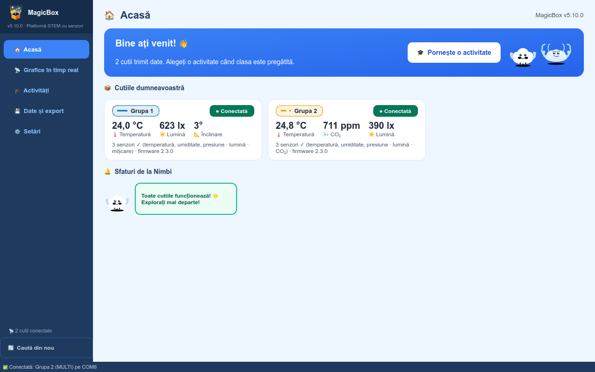
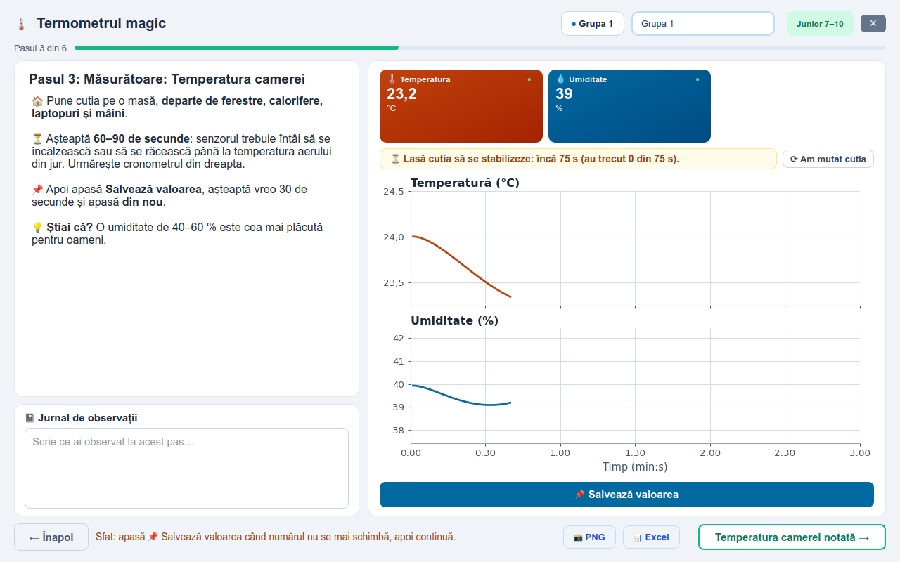

# MagicBox

[English](README.md) · **Română** · [Français](README_FR.md) · [Deutsch](README_DE.md)

**Versiunea 5.7.0** · Windows 10 / 11 · aplicația și documentele în română, engleză, franceză și germană

## Pentru profesori

MagicBox este o cutie cu senzori pentru ora de științe. Elevii măsoară cu ea
temperatura, umiditatea, presiunea aerului, lumina, dioxidul de carbon și
mișcarea. Aplicația de pe calculator arată măsurătorile pe grafice, în timp
real, și conduce clasa prin experimente ghidate, instrumente de explorare și
jocuri, de la clasa a II-a până la a XII-a.

**Fiecare activitate are un ghid pentru profesor și o fișă pentru elev, în
română, engleză, franceză și germană.** Ghidul spune cum pregătiți ora, cum o desfășurați,
ce întrebări puneți și unde greșesc de obicei elevii. În aplicație, butonul
**Deschide ghidul** de pe fiecare activitate deschide ghidul potrivit.

*Stânga: pagina Acasă, cu cutiile conectate. Dreapta: un experiment ghidat.
Fiecare ecran și fiecare buton sunt explicate, cu imagini, în
[Manualul de utilizare](MagicBox/docs/ro/manual_de_utilizare.pdf) [⬇](https://github.com/GeoEduLab/MagicBox/raw/main/MagicBox/docs/ro/manual_de_utilizare.pdf).*

### ⬇️ [Descărcați MagicBox 5.7.0 (un singur fișier ZIP)](https://github.com/GeoEduLab/MagicBox/releases/download/v5.7.0/MagicBox_v5.7.0.zip)

Arhiva conține tot: aplicația, ghidurile, fișele, firmware-ul cutiei și
ghidul de instalare a firmware-ului, toate din aceeași versiune.

Doar documentele (ghiduri, fișe, Primii pași, manualul tehnic, ghidul de
firmware, în patru limbi, în aceleași foldere ca în aplicație):
**[MagicBox_docs_v5.7.0.zip](https://github.com/GeoEduLab/MagicBox/releases/download/v5.7.0/MagicBox_docs_v5.7.0.zip)**. Fiecare PDF de mai jos se
deschide și aici, pe GitHub; săgeata ⬇ de lângă el îl descarcă.

---

## 1. Instalarea aplicației

1. Dezarhivați ZIP-ul (clic dreapta → **Extract All…**) în **Documente** sau
   pe un stick. Nu în *Program Files* și nu porniți aplicația direct din ZIP.
   Țineți tot folderul `MagicBox` împreună.
2. Porniți **`MagicBox.exe`**. Nu trebuie instalat nimic altceva.
3. Dacă apare *„Windows a protejat computerul”*, apăsați **Mai multe
   informații → Executare oricum**. Mesajul apare pentru că aplicația nu are
   semnătură comercială, nu pentru că ar fi periculoasă.
4. Când Windows întreabă despre rețea, bifați **Rețele private** și apăsați
   **Permiteți accesul**. Altfel cutiile nu se pot conecta prin WiFi.

Aplicația pornește în engleză. Pentru română: **Settings → Language and
display → Language: Română**, apoi reporniți-o. Butonul **Deschide ghidul**
deschide ghidul în limba aplicației.

Pașii de la instalare la prima cutie pe ecran, cu un tabel „ce vedeți → ce
faceți”, sunt în [Primii pași](MagicBox/docs/ro/primii_pasi.pdf) [⬇](https://github.com/GeoEduLab/MagicBox/raw/main/MagicBox/docs/ro/primii_pasi.pdf) (două pagini).

**Prin USB:** folosiți un cablu USB de tip C, *de date*. Dacă cutia nu apare în 10 secunde,
instalați o dată driverul plăcii:
[CP210x](https://www.silabs.com/developers/usb-to-uart-bridge-vcp-drivers)
sau [CH340](https://www.wch-ic.com/downloads/CH341SER_EXE.html).

**Prin WiFi:** o singură dată pentru fiecare cutie, de pe un telefon.

1. Porniți cutia. Prima dată ea face o rețea **MagicBox-XXXX** (XXXX = ultimele
   patru caractere ale ID-ului cutiei; **CutiaMagica-XXXX** la firmware mai
   vechi de 2.2.6). În setările WiFi ale telefonului, atingeți rețeaua ei.
2. Telefonul spune că rețeaua nu are internet (pe Samsung: *Internet may not be
   available*): alegeți **Connect only this time** (Conectare doar de data
   aceasta).
3. Telefonul rămâne conectat la **MagicBox-XXXX**, „fără internet”: e normal.
4. Pagina de configurare se deschide singură; dacă nu, deschideți în browser
   **http://192.168.4.1** (d). Alegeți rețeaua clasei din listă (a), scrieți
   parola (b) și apăsați **Save and connect** (c). Cutia repornește și intră în
   rețea; aplicația o găsește singură.

Cutia vede doar rețele de **2,4 GHz**: la un router cu două benzi, lăsați banda
de 2,4 GHz pornită. Calculatorul și cutiile trebuie să fie în aceeași rețea.
Dacă rețeaua școlii nu merge (rețele cu nume de utilizator *și* parolă, sau
care nu lasă aparatele să se vadă între ele), folosiți hotspotul unui telefon.
Pentru o altă rețea: țineți apăsat butonul BOOT al cutiei cât o porniți, iar
cutia uită rețeaua salvată.

**Senzorii:** cutia are trei socluri pentru patru senzori, deci unul lipsește
mereu, iar la pornire apare ca `FAIL`: e normal. Cu cutia oprită, puneți
senzorul de care are nevoie activitatea (jocurile cer senzorul de mișcare).

## 2. Firmware-ul cutiei

Cutiile care funcționează nu trebuie reprogramate. Firmware-ul se încarcă la
o cutie nouă sau când aplicația vă avertizează că o cutie are firmware vechi.
Pașii, cu imagini, sunt în
[ghidul de instalare a firmware-ului](MagicBox/firmware/FLASHING_GUIDE_RO.pdf) [⬇](https://github.com/GeoEduLab/MagicBox/raw/main/MagicBox/firmware/FLASHING_GUIDE_RO.pdf):
circa 30 de minute prima dată, apoi 2–3 minute pe cutie. Folosiți varianta
`serial_wifi_…` (USB și WiFi) din folderul [firmware](MagicBox/firmware).

Dacă o cutie așezată pe masă arată accelerația Z cam −1 g în loc de +1 g,
bifați **Senzor de mișcare întors** la acea cutie, în **Setări → Numele
cutiilor**. Nu e nevoie de alt firmware.

## 3. Documentele

Toate documentele într-o singură arhivă:
**[MagicBox_docs_v5.7.0.zip](https://github.com/GeoEduLab/MagicBox/releases/download/v5.7.0/MagicBox_docs_v5.7.0.zip)**. Un PDF anume: clic pe nume ca
să-l citiți pe GitHub, sau pe ⬇ ca să-l descărcați.

| | Română | English | Français | Deutsch |
|---|---|---|---|---|
| Primii pași: instalare, conectare, probleme frecvente | [primii_pasi.pdf](MagicBox/docs/ro/primii_pasi.pdf) [⬇](https://github.com/GeoEduLab/MagicBox/raw/main/MagicBox/docs/ro/primii_pasi.pdf) | [first_steps.pdf](MagicBox/docs/en/first_steps.pdf) [⬇](https://github.com/GeoEduLab/MagicBox/raw/main/MagicBox/docs/en/first_steps.pdf) | [premiers_pas.pdf](MagicBox/docs/fr/premiers_pas.pdf) [⬇](https://github.com/GeoEduLab/MagicBox/raw/main/MagicBox/docs/fr/premiers_pas.pdf) | [erste_schritte.pdf](MagicBox/docs/de/erste_schritte.pdf) [⬇](https://github.com/GeoEduLab/MagicBox/raw/main/MagicBox/docs/de/erste_schritte.pdf) |
| Manualul de utilizare: fiecare ecran și fiecare buton, cu imagini | [manual_de_utilizare.pdf](MagicBox/docs/ro/manual_de_utilizare.pdf) [⬇](https://github.com/GeoEduLab/MagicBox/raw/main/MagicBox/docs/ro/manual_de_utilizare.pdf) | [user_manual.pdf](MagicBox/docs/en/user_manual.pdf) [⬇](https://github.com/GeoEduLab/MagicBox/raw/main/MagicBox/docs/en/user_manual.pdf) | [manuel_utilisateur.pdf](MagicBox/docs/fr/manuel_utilisateur.pdf) [⬇](https://github.com/GeoEduLab/MagicBox/raw/main/MagicBox/docs/fr/manuel_utilisateur.pdf) | [benutzerhandbuch.pdf](MagicBox/docs/de/benutzerhandbuch.pdf) [⬇](https://github.com/GeoEduLab/MagicBox/raw/main/MagicBox/docs/de/benutzerhandbuch.pdf) |
| Activitățile pe clase și discipline (o pagină) | [activitatile_pe_clase_si_discipline.pdf](MagicBox/docs/ro/activitatile_pe_clase_si_discipline.pdf) [⬇](https://github.com/GeoEduLab/MagicBox/raw/main/MagicBox/docs/ro/activitatile_pe_clase_si_discipline.pdf) | [activities_by_grade_and_subject.pdf](MagicBox/docs/en/activities_by_grade_and_subject.pdf) [⬇](https://github.com/GeoEduLab/MagicBox/raw/main/MagicBox/docs/en/activities_by_grade_and_subject.pdf) | [activites_par_classe_et_matiere.pdf](MagicBox/docs/fr/activites_par_classe_et_matiere.pdf) [⬇](https://github.com/GeoEduLab/MagicBox/raw/main/MagicBox/docs/fr/activites_par_classe_et_matiere.pdf) | [aktivitaeten_nach_klasse_und_fach.pdf](MagicBox/docs/de/aktivitaeten_nach_klasse_und_fach.pdf) [⬇](https://github.com/GeoEduLab/MagicBox/raw/main/MagicBox/docs/de/aktivitaeten_nach_klasse_und_fach.pdf) |
| Planul curricular (ce activitate la ce clasă) | [plan_curricular.pdf](MagicBox/docs/ro/plan_curricular.pdf) [⬇](https://github.com/GeoEduLab/MagicBox/raw/main/MagicBox/docs/ro/plan_curricular.pdf) | [curriculum_plan.pdf](MagicBox/docs/en/curriculum_plan.pdf) [⬇](https://github.com/GeoEduLab/MagicBox/raw/main/MagicBox/docs/en/curriculum_plan.pdf) | [plan_curriculaire.pdf](MagicBox/docs/fr/plan_curriculaire.pdf) [⬇](https://github.com/GeoEduLab/MagicBox/raw/main/MagicBox/docs/fr/plan_curriculaire.pdf) | [lehrplan.pdf](MagicBox/docs/de/lehrplan.pdf) [⬇](https://github.com/GeoEduLab/MagicBox/raw/main/MagicBox/docs/de/lehrplan.pdf) |
| Manualul tehnic și problemele frecvente | [manual_tehnic.pdf](MagicBox/docs/ro/manual_tehnic.pdf) [⬇](https://github.com/GeoEduLab/MagicBox/raw/main/MagicBox/docs/ro/manual_tehnic.pdf) | [technical_manual.pdf](MagicBox/docs/en/technical_manual.pdf) [⬇](https://github.com/GeoEduLab/MagicBox/raw/main/MagicBox/docs/en/technical_manual.pdf) | [manuel_technique.pdf](MagicBox/docs/fr/manuel_technique.pdf) [⬇](https://github.com/GeoEduLab/MagicBox/raw/main/MagicBox/docs/fr/manuel_technique.pdf) | [technisches_handbuch.pdf](MagicBox/docs/de/technisches_handbuch.pdf) [⬇](https://github.com/GeoEduLab/MagicBox/raw/main/MagicBox/docs/de/technisches_handbuch.pdf) |
| Instalarea firmware-ului | [FLASHING_GUIDE_RO.pdf](MagicBox/firmware/FLASHING_GUIDE_RO.pdf) [⬇](https://github.com/GeoEduLab/MagicBox/raw/main/MagicBox/firmware/FLASHING_GUIDE_RO.pdf) | [FLASHING_GUIDE.pdf](MagicBox/firmware/FLASHING_GUIDE.pdf) [⬇](https://github.com/GeoEduLab/MagicBox/raw/main/MagicBox/firmware/FLASHING_GUIDE.pdf) | [FLASHING_GUIDE_FR.pdf](MagicBox/firmware/FLASHING_GUIDE_FR.pdf) [⬇](https://github.com/GeoEduLab/MagicBox/raw/main/MagicBox/firmware/FLASHING_GUIDE_FR.pdf) | [FLASHING_GUIDE_DE.pdf](MagicBox/firmware/FLASHING_GUIDE_DE.pdf) [⬇](https://github.com/GeoEduLab/MagicBox/raw/main/MagicBox/firmware/FLASHING_GUIDE_DE.pdf) |

Ce s-a schimbat de la o versiune la alta: [CHANGELOG.txt](MagicBox/CHANGELOG.txt)
(aplicația) și [firmware/CHANGELOG.txt](MagicBox/firmware/CHANGELOG.txt).

---

## Activitățile

Toate PDF-urile se deschid direct aici, pe GitHub; ⬇ de lângă fiecare descarcă fișierul.

### Experimente ghidate

| Activitate | Clasele | Ghidul profesorului | Fișa elevului |
|---|---|---|---|
| 🌞 Lumina de pretutindeni | II–IV | [RO](MagicBox/docs/ro/ghiduri_profesor/lumina_de_pretutindeni.pdf) [⬇](https://github.com/GeoEduLab/MagicBox/raw/main/MagicBox/docs/ro/ghiduri_profesor/lumina_de_pretutindeni.pdf) · [EN](MagicBox/docs/en/teacher_guides/light_is_everywhere.pdf) [⬇](https://github.com/GeoEduLab/MagicBox/raw/main/MagicBox/docs/en/teacher_guides/light_is_everywhere.pdf) · [FR](MagicBox/docs/fr/guides_enseignant/lumiere_est_partout.pdf) [⬇](https://github.com/GeoEduLab/MagicBox/raw/main/MagicBox/docs/fr/guides_enseignant/lumiere_est_partout.pdf) · [DE](MagicBox/docs/de/lehrerhandbuecher/licht_ist_ueberall.pdf) [⬇](https://github.com/GeoEduLab/MagicBox/raw/main/MagicBox/docs/de/lehrerhandbuecher/licht_ist_ueberall.pdf) | [RO](MagicBox/docs/ro/fise_elev/lumina_de_pretutindeni.pdf) [⬇](https://github.com/GeoEduLab/MagicBox/raw/main/MagicBox/docs/ro/fise_elev/lumina_de_pretutindeni.pdf) · [EN](MagicBox/docs/en/student_sheets/light_is_everywhere.pdf) [⬇](https://github.com/GeoEduLab/MagicBox/raw/main/MagicBox/docs/en/student_sheets/light_is_everywhere.pdf) · [FR](MagicBox/docs/fr/fiches_eleve/lumiere_est_partout.pdf) [⬇](https://github.com/GeoEduLab/MagicBox/raw/main/MagicBox/docs/fr/fiches_eleve/lumiere_est_partout.pdf) · [DE](MagicBox/docs/de/arbeitsblaetter/licht_ist_ueberall.pdf) [⬇](https://github.com/GeoEduLab/MagicBox/raw/main/MagicBox/docs/de/arbeitsblaetter/licht_ist_ueberall.pdf) |
| 🌡️ Termometrul magic | II–IV | [RO](MagicBox/docs/ro/ghiduri_profesor/termometrul_magic.pdf) [⬇](https://github.com/GeoEduLab/MagicBox/raw/main/MagicBox/docs/ro/ghiduri_profesor/termometrul_magic.pdf) · [EN](MagicBox/docs/en/teacher_guides/magic_thermometer.pdf) [⬇](https://github.com/GeoEduLab/MagicBox/raw/main/MagicBox/docs/en/teacher_guides/magic_thermometer.pdf) · [FR](MagicBox/docs/fr/guides_enseignant/thermometre_magique.pdf) [⬇](https://github.com/GeoEduLab/MagicBox/raw/main/MagicBox/docs/fr/guides_enseignant/thermometre_magique.pdf) · [DE](MagicBox/docs/de/lehrerhandbuecher/magische_thermometer.pdf) [⬇](https://github.com/GeoEduLab/MagicBox/raw/main/MagicBox/docs/de/lehrerhandbuecher/magische_thermometer.pdf) | [RO](MagicBox/docs/ro/fise_elev/termometrul_magic.pdf) [⬇](https://github.com/GeoEduLab/MagicBox/raw/main/MagicBox/docs/ro/fise_elev/termometrul_magic.pdf) · [EN](MagicBox/docs/en/student_sheets/magic_thermometer.pdf) [⬇](https://github.com/GeoEduLab/MagicBox/raw/main/MagicBox/docs/en/student_sheets/magic_thermometer.pdf) · [FR](MagicBox/docs/fr/fiches_eleve/thermometre_magique.pdf) [⬇](https://github.com/GeoEduLab/MagicBox/raw/main/MagicBox/docs/fr/fiches_eleve/thermometre_magique.pdf) · [DE](MagicBox/docs/de/arbeitsblaetter/magische_thermometer.pdf) [⬇](https://github.com/GeoEduLab/MagicBox/raw/main/MagicBox/docs/de/arbeitsblaetter/magische_thermometer.pdf) |
| 🫁 Aerul pe care îl respirăm | II–IV | [RO](MagicBox/docs/ro/ghiduri_profesor/aerul_pe_care_il_respiram.pdf) [⬇](https://github.com/GeoEduLab/MagicBox/raw/main/MagicBox/docs/ro/ghiduri_profesor/aerul_pe_care_il_respiram.pdf) · [EN](MagicBox/docs/en/teacher_guides/air_we_breathe.pdf) [⬇](https://github.com/GeoEduLab/MagicBox/raw/main/MagicBox/docs/en/teacher_guides/air_we_breathe.pdf) · [FR](MagicBox/docs/fr/guides_enseignant/air_que_nous_respirons.pdf) [⬇](https://github.com/GeoEduLab/MagicBox/raw/main/MagicBox/docs/fr/guides_enseignant/air_que_nous_respirons.pdf) · [DE](MagicBox/docs/de/lehrerhandbuecher/luft_die_wir_atmen.pdf) [⬇](https://github.com/GeoEduLab/MagicBox/raw/main/MagicBox/docs/de/lehrerhandbuecher/luft_die_wir_atmen.pdf) | [RO](MagicBox/docs/ro/fise_elev/aerul_pe_care_il_respiram.pdf) [⬇](https://github.com/GeoEduLab/MagicBox/raw/main/MagicBox/docs/ro/fise_elev/aerul_pe_care_il_respiram.pdf) · [EN](MagicBox/docs/en/student_sheets/air_we_breathe.pdf) [⬇](https://github.com/GeoEduLab/MagicBox/raw/main/MagicBox/docs/en/student_sheets/air_we_breathe.pdf) · [FR](MagicBox/docs/fr/fiches_eleve/air_que_nous_respirons.pdf) [⬇](https://github.com/GeoEduLab/MagicBox/raw/main/MagicBox/docs/fr/fiches_eleve/air_que_nous_respirons.pdf) · [DE](MagicBox/docs/de/arbeitsblaetter/luft_die_wir_atmen.pdf) [⬇](https://github.com/GeoEduLab/MagicBox/raw/main/MagicBox/docs/de/arbeitsblaetter/luft_die_wir_atmen.pdf) |
| 🏠 Poluarea de interior | V–VIII | [RO](MagicBox/docs/ro/ghiduri_profesor/poluarea_de_interior.pdf) [⬇](https://github.com/GeoEduLab/MagicBox/raw/main/MagicBox/docs/ro/ghiduri_profesor/poluarea_de_interior.pdf) · [EN](MagicBox/docs/en/teacher_guides/indoor_pollution.pdf) [⬇](https://github.com/GeoEduLab/MagicBox/raw/main/MagicBox/docs/en/teacher_guides/indoor_pollution.pdf) · [FR](MagicBox/docs/fr/guides_enseignant/pollution_interieure.pdf) [⬇](https://github.com/GeoEduLab/MagicBox/raw/main/MagicBox/docs/fr/guides_enseignant/pollution_interieure.pdf) · [DE](MagicBox/docs/de/lehrerhandbuecher/luftverschmutzung_in_innenraeumen.pdf) [⬇](https://github.com/GeoEduLab/MagicBox/raw/main/MagicBox/docs/de/lehrerhandbuecher/luftverschmutzung_in_innenraeumen.pdf) | [RO](MagicBox/docs/ro/fise_elev/poluarea_de_interior.pdf) [⬇](https://github.com/GeoEduLab/MagicBox/raw/main/MagicBox/docs/ro/fise_elev/poluarea_de_interior.pdf) · [EN](MagicBox/docs/en/student_sheets/indoor_pollution.pdf) [⬇](https://github.com/GeoEduLab/MagicBox/raw/main/MagicBox/docs/en/student_sheets/indoor_pollution.pdf) · [FR](MagicBox/docs/fr/fiches_eleve/pollution_interieure.pdf) [⬇](https://github.com/GeoEduLab/MagicBox/raw/main/MagicBox/docs/fr/fiches_eleve/pollution_interieure.pdf) · [DE](MagicBox/docs/de/arbeitsblaetter/luftverschmutzung_in_innenraeumen.pdf) [⬇](https://github.com/GeoEduLab/MagicBox/raw/main/MagicBox/docs/de/arbeitsblaetter/luftverschmutzung_in_innenraeumen.pdf) |
| 🌿 CO₂ și fotosinteza | X–XII | [RO](MagicBox/docs/ro/ghiduri_profesor/co2_si_fotosinteza.pdf) [⬇](https://github.com/GeoEduLab/MagicBox/raw/main/MagicBox/docs/ro/ghiduri_profesor/co2_si_fotosinteza.pdf) · [EN](MagicBox/docs/en/teacher_guides/co2_and_photosynthesis.pdf) [⬇](https://github.com/GeoEduLab/MagicBox/raw/main/MagicBox/docs/en/teacher_guides/co2_and_photosynthesis.pdf) · [FR](MagicBox/docs/fr/guides_enseignant/co2_et_photosynthese.pdf) [⬇](https://github.com/GeoEduLab/MagicBox/raw/main/MagicBox/docs/fr/guides_enseignant/co2_et_photosynthese.pdf) · [DE](MagicBox/docs/de/lehrerhandbuecher/co2_und_fotosynthese.pdf) [⬇](https://github.com/GeoEduLab/MagicBox/raw/main/MagicBox/docs/de/lehrerhandbuecher/co2_und_fotosynthese.pdf) | [RO](MagicBox/docs/ro/fise_elev/co2_si_fotosinteza.pdf) [⬇](https://github.com/GeoEduLab/MagicBox/raw/main/MagicBox/docs/ro/fise_elev/co2_si_fotosinteza.pdf) · [EN](MagicBox/docs/en/student_sheets/co2_and_photosynthesis.pdf) [⬇](https://github.com/GeoEduLab/MagicBox/raw/main/MagicBox/docs/en/student_sheets/co2_and_photosynthesis.pdf) · [FR](MagicBox/docs/fr/fiches_eleve/co2_et_photosynthese.pdf) [⬇](https://github.com/GeoEduLab/MagicBox/raw/main/MagicBox/docs/fr/fiches_eleve/co2_et_photosynthese.pdf) · [DE](MagicBox/docs/de/arbeitsblaetter/co2_und_fotosynthese.pdf) [⬇](https://github.com/GeoEduLab/MagicBox/raw/main/MagicBox/docs/de/arbeitsblaetter/co2_und_fotosynthese.pdf) |
| 📊 Seismograful | V–XII | [RO](MagicBox/docs/ro/ghiduri_profesor/seismograful.pdf) [⬇](https://github.com/GeoEduLab/MagicBox/raw/main/MagicBox/docs/ro/ghiduri_profesor/seismograful.pdf) · [EN](MagicBox/docs/en/teacher_guides/seismometer.pdf) [⬇](https://github.com/GeoEduLab/MagicBox/raw/main/MagicBox/docs/en/teacher_guides/seismometer.pdf) · [FR](MagicBox/docs/fr/guides_enseignant/sismometre.pdf) [⬇](https://github.com/GeoEduLab/MagicBox/raw/main/MagicBox/docs/fr/guides_enseignant/sismometre.pdf) · [DE](MagicBox/docs/de/lehrerhandbuecher/seismometer.pdf) [⬇](https://github.com/GeoEduLab/MagicBox/raw/main/MagicBox/docs/de/lehrerhandbuecher/seismometer.pdf) | [RO](MagicBox/docs/ro/fise_elev/seismograful.pdf) [⬇](https://github.com/GeoEduLab/MagicBox/raw/main/MagicBox/docs/ro/fise_elev/seismograful.pdf) · [EN](MagicBox/docs/en/student_sheets/seismometer.pdf) [⬇](https://github.com/GeoEduLab/MagicBox/raw/main/MagicBox/docs/en/student_sheets/seismometer.pdf) · [FR](MagicBox/docs/fr/fiches_eleve/sismometre.pdf) [⬇](https://github.com/GeoEduLab/MagicBox/raw/main/MagicBox/docs/fr/fiches_eleve/sismometre.pdf) · [DE](MagicBox/docs/de/arbeitsblaetter/seismometer.pdf) [⬇](https://github.com/GeoEduLab/MagicBox/raw/main/MagicBox/docs/de/arbeitsblaetter/seismometer.pdf) |
| ✈️ Zbor drept | II–IV | [RO](MagicBox/docs/ro/ghiduri_profesor/zbor_drept.pdf) [⬇](https://github.com/GeoEduLab/MagicBox/raw/main/MagicBox/docs/ro/ghiduri_profesor/zbor_drept.pdf) · [EN](MagicBox/docs/en/teacher_guides/flying_straight.pdf) [⬇](https://github.com/GeoEduLab/MagicBox/raw/main/MagicBox/docs/en/teacher_guides/flying_straight.pdf) · [FR](MagicBox/docs/fr/guides_enseignant/voler_droit.pdf) [⬇](https://github.com/GeoEduLab/MagicBox/raw/main/MagicBox/docs/fr/guides_enseignant/voler_droit.pdf) · [DE](MagicBox/docs/de/lehrerhandbuecher/geradeaus_fliegen.pdf) [⬇](https://github.com/GeoEduLab/MagicBox/raw/main/MagicBox/docs/de/lehrerhandbuecher/geradeaus_fliegen.pdf) | [RO](MagicBox/docs/ro/fise_elev/zbor_drept.pdf) [⬇](https://github.com/GeoEduLab/MagicBox/raw/main/MagicBox/docs/ro/fise_elev/zbor_drept.pdf) · [EN](MagicBox/docs/en/student_sheets/flying_straight.pdf) [⬇](https://github.com/GeoEduLab/MagicBox/raw/main/MagicBox/docs/en/student_sheets/flying_straight.pdf) · [FR](MagicBox/docs/fr/fiches_eleve/voler_droit.pdf) [⬇](https://github.com/GeoEduLab/MagicBox/raw/main/MagicBox/docs/fr/fiches_eleve/voler_droit.pdf) · [DE](MagicBox/docs/de/arbeitsblaetter/geradeaus_fliegen.pdf) [⬇](https://github.com/GeoEduLab/MagicBox/raw/main/MagicBox/docs/de/arbeitsblaetter/geradeaus_fliegen.pdf) |
| ⚖️ Cutia în echilibru | II–IV | [RO](MagicBox/docs/ro/ghiduri_profesor/cutia_in_echilibru.pdf) [⬇](https://github.com/GeoEduLab/MagicBox/raw/main/MagicBox/docs/ro/ghiduri_profesor/cutia_in_echilibru.pdf) · [EN](MagicBox/docs/en/teacher_guides/box_in_balance.pdf) [⬇](https://github.com/GeoEduLab/MagicBox/raw/main/MagicBox/docs/en/teacher_guides/box_in_balance.pdf) · [FR](MagicBox/docs/fr/guides_enseignant/boitier_en_equilibre.pdf) [⬇](https://github.com/GeoEduLab/MagicBox/raw/main/MagicBox/docs/fr/guides_enseignant/boitier_en_equilibre.pdf) · [DE](MagicBox/docs/de/lehrerhandbuecher/box_im_gleichgewicht.pdf) [⬇](https://github.com/GeoEduLab/MagicBox/raw/main/MagicBox/docs/de/lehrerhandbuecher/box_im_gleichgewicht.pdf) | [RO](MagicBox/docs/ro/fise_elev/cutia_in_echilibru.pdf) [⬇](https://github.com/GeoEduLab/MagicBox/raw/main/MagicBox/docs/ro/fise_elev/cutia_in_echilibru.pdf) · [EN](MagicBox/docs/en/student_sheets/box_in_balance.pdf) [⬇](https://github.com/GeoEduLab/MagicBox/raw/main/MagicBox/docs/en/student_sheets/box_in_balance.pdf) · [FR](MagicBox/docs/fr/fiches_eleve/boitier_en_equilibre.pdf) [⬇](https://github.com/GeoEduLab/MagicBox/raw/main/MagicBox/docs/fr/fiches_eleve/boitier_en_equilibre.pdf) · [DE](MagicBox/docs/de/arbeitsblaetter/box_im_gleichgewicht.pdf) [⬇](https://github.com/GeoEduLab/MagicBox/raw/main/MagicBox/docs/de/arbeitsblaetter/box_im_gleichgewicht.pdf) |
| ⛰️ Presiune și altitudine | V–VIII | [RO](MagicBox/docs/ro/ghiduri_profesor/presiune_si_altitudine.pdf) [⬇](https://github.com/GeoEduLab/MagicBox/raw/main/MagicBox/docs/ro/ghiduri_profesor/presiune_si_altitudine.pdf) · [EN](MagicBox/docs/en/teacher_guides/pressure_and_altitude.pdf) [⬇](https://github.com/GeoEduLab/MagicBox/raw/main/MagicBox/docs/en/teacher_guides/pressure_and_altitude.pdf) · [FR](MagicBox/docs/fr/guides_enseignant/pression_et_altitude.pdf) [⬇](https://github.com/GeoEduLab/MagicBox/raw/main/MagicBox/docs/fr/guides_enseignant/pression_et_altitude.pdf) · [DE](MagicBox/docs/de/lehrerhandbuecher/luftdruck_und_hoehe.pdf) [⬇](https://github.com/GeoEduLab/MagicBox/raw/main/MagicBox/docs/de/lehrerhandbuecher/luftdruck_und_hoehe.pdf) | [RO](MagicBox/docs/ro/fise_elev/presiune_si_altitudine.pdf) [⬇](https://github.com/GeoEduLab/MagicBox/raw/main/MagicBox/docs/ro/fise_elev/presiune_si_altitudine.pdf) · [EN](MagicBox/docs/en/student_sheets/pressure_and_altitude.pdf) [⬇](https://github.com/GeoEduLab/MagicBox/raw/main/MagicBox/docs/en/student_sheets/pressure_and_altitude.pdf) · [FR](MagicBox/docs/fr/fiches_eleve/pression_et_altitude.pdf) [⬇](https://github.com/GeoEduLab/MagicBox/raw/main/MagicBox/docs/fr/fiches_eleve/pression_et_altitude.pdf) · [DE](MagicBox/docs/de/arbeitsblaetter/luftdruck_und_hoehe.pdf) [⬇](https://github.com/GeoEduLab/MagicBox/raw/main/MagicBox/docs/de/arbeitsblaetter/luftdruck_und_hoehe.pdf) |
| 🌆 Insule termice | V–VIII | [RO](MagicBox/docs/ro/ghiduri_profesor/insule_termice.pdf) [⬇](https://github.com/GeoEduLab/MagicBox/raw/main/MagicBox/docs/ro/ghiduri_profesor/insule_termice.pdf) · [EN](MagicBox/docs/en/teacher_guides/urban_heat_islands.pdf) [⬇](https://github.com/GeoEduLab/MagicBox/raw/main/MagicBox/docs/en/teacher_guides/urban_heat_islands.pdf) · [FR](MagicBox/docs/fr/guides_enseignant/ilots_de_chaleur_urbains.pdf) [⬇](https://github.com/GeoEduLab/MagicBox/raw/main/MagicBox/docs/fr/guides_enseignant/ilots_de_chaleur_urbains.pdf) · [DE](MagicBox/docs/de/lehrerhandbuecher/staedtische_waermeinseln.pdf) [⬇](https://github.com/GeoEduLab/MagicBox/raw/main/MagicBox/docs/de/lehrerhandbuecher/staedtische_waermeinseln.pdf) | [RO](MagicBox/docs/ro/fise_elev/insule_termice.pdf) [⬇](https://github.com/GeoEduLab/MagicBox/raw/main/MagicBox/docs/ro/fise_elev/insule_termice.pdf) · [EN](MagicBox/docs/en/student_sheets/urban_heat_islands.pdf) [⬇](https://github.com/GeoEduLab/MagicBox/raw/main/MagicBox/docs/en/student_sheets/urban_heat_islands.pdf) · [FR](MagicBox/docs/fr/fiches_eleve/ilots_de_chaleur_urbains.pdf) [⬇](https://github.com/GeoEduLab/MagicBox/raw/main/MagicBox/docs/fr/fiches_eleve/ilots_de_chaleur_urbains.pdf) · [DE](MagicBox/docs/de/arbeitsblaetter/staedtische_waermeinseln.pdf) [⬇](https://github.com/GeoEduLab/MagicBox/raw/main/MagicBox/docs/de/arbeitsblaetter/staedtische_waermeinseln.pdf) |
| ⚡ Panouri solare | IX–XII | [RO](MagicBox/docs/ro/ghiduri_profesor/panouri_solare.pdf) [⬇](https://github.com/GeoEduLab/MagicBox/raw/main/MagicBox/docs/ro/ghiduri_profesor/panouri_solare.pdf) · [EN](MagicBox/docs/en/teacher_guides/solar_panels.pdf) [⬇](https://github.com/GeoEduLab/MagicBox/raw/main/MagicBox/docs/en/teacher_guides/solar_panels.pdf) · [FR](MagicBox/docs/fr/guides_enseignant/panneaux_solaires.pdf) [⬇](https://github.com/GeoEduLab/MagicBox/raw/main/MagicBox/docs/fr/guides_enseignant/panneaux_solaires.pdf) · [DE](MagicBox/docs/de/lehrerhandbuecher/solarmodule.pdf) [⬇](https://github.com/GeoEduLab/MagicBox/raw/main/MagicBox/docs/de/lehrerhandbuecher/solarmodule.pdf) | [RO](MagicBox/docs/ro/fise_elev/panouri_solare.pdf) [⬇](https://github.com/GeoEduLab/MagicBox/raw/main/MagicBox/docs/ro/fise_elev/panouri_solare.pdf) · [EN](MagicBox/docs/en/student_sheets/solar_panels.pdf) [⬇](https://github.com/GeoEduLab/MagicBox/raw/main/MagicBox/docs/en/student_sheets/solar_panels.pdf) · [FR](MagicBox/docs/fr/fiches_eleve/panneaux_solaires.pdf) [⬇](https://github.com/GeoEduLab/MagicBox/raw/main/MagicBox/docs/fr/fiches_eleve/panneaux_solaires.pdf) · [DE](MagicBox/docs/de/arbeitsblaetter/solarmodule.pdf) [⬇](https://github.com/GeoEduLab/MagicBox/raw/main/MagicBox/docs/de/arbeitsblaetter/solarmodule.pdf) |
| 🔥 Convecția aerului | V–VIII | [RO](MagicBox/docs/ro/ghiduri_profesor/convectia_aerului.pdf) [⬇](https://github.com/GeoEduLab/MagicBox/raw/main/MagicBox/docs/ro/ghiduri_profesor/convectia_aerului.pdf) · [EN](MagicBox/docs/en/teacher_guides/air_convection.pdf) [⬇](https://github.com/GeoEduLab/MagicBox/raw/main/MagicBox/docs/en/teacher_guides/air_convection.pdf) · [FR](MagicBox/docs/fr/guides_enseignant/convection_de_l_air.pdf) [⬇](https://github.com/GeoEduLab/MagicBox/raw/main/MagicBox/docs/fr/guides_enseignant/convection_de_l_air.pdf) · [DE](MagicBox/docs/de/lehrerhandbuecher/konvektion_der_luft.pdf) [⬇](https://github.com/GeoEduLab/MagicBox/raw/main/MagicBox/docs/de/lehrerhandbuecher/konvektion_der_luft.pdf) | [RO](MagicBox/docs/ro/fise_elev/convectia_aerului.pdf) [⬇](https://github.com/GeoEduLab/MagicBox/raw/main/MagicBox/docs/ro/fise_elev/convectia_aerului.pdf) · [EN](MagicBox/docs/en/student_sheets/air_convection.pdf) [⬇](https://github.com/GeoEduLab/MagicBox/raw/main/MagicBox/docs/en/student_sheets/air_convection.pdf) · [FR](MagicBox/docs/fr/fiches_eleve/convection_de_l_air.pdf) [⬇](https://github.com/GeoEduLab/MagicBox/raw/main/MagicBox/docs/fr/fiches_eleve/convection_de_l_air.pdf) · [DE](MagicBox/docs/de/arbeitsblaetter/konvektion_der_luft.pdf) [⬇](https://github.com/GeoEduLab/MagicBox/raw/main/MagicBox/docs/de/arbeitsblaetter/konvektion_der_luft.pdf) |
| 💧 Ciclul apei | V–VIII | [RO](MagicBox/docs/ro/ghiduri_profesor/ciclul_apei.pdf) [⬇](https://github.com/GeoEduLab/MagicBox/raw/main/MagicBox/docs/ro/ghiduri_profesor/ciclul_apei.pdf) · [EN](MagicBox/docs/en/teacher_guides/water_cycle.pdf) [⬇](https://github.com/GeoEduLab/MagicBox/raw/main/MagicBox/docs/en/teacher_guides/water_cycle.pdf) · [FR](MagicBox/docs/fr/guides_enseignant/cycle_de_l_eau.pdf) [⬇](https://github.com/GeoEduLab/MagicBox/raw/main/MagicBox/docs/fr/guides_enseignant/cycle_de_l_eau.pdf) · [DE](MagicBox/docs/de/lehrerhandbuecher/wasserkreislauf.pdf) [⬇](https://github.com/GeoEduLab/MagicBox/raw/main/MagicBox/docs/de/lehrerhandbuecher/wasserkreislauf.pdf) | [RO](MagicBox/docs/ro/fise_elev/ciclul_apei.pdf) [⬇](https://github.com/GeoEduLab/MagicBox/raw/main/MagicBox/docs/ro/fise_elev/ciclul_apei.pdf) · [EN](MagicBox/docs/en/student_sheets/water_cycle.pdf) [⬇](https://github.com/GeoEduLab/MagicBox/raw/main/MagicBox/docs/en/student_sheets/water_cycle.pdf) · [FR](MagicBox/docs/fr/fiches_eleve/cycle_de_l_eau.pdf) [⬇](https://github.com/GeoEduLab/MagicBox/raw/main/MagicBox/docs/fr/fiches_eleve/cycle_de_l_eau.pdf) · [DE](MagicBox/docs/de/arbeitsblaetter/wasserkreislauf.pdf) [⬇](https://github.com/GeoEduLab/MagicBox/raw/main/MagicBox/docs/de/arbeitsblaetter/wasserkreislauf.pdf) |
| 🌐 Fizica atmosferei | IX–XII | [RO](MagicBox/docs/ro/ghiduri_profesor/fizica_atmosferei.pdf) [⬇](https://github.com/GeoEduLab/MagicBox/raw/main/MagicBox/docs/ro/ghiduri_profesor/fizica_atmosferei.pdf) · [EN](MagicBox/docs/en/teacher_guides/physics_of_the_atmosphere.pdf) [⬇](https://github.com/GeoEduLab/MagicBox/raw/main/MagicBox/docs/en/teacher_guides/physics_of_the_atmosphere.pdf) · [FR](MagicBox/docs/fr/guides_enseignant/physique_de_l_atmosphere.pdf) [⬇](https://github.com/GeoEduLab/MagicBox/raw/main/MagicBox/docs/fr/guides_enseignant/physique_de_l_atmosphere.pdf) · [DE](MagicBox/docs/de/lehrerhandbuecher/physik_der_atmosphaere.pdf) [⬇](https://github.com/GeoEduLab/MagicBox/raw/main/MagicBox/docs/de/lehrerhandbuecher/physik_der_atmosphaere.pdf) | [RO](MagicBox/docs/ro/fise_elev/fizica_atmosferei.pdf) [⬇](https://github.com/GeoEduLab/MagicBox/raw/main/MagicBox/docs/ro/fise_elev/fizica_atmosferei.pdf) · [EN](MagicBox/docs/en/student_sheets/physics_of_the_atmosphere.pdf) [⬇](https://github.com/GeoEduLab/MagicBox/raw/main/MagicBox/docs/en/student_sheets/physics_of_the_atmosphere.pdf) · [FR](MagicBox/docs/fr/fiches_eleve/physique_de_l_atmosphere.pdf) [⬇](https://github.com/GeoEduLab/MagicBox/raw/main/MagicBox/docs/fr/fiches_eleve/physique_de_l_atmosphere.pdf) · [DE](MagicBox/docs/de/arbeitsblaetter/physik_der_atmosphaere.pdf) [⬇](https://github.com/GeoEduLab/MagicBox/raw/main/MagicBox/docs/de/arbeitsblaetter/physik_der_atmosphaere.pdf) |
| ⚗️ Legea Beer–Lambert | X–XII | [RO](MagicBox/docs/ro/ghiduri_profesor/legea_beer_lambert.pdf) [⬇](https://github.com/GeoEduLab/MagicBox/raw/main/MagicBox/docs/ro/ghiduri_profesor/legea_beer_lambert.pdf) · [EN](MagicBox/docs/en/teacher_guides/beer_lambert_law.pdf) [⬇](https://github.com/GeoEduLab/MagicBox/raw/main/MagicBox/docs/en/teacher_guides/beer_lambert_law.pdf) · [FR](MagicBox/docs/fr/guides_enseignant/loi_de_beer_lambert.pdf) [⬇](https://github.com/GeoEduLab/MagicBox/raw/main/MagicBox/docs/fr/guides_enseignant/loi_de_beer_lambert.pdf) · [DE](MagicBox/docs/de/lehrerhandbuecher/lambert_beer_gesetz.pdf) [⬇](https://github.com/GeoEduLab/MagicBox/raw/main/MagicBox/docs/de/lehrerhandbuecher/lambert_beer_gesetz.pdf) | [RO](MagicBox/docs/ro/fise_elev/legea_beer_lambert.pdf) [⬇](https://github.com/GeoEduLab/MagicBox/raw/main/MagicBox/docs/ro/fise_elev/legea_beer_lambert.pdf) · [EN](MagicBox/docs/en/student_sheets/beer_lambert_law.pdf) [⬇](https://github.com/GeoEduLab/MagicBox/raw/main/MagicBox/docs/en/student_sheets/beer_lambert_law.pdf) · [FR](MagicBox/docs/fr/fiches_eleve/loi_de_beer_lambert.pdf) [⬇](https://github.com/GeoEduLab/MagicBox/raw/main/MagicBox/docs/fr/fiches_eleve/loi_de_beer_lambert.pdf) · [DE](MagicBox/docs/de/arbeitsblaetter/lambert_beer_gesetz.pdf) [⬇](https://github.com/GeoEduLab/MagicBox/raw/main/MagicBox/docs/de/arbeitsblaetter/lambert_beer_gesetz.pdf) |

### Instrumente de explorare

| Activitate | Clasele | Ghidul profesorului | Fișa elevului |
|---|---|---|---|
| 📌 Carnetul de măsurători | IV–XII | [RO](MagicBox/docs/ro/ghiduri_profesor/carnetul_de_masuratori.pdf) [⬇](https://github.com/GeoEduLab/MagicBox/raw/main/MagicBox/docs/ro/ghiduri_profesor/carnetul_de_masuratori.pdf) · [EN](MagicBox/docs/en/teacher_guides/measurement_notebook.pdf) [⬇](https://github.com/GeoEduLab/MagicBox/raw/main/MagicBox/docs/en/teacher_guides/measurement_notebook.pdf) · [FR](MagicBox/docs/fr/guides_enseignant/carnet_de_mesures.pdf) [⬇](https://github.com/GeoEduLab/MagicBox/raw/main/MagicBox/docs/fr/guides_enseignant/carnet_de_mesures.pdf) · [DE](MagicBox/docs/de/lehrerhandbuecher/messheft.pdf) [⬇](https://github.com/GeoEduLab/MagicBox/raw/main/MagicBox/docs/de/lehrerhandbuecher/messheft.pdf) | [RO](MagicBox/docs/ro/fise_elev/carnetul_de_masuratori.pdf) [⬇](https://github.com/GeoEduLab/MagicBox/raw/main/MagicBox/docs/ro/fise_elev/carnetul_de_masuratori.pdf) · [EN](MagicBox/docs/en/student_sheets/measurement_notebook.pdf) [⬇](https://github.com/GeoEduLab/MagicBox/raw/main/MagicBox/docs/en/student_sheets/measurement_notebook.pdf) · [FR](MagicBox/docs/fr/fiches_eleve/carnet_de_mesures.pdf) [⬇](https://github.com/GeoEduLab/MagicBox/raw/main/MagicBox/docs/fr/fiches_eleve/carnet_de_mesures.pdf) · [DE](MagicBox/docs/de/arbeitsblaetter/messheft.pdf) [⬇](https://github.com/GeoEduLab/MagicBox/raw/main/MagicBox/docs/de/arbeitsblaetter/messheft.pdf) |
| 🌦️ Stația meteo | V–XII | [RO](MagicBox/docs/ro/ghiduri_profesor/statia_meteo.pdf) [⬇](https://github.com/GeoEduLab/MagicBox/raw/main/MagicBox/docs/ro/ghiduri_profesor/statia_meteo.pdf) · [EN](MagicBox/docs/en/teacher_guides/weather_station.pdf) [⬇](https://github.com/GeoEduLab/MagicBox/raw/main/MagicBox/docs/en/teacher_guides/weather_station.pdf) · [FR](MagicBox/docs/fr/guides_enseignant/station_meteo.pdf) [⬇](https://github.com/GeoEduLab/MagicBox/raw/main/MagicBox/docs/fr/guides_enseignant/station_meteo.pdf) · [DE](MagicBox/docs/de/lehrerhandbuecher/wetterstation.pdf) [⬇](https://github.com/GeoEduLab/MagicBox/raw/main/MagicBox/docs/de/lehrerhandbuecher/wetterstation.pdf) | [RO](MagicBox/docs/ro/fise_elev/statia_meteo.pdf) [⬇](https://github.com/GeoEduLab/MagicBox/raw/main/MagicBox/docs/ro/fise_elev/statia_meteo.pdf) · [EN](MagicBox/docs/en/student_sheets/weather_station.pdf) [⬇](https://github.com/GeoEduLab/MagicBox/raw/main/MagicBox/docs/en/student_sheets/weather_station.pdf) · [FR](MagicBox/docs/fr/fiches_eleve/station_meteo.pdf) [⬇](https://github.com/GeoEduLab/MagicBox/raw/main/MagicBox/docs/fr/fiches_eleve/station_meteo.pdf) · [DE](MagicBox/docs/de/arbeitsblaetter/wetterstation.pdf) [⬇](https://github.com/GeoEduLab/MagicBox/raw/main/MagicBox/docs/de/arbeitsblaetter/wetterstation.pdf) |
| 🌬️ Calitatea aerului | V–XII | [RO](MagicBox/docs/ro/ghiduri_profesor/calitatea_aerului.pdf) [⬇](https://github.com/GeoEduLab/MagicBox/raw/main/MagicBox/docs/ro/ghiduri_profesor/calitatea_aerului.pdf) · [EN](MagicBox/docs/en/teacher_guides/air_quality.pdf) [⬇](https://github.com/GeoEduLab/MagicBox/raw/main/MagicBox/docs/en/teacher_guides/air_quality.pdf) · [FR](MagicBox/docs/fr/guides_enseignant/qualite_de_l_air.pdf) [⬇](https://github.com/GeoEduLab/MagicBox/raw/main/MagicBox/docs/fr/guides_enseignant/qualite_de_l_air.pdf) · [DE](MagicBox/docs/de/lehrerhandbuecher/luftqualitaet.pdf) [⬇](https://github.com/GeoEduLab/MagicBox/raw/main/MagicBox/docs/de/lehrerhandbuecher/luftqualitaet.pdf) | [RO](MagicBox/docs/ro/fise_elev/calitatea_aerului.pdf) [⬇](https://github.com/GeoEduLab/MagicBox/raw/main/MagicBox/docs/ro/fise_elev/calitatea_aerului.pdf) · [EN](MagicBox/docs/en/student_sheets/air_quality.pdf) [⬇](https://github.com/GeoEduLab/MagicBox/raw/main/MagicBox/docs/en/student_sheets/air_quality.pdf) · [FR](MagicBox/docs/fr/fiches_eleve/qualite_de_l_air.pdf) [⬇](https://github.com/GeoEduLab/MagicBox/raw/main/MagicBox/docs/fr/fiches_eleve/qualite_de_l_air.pdf) · [DE](MagicBox/docs/de/arbeitsblaetter/luftqualitaet.pdf) [⬇](https://github.com/GeoEduLab/MagicBox/raw/main/MagicBox/docs/de/arbeitsblaetter/luftqualitaet.pdf) |
| ☀️ Energia solară | VI–XII | [RO](MagicBox/docs/ro/ghiduri_profesor/energia_solara.pdf) [⬇](https://github.com/GeoEduLab/MagicBox/raw/main/MagicBox/docs/ro/ghiduri_profesor/energia_solara.pdf) · [EN](MagicBox/docs/en/teacher_guides/solar_energy.pdf) [⬇](https://github.com/GeoEduLab/MagicBox/raw/main/MagicBox/docs/en/teacher_guides/solar_energy.pdf) · [FR](MagicBox/docs/fr/guides_enseignant/energie_solaire.pdf) [⬇](https://github.com/GeoEduLab/MagicBox/raw/main/MagicBox/docs/fr/guides_enseignant/energie_solaire.pdf) · [DE](MagicBox/docs/de/lehrerhandbuecher/sonnenenergie.pdf) [⬇](https://github.com/GeoEduLab/MagicBox/raw/main/MagicBox/docs/de/lehrerhandbuecher/sonnenenergie.pdf) | [RO](MagicBox/docs/ro/fise_elev/energia_solara.pdf) [⬇](https://github.com/GeoEduLab/MagicBox/raw/main/MagicBox/docs/ro/fise_elev/energia_solara.pdf) · [EN](MagicBox/docs/en/student_sheets/solar_energy.pdf) [⬇](https://github.com/GeoEduLab/MagicBox/raw/main/MagicBox/docs/en/student_sheets/solar_energy.pdf) · [FR](MagicBox/docs/fr/fiches_eleve/energie_solaire.pdf) [⬇](https://github.com/GeoEduLab/MagicBox/raw/main/MagicBox/docs/fr/fiches_eleve/energie_solaire.pdf) · [DE](MagicBox/docs/de/arbeitsblaetter/sonnenenergie.pdf) [⬇](https://github.com/GeoEduLab/MagicBox/raw/main/MagicBox/docs/de/arbeitsblaetter/sonnenenergie.pdf) |
| 📐 Seismologie | V–XII | [RO](MagicBox/docs/ro/ghiduri_profesor/seismologie.pdf) [⬇](https://github.com/GeoEduLab/MagicBox/raw/main/MagicBox/docs/ro/ghiduri_profesor/seismologie.pdf) · [EN](MagicBox/docs/en/teacher_guides/seismology.pdf) [⬇](https://github.com/GeoEduLab/MagicBox/raw/main/MagicBox/docs/en/teacher_guides/seismology.pdf) · [FR](MagicBox/docs/fr/guides_enseignant/sismologie.pdf) [⬇](https://github.com/GeoEduLab/MagicBox/raw/main/MagicBox/docs/fr/guides_enseignant/sismologie.pdf) · [DE](MagicBox/docs/de/lehrerhandbuecher/seismologie.pdf) [⬇](https://github.com/GeoEduLab/MagicBox/raw/main/MagicBox/docs/de/lehrerhandbuecher/seismologie.pdf) | [RO](MagicBox/docs/ro/fise_elev/seismologie.pdf) [⬇](https://github.com/GeoEduLab/MagicBox/raw/main/MagicBox/docs/ro/fise_elev/seismologie.pdf) · [EN](MagicBox/docs/en/student_sheets/seismology.pdf) [⬇](https://github.com/GeoEduLab/MagicBox/raw/main/MagicBox/docs/en/student_sheets/seismology.pdf) · [FR](MagicBox/docs/fr/fiches_eleve/sismologie.pdf) [⬇](https://github.com/GeoEduLab/MagicBox/raw/main/MagicBox/docs/fr/fiches_eleve/sismologie.pdf) · [DE](MagicBox/docs/de/arbeitsblaetter/seismologie.pdf) [⬇](https://github.com/GeoEduLab/MagicBox/raw/main/MagicBox/docs/de/arbeitsblaetter/seismologie.pdf) |
| 🌆 Insule termice cu mai multe cutii | V–XII | [RO](MagicBox/docs/ro/ghiduri_profesor/insule_termice_cu_mai_multe_cutii.pdf) [⬇](https://github.com/GeoEduLab/MagicBox/raw/main/MagicBox/docs/ro/ghiduri_profesor/insule_termice_cu_mai_multe_cutii.pdf) · [EN](MagicBox/docs/en/teacher_guides/heat_islands_with_several_boxes.pdf) [⬇](https://github.com/GeoEduLab/MagicBox/raw/main/MagicBox/docs/en/teacher_guides/heat_islands_with_several_boxes.pdf) · [FR](MagicBox/docs/fr/guides_enseignant/ilots_de_chaleur_avec_plusieurs_boitiers.pdf) [⬇](https://github.com/GeoEduLab/MagicBox/raw/main/MagicBox/docs/fr/guides_enseignant/ilots_de_chaleur_avec_plusieurs_boitiers.pdf) · [DE](MagicBox/docs/de/lehrerhandbuecher/waermeinseln_mit_mehreren_boxen.pdf) [⬇](https://github.com/GeoEduLab/MagicBox/raw/main/MagicBox/docs/de/lehrerhandbuecher/waermeinseln_mit_mehreren_boxen.pdf) | [RO](MagicBox/docs/ro/fise_elev/insule_termice_cu_mai_multe_cutii.pdf) [⬇](https://github.com/GeoEduLab/MagicBox/raw/main/MagicBox/docs/ro/fise_elev/insule_termice_cu_mai_multe_cutii.pdf) · [EN](MagicBox/docs/en/student_sheets/heat_islands_with_several_boxes.pdf) [⬇](https://github.com/GeoEduLab/MagicBox/raw/main/MagicBox/docs/en/student_sheets/heat_islands_with_several_boxes.pdf) · [FR](MagicBox/docs/fr/fiches_eleve/ilots_de_chaleur_avec_plusieurs_boitiers.pdf) [⬇](https://github.com/GeoEduLab/MagicBox/raw/main/MagicBox/docs/fr/fiches_eleve/ilots_de_chaleur_avec_plusieurs_boitiers.pdf) · [DE](MagicBox/docs/de/arbeitsblaetter/waermeinseln_mit_mehreren_boxen.pdf) [⬇](https://github.com/GeoEduLab/MagicBox/raw/main/MagicBox/docs/de/arbeitsblaetter/waermeinseln_mit_mehreren_boxen.pdf) |
| 🌿 Efectul de seră | V–XII | [RO](MagicBox/docs/ro/ghiduri_profesor/efectul_de_sera.pdf) [⬇](https://github.com/GeoEduLab/MagicBox/raw/main/MagicBox/docs/ro/ghiduri_profesor/efectul_de_sera.pdf) · [EN](MagicBox/docs/en/teacher_guides/greenhouse_effect.pdf) [⬇](https://github.com/GeoEduLab/MagicBox/raw/main/MagicBox/docs/en/teacher_guides/greenhouse_effect.pdf) · [FR](MagicBox/docs/fr/guides_enseignant/effet_de_serre.pdf) [⬇](https://github.com/GeoEduLab/MagicBox/raw/main/MagicBox/docs/fr/guides_enseignant/effet_de_serre.pdf) · [DE](MagicBox/docs/de/lehrerhandbuecher/treibhauseffekt.pdf) [⬇](https://github.com/GeoEduLab/MagicBox/raw/main/MagicBox/docs/de/lehrerhandbuecher/treibhauseffekt.pdf) | [RO](MagicBox/docs/ro/fise_elev/efectul_de_sera.pdf) [⬇](https://github.com/GeoEduLab/MagicBox/raw/main/MagicBox/docs/ro/fise_elev/efectul_de_sera.pdf) · [EN](MagicBox/docs/en/student_sheets/greenhouse_effect.pdf) [⬇](https://github.com/GeoEduLab/MagicBox/raw/main/MagicBox/docs/en/student_sheets/greenhouse_effect.pdf) · [FR](MagicBox/docs/fr/fiches_eleve/effet_de_serre.pdf) [⬇](https://github.com/GeoEduLab/MagicBox/raw/main/MagicBox/docs/fr/fiches_eleve/effet_de_serre.pdf) · [DE](MagicBox/docs/de/arbeitsblaetter/treibhauseffekt.pdf) [⬇](https://github.com/GeoEduLab/MagicBox/raw/main/MagicBox/docs/de/arbeitsblaetter/treibhauseffekt.pdf) |
| 🔬 Spectroscopie | IX–XII | [RO](MagicBox/docs/ro/ghiduri_profesor/spectroscopie.pdf) [⬇](https://github.com/GeoEduLab/MagicBox/raw/main/MagicBox/docs/ro/ghiduri_profesor/spectroscopie.pdf) · [EN](MagicBox/docs/en/teacher_guides/spectroscopy.pdf) [⬇](https://github.com/GeoEduLab/MagicBox/raw/main/MagicBox/docs/en/teacher_guides/spectroscopy.pdf) · [FR](MagicBox/docs/fr/guides_enseignant/spectroscopie.pdf) [⬇](https://github.com/GeoEduLab/MagicBox/raw/main/MagicBox/docs/fr/guides_enseignant/spectroscopie.pdf) · [DE](MagicBox/docs/de/lehrerhandbuecher/spektroskopie.pdf) [⬇](https://github.com/GeoEduLab/MagicBox/raw/main/MagicBox/docs/de/lehrerhandbuecher/spektroskopie.pdf) | [RO](MagicBox/docs/ro/fise_elev/spectroscopie.pdf) [⬇](https://github.com/GeoEduLab/MagicBox/raw/main/MagicBox/docs/ro/fise_elev/spectroscopie.pdf) · [EN](MagicBox/docs/en/student_sheets/spectroscopy.pdf) [⬇](https://github.com/GeoEduLab/MagicBox/raw/main/MagicBox/docs/en/student_sheets/spectroscopy.pdf) · [FR](MagicBox/docs/fr/fiches_eleve/spectroscopie.pdf) [⬇](https://github.com/GeoEduLab/MagicBox/raw/main/MagicBox/docs/fr/fiches_eleve/spectroscopie.pdf) · [DE](MagicBox/docs/de/arbeitsblaetter/spektroskopie.pdf) [⬇](https://github.com/GeoEduLab/MagicBox/raw/main/MagicBox/docs/de/arbeitsblaetter/spektroskopie.pdf) |

### Jocuri

| Activitate | Clasele | Ghidul profesorului | Fișa elevului |
|---|---|---|---|
| 🎮 Printre nori | II–VIII | [RO](MagicBox/docs/ro/ghiduri_profesor/printre_nori.pdf) [⬇](https://github.com/GeoEduLab/MagicBox/raw/main/MagicBox/docs/ro/ghiduri_profesor/printre_nori.pdf) · [EN](MagicBox/docs/en/teacher_guides/among_the_clouds.pdf) [⬇](https://github.com/GeoEduLab/MagicBox/raw/main/MagicBox/docs/en/teacher_guides/among_the_clouds.pdf) · [FR](MagicBox/docs/fr/guides_enseignant/parmi_les_nuages.pdf) [⬇](https://github.com/GeoEduLab/MagicBox/raw/main/MagicBox/docs/fr/guides_enseignant/parmi_les_nuages.pdf) · [DE](MagicBox/docs/de/lehrerhandbuecher/zwischen_den_wolken.pdf) [⬇](https://github.com/GeoEduLab/MagicBox/raw/main/MagicBox/docs/de/lehrerhandbuecher/zwischen_den_wolken.pdf) | [RO](MagicBox/docs/ro/fise_elev/printre_nori.pdf) [⬇](https://github.com/GeoEduLab/MagicBox/raw/main/MagicBox/docs/ro/fise_elev/printre_nori.pdf) · [EN](MagicBox/docs/en/student_sheets/among_the_clouds.pdf) [⬇](https://github.com/GeoEduLab/MagicBox/raw/main/MagicBox/docs/en/student_sheets/among_the_clouds.pdf) · [FR](MagicBox/docs/fr/fiches_eleve/parmi_les_nuages.pdf) [⬇](https://github.com/GeoEduLab/MagicBox/raw/main/MagicBox/docs/fr/fiches_eleve/parmi_les_nuages.pdf) · [DE](MagicBox/docs/de/arbeitsblaetter/zwischen_den_wolken.pdf) [⬇](https://github.com/GeoEduLab/MagicBox/raw/main/MagicBox/docs/de/arbeitsblaetter/zwischen_den_wolken.pdf) |
| 🎮 Cutremur! | IV–XII | [RO](MagicBox/docs/ro/ghiduri_profesor/cutremur.pdf) [⬇](https://github.com/GeoEduLab/MagicBox/raw/main/MagicBox/docs/ro/ghiduri_profesor/cutremur.pdf) · [EN](MagicBox/docs/en/teacher_guides/earthquake.pdf) [⬇](https://github.com/GeoEduLab/MagicBox/raw/main/MagicBox/docs/en/teacher_guides/earthquake.pdf) · [FR](MagicBox/docs/fr/guides_enseignant/seisme.pdf) [⬇](https://github.com/GeoEduLab/MagicBox/raw/main/MagicBox/docs/fr/guides_enseignant/seisme.pdf) · [DE](MagicBox/docs/de/lehrerhandbuecher/erdbeben.pdf) [⬇](https://github.com/GeoEduLab/MagicBox/raw/main/MagicBox/docs/de/lehrerhandbuecher/erdbeben.pdf) | [RO](MagicBox/docs/ro/fise_elev/cutremur.pdf) [⬇](https://github.com/GeoEduLab/MagicBox/raw/main/MagicBox/docs/ro/fise_elev/cutremur.pdf) · [EN](MagicBox/docs/en/student_sheets/earthquake.pdf) [⬇](https://github.com/GeoEduLab/MagicBox/raw/main/MagicBox/docs/en/student_sheets/earthquake.pdf) · [FR](MagicBox/docs/fr/fiches_eleve/seisme.pdf) [⬇](https://github.com/GeoEduLab/MagicBox/raw/main/MagicBox/docs/fr/fiches_eleve/seisme.pdf) · [DE](MagicBox/docs/de/arbeitsblaetter/erdbeben.pdf) [⬇](https://github.com/GeoEduLab/MagicBox/raw/main/MagicBox/docs/de/arbeitsblaetter/erdbeben.pdf) |
| 🎮 Rezonanța | XI | [RO](MagicBox/docs/ro/ghiduri_profesor/rezonanta.pdf) [⬇](https://github.com/GeoEduLab/MagicBox/raw/main/MagicBox/docs/ro/ghiduri_profesor/rezonanta.pdf) · [EN](MagicBox/docs/en/teacher_guides/resonance.pdf) [⬇](https://github.com/GeoEduLab/MagicBox/raw/main/MagicBox/docs/en/teacher_guides/resonance.pdf) · [FR](MagicBox/docs/fr/guides_enseignant/resonance.pdf) [⬇](https://github.com/GeoEduLab/MagicBox/raw/main/MagicBox/docs/fr/guides_enseignant/resonance.pdf) · [DE](MagicBox/docs/de/lehrerhandbuecher/resonanz.pdf) [⬇](https://github.com/GeoEduLab/MagicBox/raw/main/MagicBox/docs/de/lehrerhandbuecher/resonanz.pdf) | [RO](MagicBox/docs/ro/fise_elev/rezonanta.pdf) [⬇](https://github.com/GeoEduLab/MagicBox/raw/main/MagicBox/docs/ro/fise_elev/rezonanta.pdf) · [EN](MagicBox/docs/en/student_sheets/resonance.pdf) [⬇](https://github.com/GeoEduLab/MagicBox/raw/main/MagicBox/docs/en/student_sheets/resonance.pdf) · [FR](MagicBox/docs/fr/fiches_eleve/resonance.pdf) [⬇](https://github.com/GeoEduLab/MagicBox/raw/main/MagicBox/docs/fr/fiches_eleve/resonance.pdf) · [DE](MagicBox/docs/de/arbeitsblaetter/resonanz.pdf) [⬇](https://github.com/GeoEduLab/MagicBox/raw/main/MagicBox/docs/de/arbeitsblaetter/resonanz.pdf) |
| 🎯 Ținta giroscopică | V–XII | [RO](MagicBox/docs/ro/ghiduri_profesor/tinta_giroscopica.pdf) [⬇](https://github.com/GeoEduLab/MagicBox/raw/main/MagicBox/docs/ro/ghiduri_profesor/tinta_giroscopica.pdf) · [EN](MagicBox/docs/en/teacher_guides/gyro_target.pdf) [⬇](https://github.com/GeoEduLab/MagicBox/raw/main/MagicBox/docs/en/teacher_guides/gyro_target.pdf) · [FR](MagicBox/docs/fr/guides_enseignant/cible_gyroscopique.pdf) [⬇](https://github.com/GeoEduLab/MagicBox/raw/main/MagicBox/docs/fr/guides_enseignant/cible_gyroscopique.pdf) · [DE](MagicBox/docs/de/lehrerhandbuecher/gyro_zielscheibe.pdf) [⬇](https://github.com/GeoEduLab/MagicBox/raw/main/MagicBox/docs/de/lehrerhandbuecher/gyro_zielscheibe.pdf) | [RO](MagicBox/docs/ro/fise_elev/tinta_giroscopica.pdf) [⬇](https://github.com/GeoEduLab/MagicBox/raw/main/MagicBox/docs/ro/fise_elev/tinta_giroscopica.pdf) · [EN](MagicBox/docs/en/student_sheets/gyro_target.pdf) [⬇](https://github.com/GeoEduLab/MagicBox/raw/main/MagicBox/docs/en/student_sheets/gyro_target.pdf) · [FR](MagicBox/docs/fr/fiches_eleve/cible_gyroscopique.pdf) [⬇](https://github.com/GeoEduLab/MagicBox/raw/main/MagicBox/docs/fr/fiches_eleve/cible_gyroscopique.pdf) · [DE](MagicBox/docs/de/arbeitsblaetter/gyro_zielscheibe.pdf) [⬇](https://github.com/GeoEduLab/MagicBox/raw/main/MagicBox/docs/de/arbeitsblaetter/gyro_zielscheibe.pdf) |
